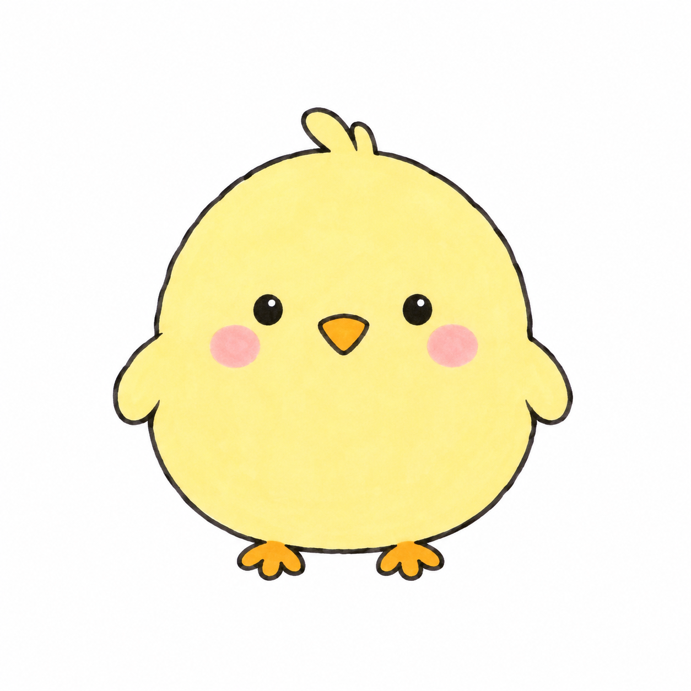

# 每天画点可爱的

每天约20分钟，用现有马克笔从简单小动物开始。**当前优先安心学画：不边画边拍，不要求每天发帖。**

每天一幅简单小画，带一个基础点。**每一练的完整教案都在一篇文档里，在GitHub打开就能跟画。**

## 从这里开始学

| 入口 | 可以看到什么 |
| --- | --- |
| [入门版练习](lessons/beginner/README.md) | 纸笔配置、练习方法、完整教案目录 |
| [001 圆滚滚小鸡](lessons/beginner/001-chick.md) | 约20分钟，学基本形概括；37、24、9号上色 |

目前已备好1篇完整教案，作者真实手绘尚未完成。后续选题准备好后再加入目录；进阶版会随着学习另设分类，36色仍可继续用。

开源仓库：[sary002/cute-drawing-diary](https://github.com/sary002/cute-drawing-diary)。代码与skill使用[MIT](LICENSE)，原创学习内容使用[CC BY 4.0](LICENSE-CONTENT.md)；AI参考与第三方内容的适用范围见[许可与来源](docs/licensing.md)。



上图为AI生成的教学参考。

## 每天只需要这样

1. 打开[入门版练习目录](lessons/beginner/README.md)，选择[小鸡教程](lessons/beginner/001-chick.md)这样的一篇完整教案；也可以在对话中说“今天画什么”。
2. 专心画约20分钟，期间不用拍过程，不需要计时。
3. 想记录时说“画完了”即可。照片、用时、感受都可省略；可以重复练同一幅。

约20分钟内参考“3分钟基础＋15分钟小画＋2分钟检查”，可灵活调整。从小鸡的“基本形概括”开始；[学习参考资料](docs/learning-references.md)记录了课程来源、适合先看的章节和画本使用建议。

以后想整理时，一次拍几张成品或一张合照就够了，也可以暂时不拍。想发小红书时再整理单张成品或合集。照片与发布不影响完成学习。

当前工具：16.5×16.5cm马克笔纸、铅笔、36色油性马克笔、0.15/0.5/1.0mm针管笔和粗勾线笔。[入门说明](lessons/beginner/README.md)写了各工具怎么用；每篇教案另列当天所需纸笔。笔头、实际色卡、针管笔耐酒精性待实测。

## 目录结构

```text
cute-drawing-diary/
├── README.md                         项目首页与学习入口
├── lessons/                          在GitHub直接阅读的完整教案
│   └── beginner/                     入门版练习
│       ├── README.md                 入门工具、练习方法、教案目录
│       └── 001-chick.md               小鸡：画法与上色在同一篇
├── entries/                          作品档案、参考图片与可选完成记录
│   ├── INDEX.md                      实际练习进度
│   └── beginner/001-chick/
│       ├── entry.json                教案路径、来源与完成状态
│       ├── tools.snapshot.json       当时的工具配置
│       ├── stage.snapshot.json       当时的阶段设置
│       ├── reference/                AI参考图、步骤图、提示词
│       ├── lesson.md                 旧地址入口，链接到完整教案
│       └── publication/              需要分享时再整理的稿件
├── config/                           当前阶段与工具档案
├── curriculum/                       阶段选题规划
├── docs/                             学习来源、流程与许可说明
├── research/                         参考项目与历史调研
├── skills/daily-cute-drawing/         固化后的每日一画流程
├── scripts/                          可选本地维护命令
├── tests/                            维护脚本的行为验证
├── LICENSE                           软件许可
└── LICENSE-CONTENT.md                 学习内容许可
```

跟画从lessons/进入即可。图片在档案中保存一份，通过相对链接直接显示在教案里；无需额外打开图片文件夹。以后每一练按“编号-题目.md”增加一篇，放入对应阶段目录。

## 项目积累什么

先积累教案、准确色号、阶段和工具快照、AI参考来源与可选的完成记录。手绘照片日后补充，保留原始记录；不要求为了归档重新画、补拍过程或写每日文案。

[学习参考资料](docs/learning-references.md) · [轻量每日流程](docs/workflow.md) · [阶段设置](config/stages.json) · [首轮7幅](curriculum/beginner.json) · [开源参考项目](research/open-source-references-2026-10-29.md) · [历史小红书调研](research/xiaohongshu-2026-10-29.md) · [可选分享](docs/xiaohongshu-template.md) · [Skill](skills/daily-cute-drawing/SKILL.md) · [公开仓库准备](docs/public-repository.md)

阶段与工具版本分开：36色也能进阶。新工具创建新版本，旧作品保留原配置。不以购买、拍照、发帖或连续天数作为升级条件。

## 可选本地命令

日常可以只通过对话推进，不用运行命令。以下只供维护项目时使用，Python 3.10+，无第三方依赖：

```sh
python3 scripts/drawing_diary.py status
python3 scripts/drawing_diary.py next
# 仅在确实画完后运行；没有日期、照片、用时也能登记
python3 scripts/drawing_diary.py record 001-chick
# 日后可为已完成作品补一张成品照，不改变完成记录
python3 scripts/drawing_diary.py add-photo 001-chick --photo /path/to/my-chick.jpg
python3 scripts/drawing_diary.py index
python3 scripts/drawing_diary.py validate
```

已知真实日期、用时或反馈时，record可加--date、--minutes、--liked、--improve。照片原件默认放被忽略的practice/private/，不会自动发布；想公开时另存检查后的副本。


维护后验证：`python3 -m unittest discover -s tests -v`。

[作品索引](entries/INDEX.md)：练习完成、照片归档和发布分别记录。
