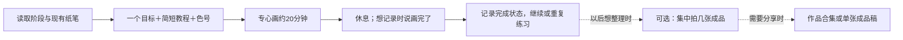

# 每日流程 v0.4：一幅小画＋一个基础点

当前阶段每天只安排约20分钟学习和画画。画的时候不用拿手机，不要求拍过程、计时、填复盘或每天发帖。可以连续几次练同一只动物，也可以把一幅分两天完成。

以完成一幅简单小画为目标，把一个基础点放进作品里练。参考节奏是3分钟基础小练习、15分钟画小作品、2分钟看一眼当天重点；都在原有20分钟内，按实际进度调整。基础小练习可以放废纸上，16.5×16.5厘米画本里的主体先控制在约8～10厘米，四周留白。

从[每日一练总目录](../lessons/README.md)选择完整教案，在[入门版练习](../lessons/beginner/README.md)查看工具与阶段说明。每天的完整教案只维护一篇，放在lessons/对应阶段/编号-题目.md中：包含参考图、纸笔、色号、一个基础点、全部画法与上色步骤、常见问题和检查点。读者无需打开配置或作品记录，就能在GitHub上跟画。

entry.json中的lesson_path指向这篇正文；entries/继续保存工具快照、图片来源与练习进度。新增教案先标draft，补齐并检查后再标ready、同步更新首页、总导航和阶段学习目录，不把未来选题列为已经可学的教程。原先的小鸡lesson.md只保留跳转链接，避免维护两份正文。

课程查阅范围与适用章节见[学习参考资料](learning-references.md)。当天只查需要的一小段，不把看完整门课作为开始画画的前置条件。

## 每天怎么做

1. 说“今天画什么”或“继续每日一画”。我提供一幅简单参考、少量步骤和准确色号；优先继续当前练习，用户要换题时可调整。
2. 用户专心画。初级只放一个主要目标，不把学习时间分给拍照和运营；针管笔是否先勾线按耐酒精实测决定。
3. 画完可以只说“画完了”，即可记录完成；照片、准确用时和感受都可省略。没说画完就保持原状态，不因已经生成教案而假定完成。
4. 下一次继续、换简单一点或再画一遍；不把没拍照、没发帖、没复盘当作未完成。

日期明确时记录真实日期；用户说“今天画完了”时采用客户端日期。日期不清楚先留null，不追问日期阻塞下一幅。20分钟是计划，不自动写成实际用时。

## 以后想留档时

学会几幅之后，用户方便时可以一次拍几张成品，或拍一张合照。也可以暂时完全不拍。没有过程图不用补拍，更不能摆拍成过去的练习过程。上传时说明每张对应的作品即可，由助手归档。

开源项目先积累教案、色号、工具版本、AI参考来源和可选的完成记录；实物照片可以日后补充。没有照片仍是有效的学习记录，不是空白失败项。

## 分享是单独的可选任务

用户明确说“帮我整理这几幅发小红书”时，才读图文模板。默认一张真实成品或一组作品合集。教程页可使用明确标注来源的教学示意，不能把示意图称为用户过程实拍。分享不决定练习是否完成。

当前不每天催发布、不主动要求查看平台指标、不自动上传或安排定时任务。

## 阶段与工具

阶段是能力范围，工具版本是实际拥有的纸笔，两者独立。36色仍可练进阶。更换工具新建版本，旧作品保留快照，不自动假定新增设备。

每积累几幅、或用户遇到具体问题时，可以做一次简短回看；7幅只是参考间隔，不是任务门槛，不要求每幅写反思。阶段调整依据实际能力和舒适度，不依据点赞、是否有照片或是否连续打卡。

先检验第一幅小鸡是否足够简单。若用户画起来吃力，就减细节或拆成更小练习，先让学习习惯轻松成立。
