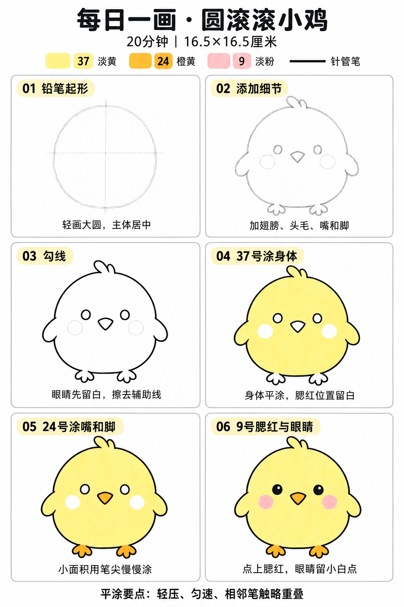

# 入门版练习 001｜圆滚滚小鸡

[每日一练总目录](../README.md) · [入门版练习目录与工具](README.md) · 约20分钟 · 使用3个马克笔色号

这是一篇完整跟画教程，所需工具、色号、画法和上色都在本页。下图和六步图为AI生成的教学参考。

**今天学一个基础：基本形概括。** 先找能代表主体的大形，再添加少量特征。小鸡可以拆成：一个圆胖轮廓＋小三角嘴＋两片水滴形翅膀。

计划约20分钟：基础小练习3分钟、画小鸡15分钟、最后看一眼2分钟。分钟数仅供安排，首次试笔或干燥需要多一点时间时可灵活调整。

## 准备纸笔

纸张为16.5×16.5厘米马克笔专用纸。小鸡含翅膀宽约9厘米、高约9.5厘米，放在纸中央，四周留白；不用涂满背景。纸下垫一张废纸。

| 工具 / 色号 | 今天用在哪里 |
| --- | --- |
| 铅笔 | 轻轻起形和定位 |
| 0.5mm针管笔 | 主体轮廓、填黑眼睛 |
| 0.15mm针管笔 | 嘴、脚、眼睛的小细节；可按控制感选用 |
| 37 Pastel Yellow／淡黄 | 身体、翅膀、头毛 |
| 24 Marigold／橙黄 | 嘴巴、小脚 |
| 9 Pale Pink／淡粉 | 腮红 |

1.0mm和粗勾线笔本次可以先放一边；不需要用120号黑色马克笔。色号来自本套Touchmark学生36色，颜色以自己的纸上试色为准。

## 先在废纸上试一下｜约3分钟

- 轻画2～3个圆胖轮廓、2个小三角形和2个水滴形。不用圆规，略有变化也可以。
- 指认它们在小鸡中的位置：圆胖轮廓是主体，小三角是嘴，水滴是翅膀。
- 试37、24、9三个小色块。
- 画一段针管笔线，等干后刷一笔37号。如果黑线溶开，采用“铅笔定位 → 上色 → 颜色干透后勾线”的顺序。尚未确认兼容性时，也可以直接采用这个顺序。

图中的第三步是先勾线的示范；具体用哪种顺序，以试笔结果为准。

## 画小鸡｜约15分钟

### 01 铅笔起形｜约2分钟

在纸中央轻画一个圆胖的大轮廓，头和身体合在一起。轻画一条竖中线，再在圆中部略偏上画一条横辅助线，帮助安排五官。

先看这个大形是不是圆胖、位置是否居中；不用反复追求标准圆。

### 02 添加细节｜约2分钟

头顶加两段小圆弧作头毛，两侧加向下的水滴形翅膀。擦掉与翅膀重叠的原圆线，下面加两只小脚。

横辅助线附近画两只小圆眼睛，直径约4～5毫米、间隔约2.5～3厘米。中间稍低处加圆角倒三角嘴巴。眼睛外下方，各轻标一个约1厘米的腮红圆。

这些尺寸帮助控制大小，不用逐项拿尺测量。

### 03 勾线｜约2分钟

试笔不晕染时，用0.5mm勾主体，0.15mm或顺手的细笔处理五官和小脚。眼睛先不填黑，腮红不勾黑圈。

墨线干后擦掉中线和多余铅笔线，把腮红定位线擦淡。若针管笔不耐酒精或尚未确认，把黑色勾线移到全部上色干透后完成。

### 04 用37号涂身体｜约5分钟

给身体、翅膀和头毛涂淡黄。眼睛、嘴、脚和两个腮红圆保留纸白。

用适合大面的笔头部分连续排笔，相邻笔触稍微搭接，轻压、匀速；小转角用笔尖或宽头尖角轻补。腮红处留白后再上粉色，更容易保留干净的淡粉。

### 05 用24号涂嘴和脚｜约2分钟

小面积用笔尖或宽头尖角，轻轻涂满橙黄，尽量停在轮廓内。

### 06 用9号点腮红，再画眼睛｜约2分钟

黄色区域干后，在两个留白圆内轻涂一层淡粉。腮红不加黑色外圈。

用针管笔填黑眼睛，在每只眼睛左上角保留一个小白点。白点来自纸白，不依赖132号白色覆盖笔；可以先画小白点边界，再绕着填黑。

## 常见问题：黄色有深浅接缝怎么办

先把下一小块紧接着上一笔涂下去，让笔触稍微搭接。若整块已经干了，先保留这一点笔痕，不在接缝处来回涂很多遍；下一次缩小每次涂的区域、保持匀速。今天先练把颜色涂在轮廓内。

## 最后看一眼｜约2分钟

今天只检查“基本形概括”：大轮廓能否看出圆胖的小鸡，嘴和翅膀这些小形是否接在合适的位置。第一次有一点歪或笔痕也能保留，不用反复修到纸面变脏。

## 六步图与学习来源

课程链接和适合先看的章节见[学习参考资料](../../docs/learning-references.md)。本教案使用圆润可爱的小鸡风格与本套36色色号。

[返回入门版练习目录](README.md)
