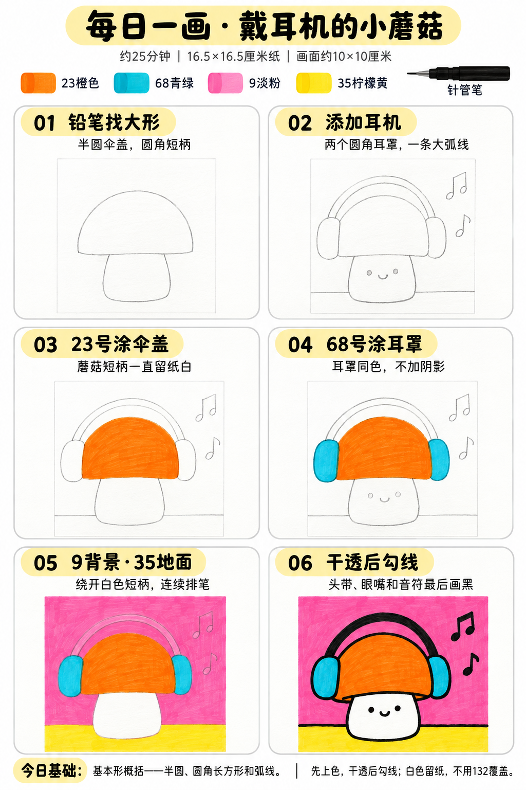

# S001-001｜戴耳机的小蘑菇 · D1基础大形

先修：能用铅笔轻画圆与方形；无需绘画经验。 本课为完整跟画，完成时间以正文为准；可分成起稿与上色两次。

[全部教案](../README.md) · [入门工具](README.md) · [S001风格](../../styles/001-playful-color-block.md) · 约25分钟 · 四色平涂

今天只学一个基础：**基本形概括**。先把画面拆成半圆伞盖、圆角长方形短柄与耳罩，再用大弧线连接耳机；不用一开始就画所有细节。

## 成品参考

成品参考和六步图都是AI教学示意，不是实际练习完成记录。构图与细节略有简化，跟画以六步图和正文为准。颜色仅近似，以自己的纸上试色为准；9号实际较淡也可以，不必反复刷成图里的鲜粉。

## 纸笔与色号

16.5×16.5厘米马克笔专用纸，画面约10×10厘米，周围留白，纸下垫废纸。铅笔轻起形，0.5mm针管笔最后勾线与填小面积黑色；0.15mm可选用于表情，1.0mm可选加粗外轮廓，粗勾线笔本次不必用。

| Touchmark学生36色色号 | 用在哪里 |
| --- | --- |
| 23 Orange／橙色 | 蘑菇伞盖 |
| 68 Turquoise Blue／青绿 | 两边耳罩 |
| 9 Pale Pink／淡粉 | 背景 |
| 35 Lemon Yellow／柠檬黄 | 底部地面 |

短柄始终保留纸白，不用132覆盖。针管笔耐酒精性未知，统一铅笔起稿 → 上色 → 完全干透后勾线。耳机头带、眼嘴与音符最后用针管笔画黑，不需要120黑色马克笔。

## 先练约3分钟

在废纸上各画两个半圆、圆角长方形与大弧线，再把一个半圆接到短圆角长方形上，看能否认出小蘑菇。形状略歪没关系，不用圆规和尺。顺便试四个色块，先确认9号在纸上的实际深浅。

## 六步跟画｜约20分钟

按从左到右、从上到下阅读。前两步铅笔轻画，第三至五步上色，第六步干透后才用针管笔。图中的浅灰眼嘴和音符只是铅笔定位。

### 01 铅笔找大形｜约3分钟

画面主体稍偏左，右边给音符留空间。轻画一个宽约6厘米的半圆伞盖，下方接宽约3厘米的圆角短柄。不要把短柄画得很长，圆胖一点更容易控制。

先看两个大形能否组成蘑菇；伞盖下缘略弯即可，不需要加复杂褶皱。

### 02 添加耳机｜约3分钟

伞盖两侧各接一个竖向圆角耳罩，上方用两条相近的大弧线连接成头带。擦掉被耳罩挡住的伞盖线。

短柄上轻标两只点眼和小笑嘴，右边标两组简单音符。下方轻画地面分界线，在短柄背后断开；这些细节不用追求完全对称。

### 03 用23号涂伞盖｜约4分钟

23单层涂伞盖，短柄一直留纸白。大面用较宽的笔头连续排笔，相邻笔触稍微搭接，转角用笔尖轻补。不要沿全部边缘先描一圈很厚的橙边再填中间。

### 04 用68号涂耳罩｜约2分钟

左右耳罩都涂68，颜色一样即可，不加阴影或反光。上方头带仍只保留铅笔定位，最后再填黑。

### 05 用9涂背景、35涂地面｜约5分钟

9涂上方背景，35涂底部窄地面，绕开白色短柄。背景从一小片接着一小片排笔，保留适度马克笔痕迹。

头带和音符可以直接画在完全干透的背景上，不必刻意留出白色宽条。若按步骤图留了细定位线，最后用黑色覆盖即可。不要把短柄先涂粉再尝试白色覆盖。

### 06 干透后勾线｜约3分钟

颜色完全干透后用0.5mm勾主要轮廓，头带填黑，点上两只黑眼、短笑弧和音符。音符可以简化为小黑椭圆加短竖线，不必严格照抄音乐记号。

伞盖底部的小折线可省略，保持大形清楚即可。黑线稍有起伏可以保留，不用反复描到很粗。

## 常见问题：画着画着太复杂怎么办

回到三个大形：半圆伞盖、圆角短柄、两边耳罩。先把它们画顺，再加弧线头带；伞盖下缘细节和一组音符都可省略，不必增加斑点或装饰。

## 最后看一眼｜约2分钟

只检查今天的基本形：伞盖能否看成半圆，短柄与耳罩能否看成圆角长方形，头带是否连接两边耳罩。少量歪斜或排笔痕迹不必反复修补。

约25分钟是试笔、跟画和检查的计划，不含额外干燥时间，可分次完成，不当实际用时登记。完成后再记录，照片与用时都可省略，不要求过程拍照。

## 来源

成品与六步图由OpenAI内置imagegen生成，采用本系列竖版两列三行教学格式。[生成提示词及检查说明](../../entries/beginner/001-headphone-mushroom/reference/generation-prompt.txt)；基础学习来源见[课程参考资料](../../docs/learning-references.md)。
