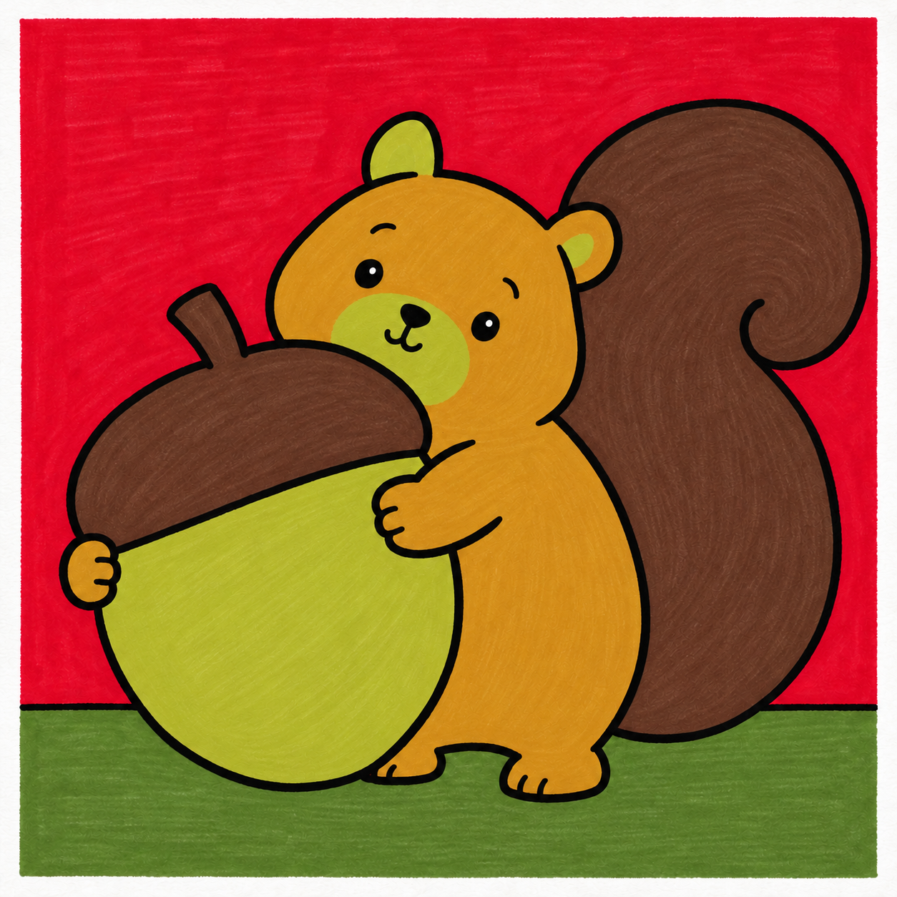
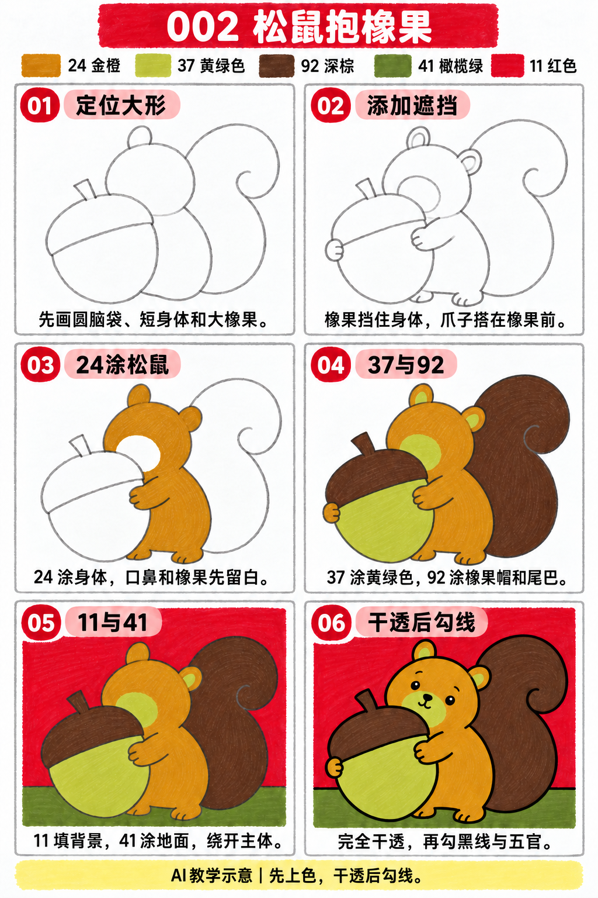

# S001-002｜松鼠抱橡果 · D1基础大形

> **配色已修订：** 成品、教学图与正文按实涂色卡的相对色相重新配套；浅色以同纸单层试色为准，屏幕图不作精确色值。旧图只作历史留存。

先修：能用铅笔轻画圆与方形；无需绘画经验。 本课为完整跟画，完成时间以正文为准；可分成起稿与上色两次。

[全部教案](../README.md) · [入门工具](README.md) · [S001风格](../../styles/001-playful-color-block.md) · D1基础大形 · 完整跟画 · 约30分钟

今天只练一个基础：**前后遮挡**。大橡果挡住松鼠身体，两只爪子搭在橡果前；后面的轮廓到遮挡边缘停住。

## 成品参考

成品和步骤图均为AI示意，不计为实际手绘完成。颜色近似，以实物试色为准；图中眼睛白点可省略，最后直接画黑点眼，不依赖白笔覆盖。

## 工具与色号

16.5厘米方形马克笔纸，画面约10×10厘米，纸下垫废纸。铅笔轻定位；0.5mm针管笔最后勾线，外轮廓可按手感选1.0mm。针管笔耐酒精性未知，统一先上色、完全干透后勾线。

| 已有Touchmark学生36色色号 | 区域 |
| --- | --- |
| 24 偏赭的金橙、琥珀色 | 松鼠头、身体、两只爪子和脚 |
| 37 黄绿色，非奶油浅黄 | 橡果身体、口鼻与耳内小块 |
| 92 深棕 | 橡果帽、短柄与大尾巴 |
| 41 较深橄榄绿 | 下方地面 |
| 11 红色 | 背景 |

共5支彩色马克笔，黑色五官与轮廓用针管笔。图上色名为近似标注，以本套色号为准。132不作不透明白色或混色笔。

## 先练约3分钟

在废纸画一个圆被大椭圆挡住，再在椭圆边缘搭两个小圆当爪子。擦掉穿过橡果内部的身体线，保留爪子外轮廓。试五个色块，确认红背景与棕尾巴能区分。

## 六步跟画

按从左到右、从上到下阅读，前五格的灰线为铅笔定位。第三格远侧小爪在图中稍晚着色，实际第三步与身体一起涂24即可；操作顺序以正文为准。

### 01 定位大形｜约3分钟

右上轻画松鼠圆脑袋，下接短圆身体；左下安排一个稍斜的大橡果椭圆。橡果要足够大，能遮住松鼠前半身。只用轻铅笔，不画黑线。

### 02 添加遮挡｜约4分钟

身后右侧添一个逗号形大尾巴；补小耳朵、短脚和橡果帽。两只爪子分别搭在橡果两侧。擦掉穿过橡果的身体线，以及穿过爪子的橡果线；眼嘴仅轻标位置。

### 03 24涂松鼠｜约4分钟

24平涂头、身体、两只爪子和脚。口鼻、耳内小块、橡果和尾巴暂时不涂；不画毛发或叠阴影。远侧小爪也一起上色。

### 04 37与92｜约5分钟

37涂橡果身体、口鼻和耳内小块；92涂橡果帽、短柄和大尾巴。绕开两只爪子，不把手与橡果涂成同色。尾巴保持一个大色块，不加密集纹理。

### 05 11与41｜约5分钟

11涂背景，41涂下方窄地面。背景绕开松鼠、尾巴和橡果，地面分界线在主体身后断开。连续排笔，相邻笔触稍搭接，不为消除笔痕反复揉擦。

### 06 干透后勾线｜约3分钟

颜色完全干透，用针管笔勾主要轮廓；被挡住的身体线不补回去。点黑眼、鼻子和短嘴，爪子加一两条短线即可。眼睛白点可省略。

## 常见问题

爪子像贴在橡果上的贴纸时，先检查身体与近侧手臂是否接顺，再让爪子盖住一小段橡果边线。远侧手臂被橡果挡住，不必穿过橡果补全。若画面太挤，先缩小尾巴，保留几毫米红背景间隙。

## 最后检查约2分钟

只看遮挡关系：橡果在身体前、爪子在橡果前、尾巴在身后、脚落在地面。少量歪斜或排笔痕迹可以保留。约30分钟为计划，不含额外干燥等待，可分次完成，不当实际用时登记。

## 来源

成品与步骤图使用OpenAI内置imagegen生成，详见[完整提示词与检查记录](../../entries/beginner/002-acorn-squirrel/reference/generation-prompts.json)。基础学习来源见[课程参考资料](../../docs/learning-references.md)。原第002练链接保留入口；旧图片退出当前S001主线展示。

[本次配色修订提示词与核对](../../entries/beginner/002-acorn-squirrel/reference/color-revision-v5.json)
