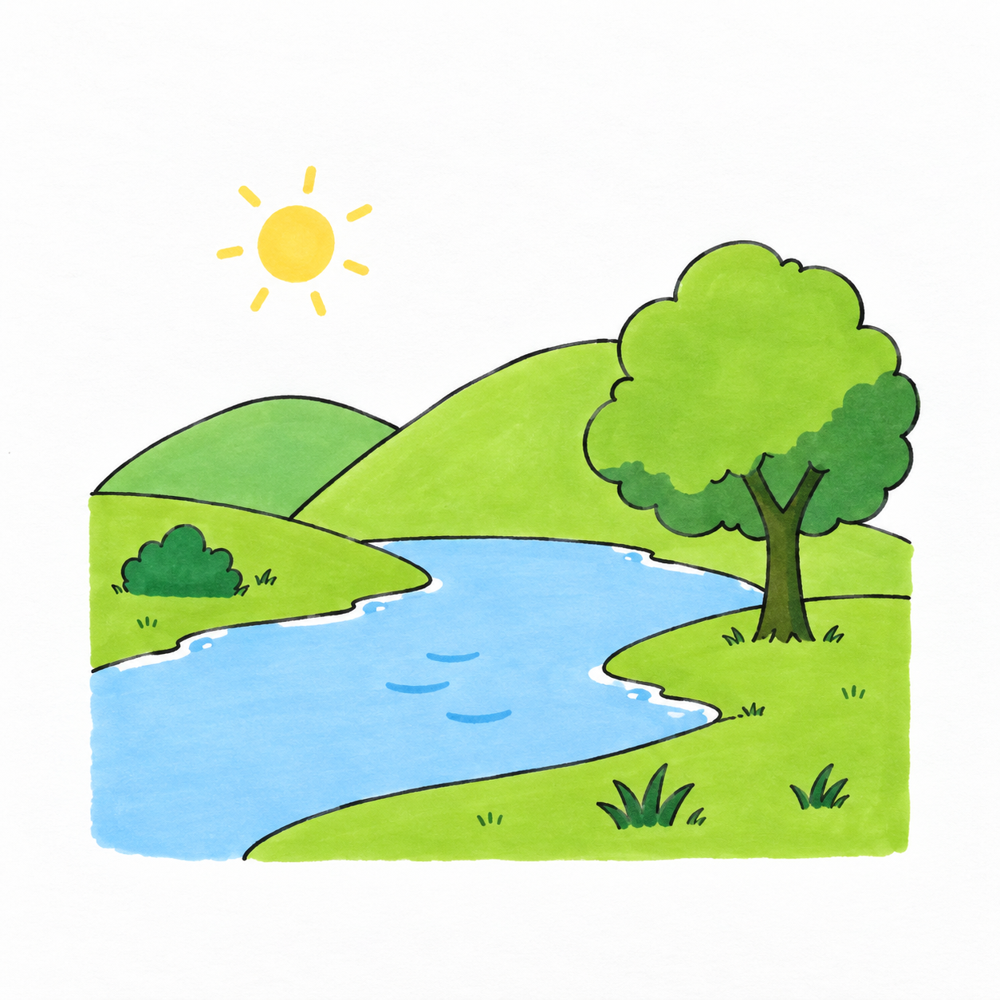
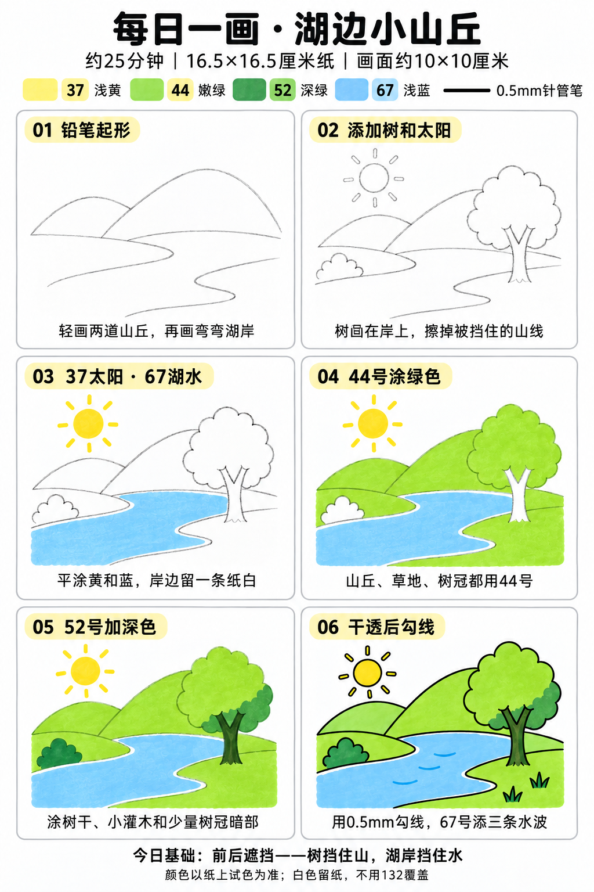

# 入门版练习 002｜湖边小山丘

[每日一练总目录](../README.md) · [入门工具](README.md) · 约25分钟 · 四色平涂

今天学一个基础：**前后遮挡**。树挡住山，湖岸挡住水；被挡住的线要擦掉。作为入门换题练习，不增加渐变、复杂倒影或写实纹理。

## 成品参考

图片为AI教学示意，非真实练习成品。实际跟画以六步图为准：零碎草丛可省略，两座山都用44号单层平涂，太阳光芒不用逐根勾黑线。图中颜色为近似示意，以纸上试色为准。

## 纸笔与色号

16.5×16.5厘米马克笔专用纸，画面约10×10厘米，居中留白，不用画边框；纸下垫废纸。铅笔轻起形，0.5mm针管笔最后勾线，0.15mm可选用于细节，1.0mm和粗勾线笔本次不用。

| Touchmark学生36色色号 | 用在哪里 |
| --- | --- |
| 37 Pastel Yellow／浅黄 | 太阳和短光芒 |
| 44 Fresh Green／嫩绿 | 两座山丘、草地、树冠底色 |
| 52 Deep Green／深绿 | 树干、小灌木、树冠一小块暗部和少量草丛 |
| 67 Pastel Blue／浅蓝 | 湖水与三条水波 |

高光和岸边细白线直接留纸白；132乳白色不当不透明覆盖笔。针管笔耐酒精性未知，本幅统一采用铅笔定位 → 上色 → 完全干透后勾线。

## 先练约3分钟

在废纸上试四色，画两条圆弧和一条弯曲湖岸线。再画一个圆挡住一段弧线，擦掉被圆挡住的那一段，体会“后面的线在前面物体边缘停住”。无需另学透视或明暗。

## 六步跟画｜约20分钟

按从左到右、从上到下阅读。每格只完成标题对应的新内容，图中的浅灰线是铅笔，最后一格才是针管笔。用时不含额外等待干燥，可分两次完成。

### 01 铅笔起形｜约3分钟

轻画左低右高两道圆润山丘。中下方画两条弯弯的湖岸线，远处靠近、近处稍分开。不要拿尺画，也不用追求完全对称。

### 02 添加树和太阳｜约3分钟

右岸画云朵形圆树冠，下面接简单分叉树干，树根落在草地上；左岸画一个小灌木，左上画小太阳。擦掉穿过树冠、树干和灌木的山线、岸线，让遮挡关系清楚。

### 03 用37画太阳、67画湖水｜约3分钟

37涂太阳和几根短光芒，67平涂湖水。岸边选择几段留细细的纸白，不必沿整圈留得一样宽；树干和草地暂时不涂。大面连续排笔，相邻笔触稍搭接，避免来回揉擦。

### 04 用44涂绿色｜约5分钟

两座山丘、两侧草地和树冠都用44单层平涂。山丘的前后主要靠轮廓与遮挡区分，不需要刻意涂不同深浅。树干和左岸小灌木继续留白。

### 05 用52加深色｜约3分钟

52填树干、左岸灌木，在树冠右下加一小块连在一起的深绿。草丛只画两处，每处两三笔即可。此处只把小形状填清楚，不扩展成复杂阴影练习。

### 06 干透后勾线｜约3分钟

颜色完全干透后，用0.5mm勾主要轮廓。树挡住山的地方不补山线，湖岸边保留纸白。67在湖里轻叠三条短水波，不画倒影；太阳光芒保留黄线即可。

## 常见问题：树像长在水里怎么办

检查树根是不是画在蓝色区域里。起稿时把树根移到右侧草地内部，岸线经过树后面时断开，不穿过树干。若已经上色，不用132盖回去，下一幅先定位树根再画岸线。

## 最后检查约2分钟

只看今天的遮挡：树是否挡住山线，湖岸是否挡住水面，树根是否落在草地上。检查后即可停笔，少量笔痕不必反复修补。计划时间不代表实际完成用时。

## 来源

成品与六步图由OpenAI内置imagegen生成，版式沿用本系列[圆滚滚小鸡](001-chick.md)；[生成提示词与检查说明](../../entries/beginner/002-lakeside-hills/reference/generation-prompt.txt)。基础学习来源见[课程参考资料](../../docs/learning-references.md)。AI参考不登记为真实练习完成，不要求边画边拍照。
