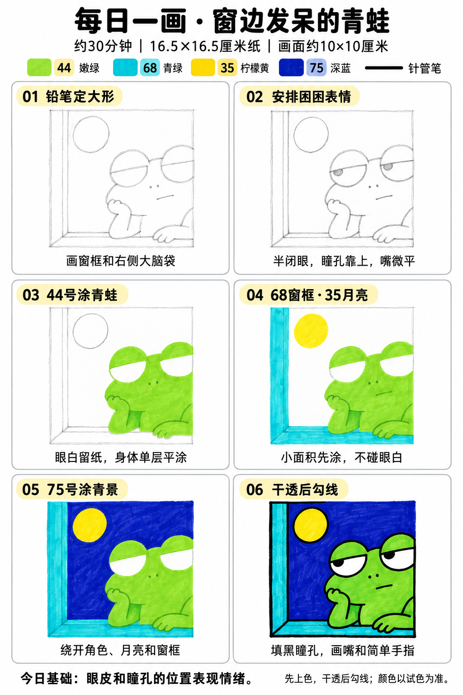

# 入门版练习 003｜窗边发呆的青蛙

[每日一练总目录](../README.md) · [入门工具](README.md) · 约30分钟 · 4色

今天只学一个基础：**眼皮和瞳孔的位置表现情绪**。用少量大形状、浓郁色块和自然手绘线条完成，不要求把马克笔笔触涂到完全消失。

## 成品参考

两图均为AI教学示意，非真实手绘完成记录。跟画以正文顺序为准；颜色只作近似示意，以自己的纸上试色为准。

## 纸笔与色号

16.5×16.5厘米马克笔专用纸，画面约10×10厘米，四周留白，纸下垫废纸。铅笔轻起形，0.5mm针管笔画轮廓和小面积黑色，0.15mm可选画细节；1.0mm仅在需要更粗外轮廓时选用，粗勾线笔不必用。山景这幅不必黑色勾线。

| 已有Touchmark学生36色色号 | 用在哪里 |
| --- | --- |
| 44 Fresh Green | 青蛙全身与双手，眼白除外 |
| 68 Turquoise Blue | 窗框与窗台 |
| 35 Lemon Yellow | 圆月 |
| 75 Dark Blue Light | 背景 |

针管笔耐酒精性未知，统一先上色、完全干透后勾线。纸白提前留，不把132当不透明白色或无色混色笔。深色不能靠浅色覆盖回来。

## 先练约3分钟

在废纸画两对圆眼睛，一对瞳孔居中，一对瞳孔紧贴上眼皮。把上眼皮压低，比较哪一对更像困倦。试当天四色。

## 六步跟画

按从左到右、从上到下阅读。第一、二步为铅笔起稿；图中提前显示的深色细节不要提前用针管笔画。原成品的紫色背景以75深蓝替代，浅绿肚皮省略，身体统一44。六步图第一格已经画出部分手部定位，可先照大形起稿，第二格再完善表情。

### 01 铅笔定大形

在约10厘米方形画面内，左侧留一条窄窗框，下方留窗台；青蛙的大脑袋放右侧，可以略微出框。先画脑袋和身体、托腮的手，再接放在窗台上的另一只手。

### 02 安排困困表情

眼睛先画两个圆，上半部作为绿色眼皮；下半部留白，瞳孔靠近眼皮下缘并偏向同一侧。鼻孔只用两点，嘴用一小段平线，不加笑弧。

### 03 44号涂青蛙

44单层平涂青蛙和两只手，眼白绕开，不需要另涂浅绿肚皮。细小转角用笔尖，手指不必画全。

### 04 68窗框·35月亮

68涂窗框和窗台，35涂左上圆月。窗台转角用简单斜线交代即可，不另学透视。

### 05 75号涂背景

75涂背景，绕开眼白、月亮和青蛙。分成两三个连续小区域排笔，不要在已经干的接缝上反复补涂。

### 06 干透后勾线

完全干透后用0.5mm勾线、填瞳孔、画鼻孔和小嘴；想让轮廓更有分量，可等墨干后用1.0mm只勾主要外轮廓。自然起伏可以保留。

## 常见问题

青蛙看起来太开心怎么办？先检查眼皮是否压低，瞳孔是否贴近眼皮，嘴是否画成上扬弧线。修改铅笔定位比增加眼睫毛和细节更有效。

## 最后检查约2分钟

只看眼皮、瞳孔和嘴能否传达困倦或无语。 不为追求完美反复补深色。计划约30分钟包含试色、六步跟画和检查，不含额外干燥时间，可分次完成；不作为实际用时登记。

## 来源

成品与六步图由OpenAI内置imagegen生成；步骤图沿用[小鸡教程](001-chick.md)的版式。详见[提示词及检查说明](../../entries/beginner/003-sleepy-frog/reference/generation-prompt.txt)，基础学习参考见[课程来源](../../docs/learning-references.md)。照片、用时和反馈可选，不要求拍过程；确认实际画完后再记录完成。
