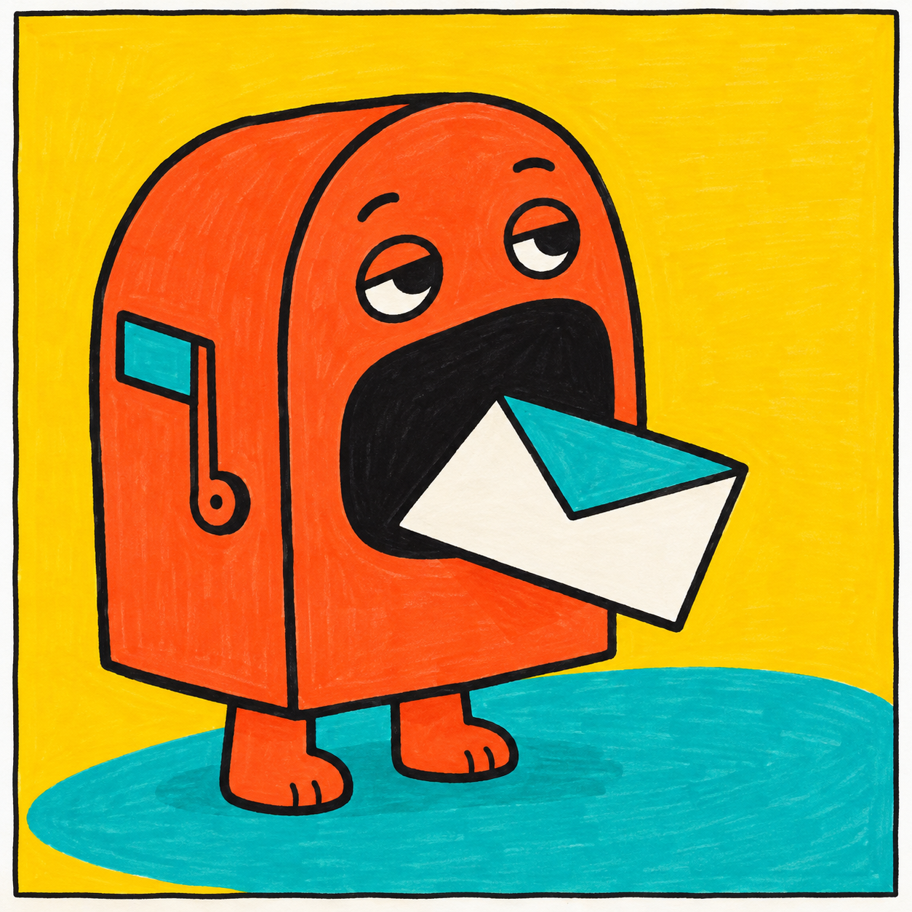
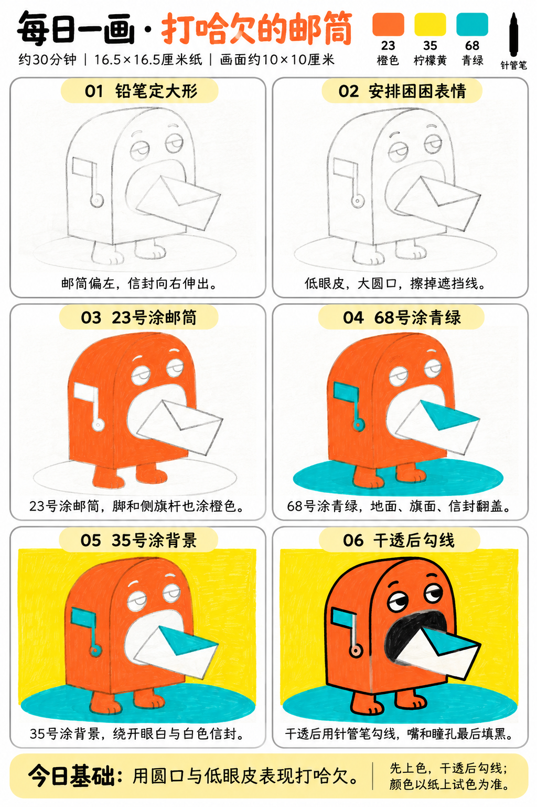

# 入门版练习 003｜打哈欠的邮筒

[全部教案](../README.md) · [入门工具](README.md) · [S001风格](../../styles/001-playful-color-block.md) · 约30分钟 · 3色

今天只学一个基础：**用圆口与低眼皮表现打哈欠**。用大形、浓郁平涂与自然手绘线完成一幅小插画。

## 成品参考

成品参考与步骤图都是AI教学示意，不计为真实练习完成。颜色仅近似，实物以纸上试色为准；具体跟画以正文顺序为准。

## 纸笔与色号

16.5×16.5厘米马克笔专用纸，画面约10×10厘米，四周留白，纸下垫废纸。铅笔轻起形，0.5mm针管笔最后勾线与填小面积黑色；0.15mm按需用于细节，1.0mm可选加粗主要外轮廓，粗勾线笔本次不必用。

| 已有Touchmark学生36色色号 | 本次用途 |
| --- | --- |
| 23 Orange | 邮筒、脚与侧旗杆 |
| 35 Lemon Yellow | 背景 |
| 68 Turquoise Blue | 地面、旗面和信封翻盖 |

针管笔耐酒精性未知，统一先铅笔定位、上色、完全干透后勾线。高光和白色形状提前留纸白，不把132当不透明白色或无色混色笔，不用浅色反复覆盖深色。

## 先练约3分钟

在废纸画两只眼睛，把上眼皮压低，再配一个大圆口。对比小笑嘴与大圆口，看哪一种更像打哈欠；试23、35、68。

## 六步跟画｜约25分钟

按从左到右、从上到下阅读，灰色线视作铅笔。首格可能已展示完整浅色定位，可按标题分两步起稿；深色轮廓和眼嘴统一最后完成。六步图有少量白色眉毛与侧旗杆色差，实际眉毛最后画黑、侧旗杆用23即可；不需要额外色号。

### 01 铅笔定大形

在约10厘米方形内，邮筒放左侧，用圆顶长方形概括；右侧给斜伸的信封留位置，下方画扁椭圆地面。轻轻定位两只短脚，不必精确画透视。

### 02 安排困困表情

眼睛放上方，低眼皮下只露部分眼白，嘴画大椭圆。信封由斜长方形和三角翻盖组成，遮住嘴的右下角；擦掉穿过信封的嘴线。

### 03 23号涂邮筒

23涂邮筒、脚和侧旗杆。眼白、嘴内和信封暂时都留白。眉毛只保留铅笔线，最后再画黑，不用刻意留白眉毛。

### 04 68号涂青绿

68涂地面、侧面小旗的旗面和信封三角翻盖；信封下方主体始终保留纸白。小转角轻补，不用加深浅阴影。

### 05 35号涂背景

35连续排笔填背景，绕开邮筒和信封。不要把眼白或信封先涂黄再想办法覆盖回来。

### 06 干透后勾线

完全干透后用0.5mm勾线，嘴和瞳孔用针管笔填黑，保留眼白。信封前面的黑轮廓要连续，后面的嘴线在信封边缘停住。

## 常见问题

嘴像普通投信口而不像哈欠怎么办？把嘴画成较高的椭圆，眼皮压低，别加笑弧。先在铅笔阶段调形，比增加表情细节更有效。

## 最后检查约2分钟

只看低眼皮与大圆口是否能读出困倦。 少量排笔痕迹可以保留，不为消除笔痕反复刷深。约30分钟为试笔、跟画与检查的计划，不含额外干燥时间，可分次完成；不作为实际用时登记。

## 来源

成品参考和六步图由OpenAI内置imagegen生成，六步教学版式沿用本系列[圆滚滚小鸡](001-chick.md)。[生成提示词及检查说明](../../entries/beginner/003-yawning-mailbox/reference/generation-prompt.txt)；基础学习来源见[课程参考资料](../../docs/learning-references.md)。不要求过程拍照，实际完成后再登记，照片与用时可省略。
