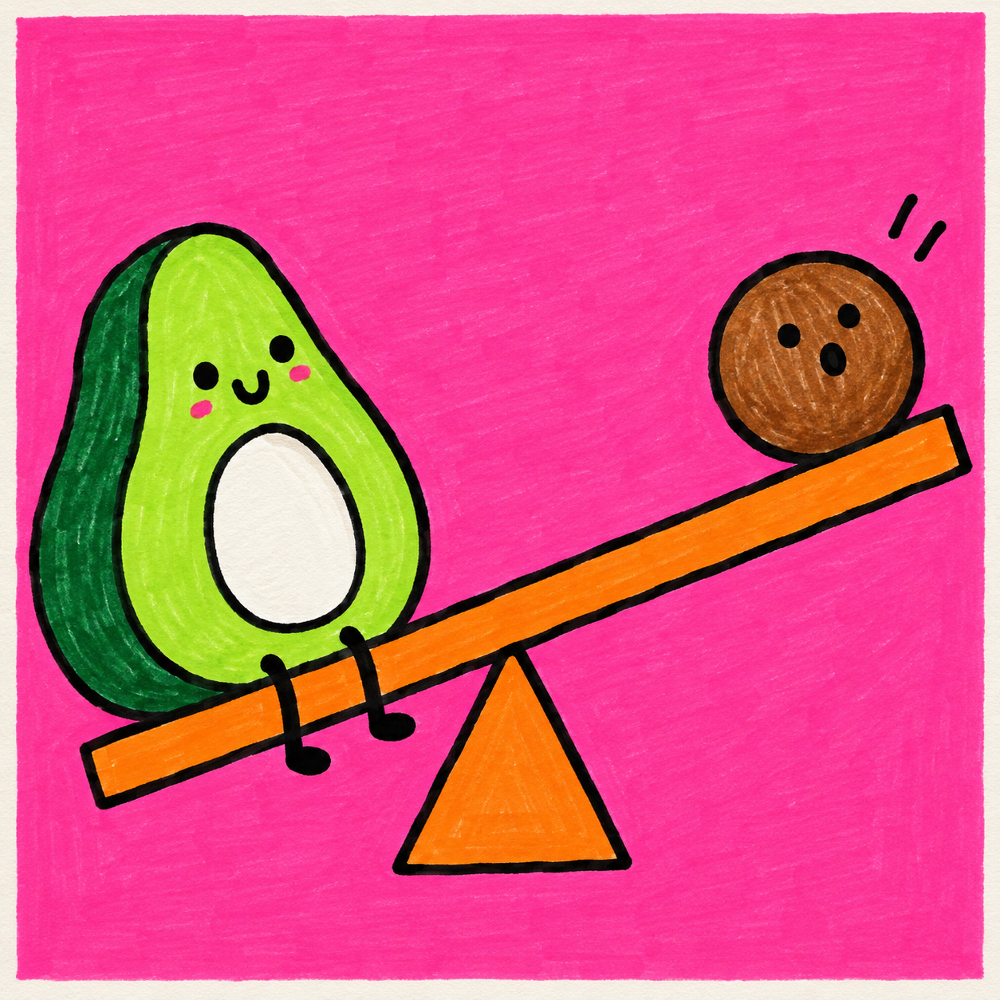
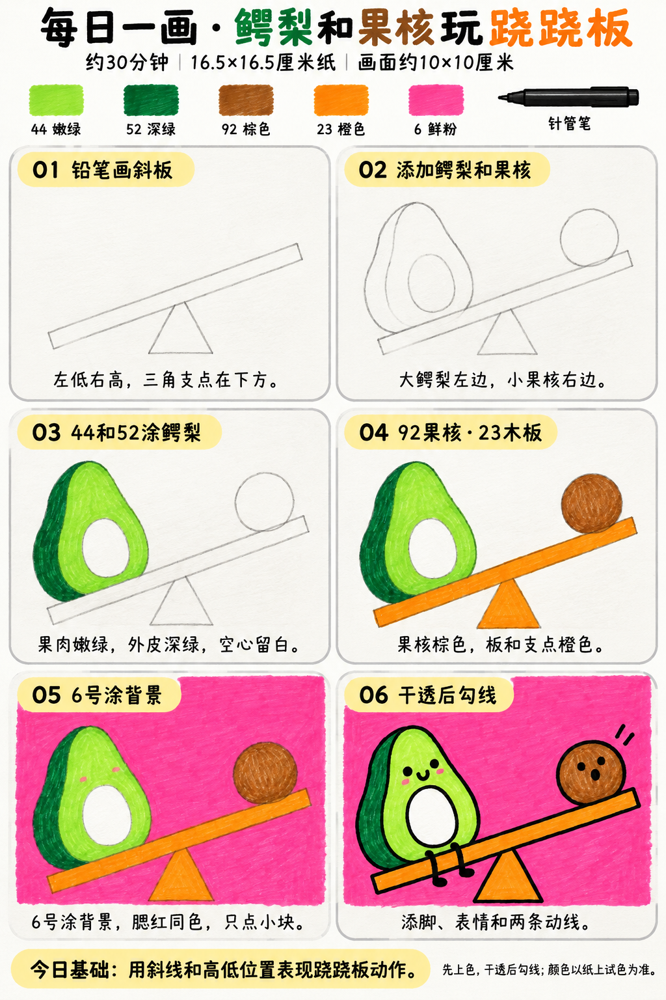

# 入门版练习 004｜鳄梨和果核玩跷跷板

[全部教案](../README.md) · [入门工具](README.md) · [S001风格](../../styles/001-playful-color-block.md) · 约30分钟 · 5色

今天只学一个基础：**用斜线和高低位置表现跷跷板动作**。用大形、浓郁平涂与自然手绘线完成一幅小插画。

## 成品参考

成品参考与步骤图都是AI教学示意，不计为真实练习完成。颜色仅近似，实物以纸上试色为准；具体跟画以正文顺序为准。

## 纸笔与色号

16.5×16.5厘米马克笔专用纸，画面约10×10厘米，四周留白，纸下垫废纸。铅笔轻起形，0.5mm针管笔最后勾线与填小面积黑色；0.15mm按需用于细节，1.0mm可选加粗主要外轮廓，粗勾线笔本次不必用。

| 已有Touchmark学生36色色号 | 本次用途 |
| --- | --- |
| 44 Fresh Green | 鳄梨果肉 |
| 52 Deep Green | 鳄梨外皮 |
| 92 Chocolate | 果核 |
| 23 Orange | 木板和三角支点 |
| 6 Vivid Pink | 背景与可选的小腮红 |

针管笔耐酒精性未知，统一先铅笔定位、上色、完全干透后勾线。高光和白色形状提前留纸白，不把132当不透明白色或无色混色笔，不用浅色反复覆盖深色。

## 先练约3分钟

在废纸画一条左低右高的斜线，在中下方接三角支点。在线两端分别放一个大梨形与小圆，比较水平线和斜线带来的动作感；试五色。

## 六步跟画｜约25分钟

按从左到右、从上到下阅读，灰色线视作铅笔。首格可能已展示完整浅色定位，可按标题分两步起稿；深色轮廓和眼嘴统一最后完成。果核用92棕色近似示意，实际以试色为准。步骤图为简化动作，不要求形体与成品像素一致。

### 01 铅笔画斜板

画两条近似平行的斜线组成长木板，左端低、右端高；板中央下面接一个三角支点，三角顶端要碰到木板。

### 02 添加鳄梨和果核

左端画上小下大的梨形鳄梨，右端画小圆果核，角色底端都落在板面上。鳄梨里面留椭圆空心，脸放空心上方；先不填黑眼嘴。

### 03 44和52涂鳄梨

44涂果肉，52涂外皮窄色带，空心保持纸白。这是两块分开的色面，不用在两色之间来回混出渐变。

### 04 92果核·23木板

92单层涂果核，23涂木板和三角支点。果核眼嘴保留浅铅笔定位，棕色干透后再画黑即可。

### 05 6号涂背景

6平涂背景，可在鳄梨脸上点同色小腮红；不喜欢腮红可省略。背景分小区域连续排笔，注意别越进纸白空心。

### 06 干透后勾线

干透后勾线，画两只垂下的简单黑脚、笑嘴和果核的惊讶圆嘴，果核上方加两条短动线。动线不必多。

## 常见问题

跷跷板像漂浮着怎么办？先检查三角顶端是否接触板底、两个角色是否坐在板面上，再确认左低右高的斜向清楚。

## 最后检查约2分钟

先看不加动线时能否读出一低一高，再看角色和木板接触是否自然。 少量排笔痕迹可以保留，不为消除笔痕反复刷深。约30分钟为试笔、跟画与检查的计划，不含额外干燥时间，可分次完成；不作为实际用时登记。

## 来源

成品参考和六步图由OpenAI内置imagegen生成，六步教学版式沿用本系列[圆滚滚小鸡](001-chick.md)。[生成提示词及检查说明](../../entries/beginner/004-avocado-seesaw/reference/generation-prompt.txt)；基础学习来源见[课程参考资料](../../docs/learning-references.md)。不要求过程拍照，实际完成后再登记，照片与用时可省略。
