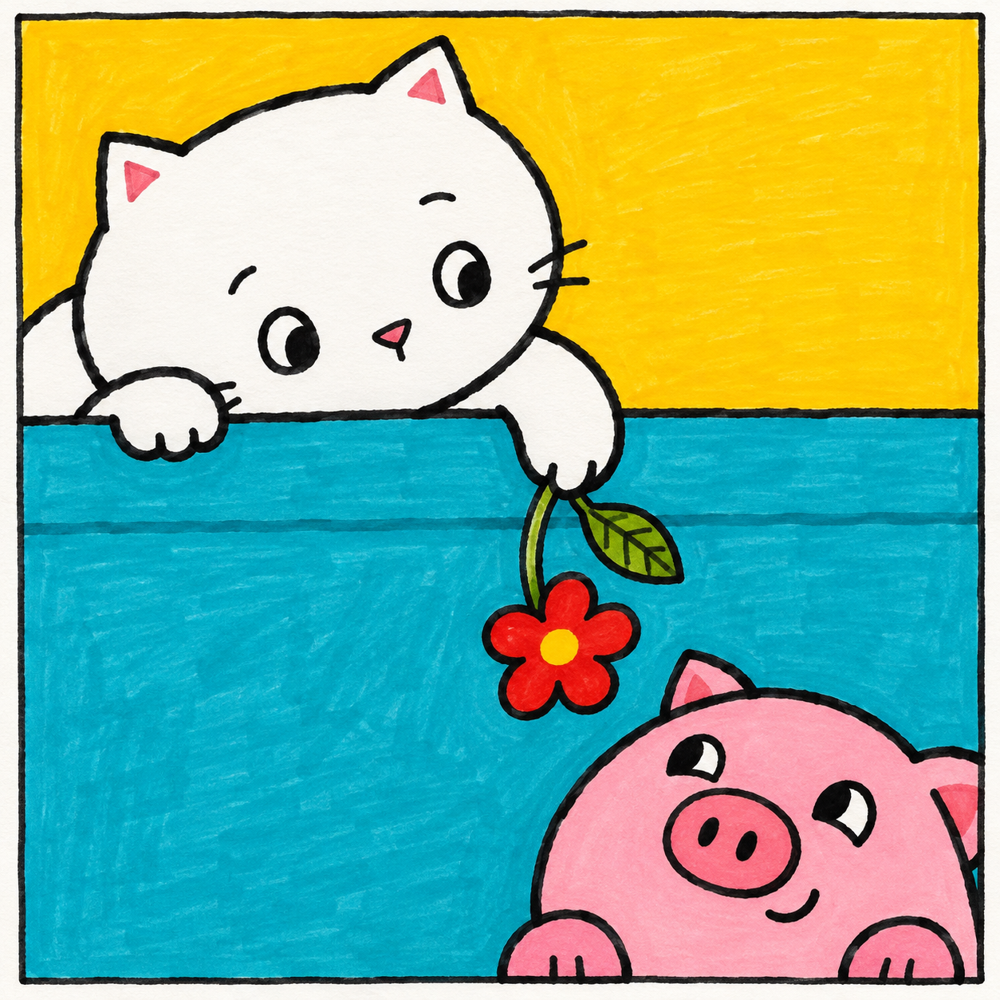
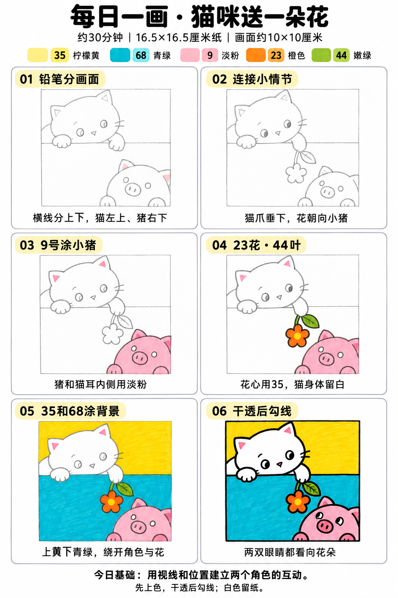

# 入门版练习 004｜猫咪送一朵花

[每日一练总目录](../README.md) · [入门工具](README.md) · 约30分钟 · 5色

今天只学一个基础：**用视线和位置建立两个角色的互动**。用少量大形状、浓郁色块和自然手绘线条完成，不要求把马克笔笔触涂到完全消失。

## 成品参考

两图均为AI教学示意，非真实手绘完成记录。跟画以正文顺序为准；颜色只作近似示意，以自己的纸上试色为准。

## 纸笔与色号

16.5×16.5厘米马克笔专用纸，画面约10×10厘米，四周留白，纸下垫废纸。铅笔轻起形，0.5mm针管笔画轮廓和小面积黑色，0.15mm可选画细节；1.0mm仅在需要更粗外轮廓时选用，粗勾线笔不必用。山景这幅不必黑色勾线。

| 已有Touchmark学生36色色号 | 用在哪里 |
| --- | --- |
| 35 Lemon Yellow | 上方背景和花心 |
| 68 Turquoise Blue | 下方背景 |
| 9 Pale Pink | 小猪、猫耳内侧与猫鼻子 |
| 23 Orange | 花瓣 |
| 44 Fresh Green | 花茎和叶片 |

针管笔耐酒精性未知，统一先上色、完全干透后勾线。纸白提前留，不把132当不透明白色或无色混色笔。深色不能靠浅色覆盖回来。

## 先练约3分钟

在废纸画两个小圆脸，中间点一朵花，把两双瞳孔都移向花朵。先用眼神建立互动，再试当天五色。

## 六步跟画

按从左到右、从上到下阅读。第一、二步为铅笔起稿；图中提前显示的深色细节不要提前用针管笔画。原成品红花改用已有23橙色，猪鼻子不另加深粉。六步图第一格出现一点粉色仅是AI示意偏差，实际第一、二步全用铅笔；中间格花叶的深色轮廓和眼睛也推迟到第六步。

### 01 铅笔分画面

轻画方形边界和约在上方四成处的横分隔线；猫放左上，猪放右下，两只角色可部分出框。用圆、椭圆和小三角耳定形。

### 02 连接小情节

让猫的一只爪子垂下来，握着弯花茎；花垂在猫与猪之间，偏向小猪。擦掉穿过猫爪与猪头的背景线，瞳孔先轻标朝花的方向。

### 03 9号涂小猪

9轻涂整只小猪、猫耳内侧和小鼻子。想要眼睛白点时先留小块纸白，猫身体和爪子全留白。猪鼻子也用同一支9，不需要额外深粉。

### 04 23花·44叶

23平涂花瓣，35画花心，44涂茎和一片叶。叶脉最多一条。先完成这些小形状再填背景，保持清楚的纸白猫轮廓。

### 05 35和68涂背景

35填上半背景，68填下半背景。先用笔尖绕开小花和叶子，再连续排笔填大面；白猫不涂132，也不先涂黄再覆盖。

### 06 干透后勾线

颜色完全干透后用0.5mm勾线并填眼睛。猫看向下方花，小猪看向左上花，瞳孔可画成简单小黑椭圆，不必照图刻画亮点。

## 常见问题

两个角色像各看各的怎么办？铅笔阶段先连一条从眼睛到花朵的假想线，沿这方向移动瞳孔；不要只给两只角色画一样的正面眼睛。

## 最后检查约2分钟

先看猫爪与花有没有连接，再看两只角色是否都朝花朵看。 不为追求完美反复补深色。计划约30分钟包含试色、六步跟画和检查，不含额外干燥时间，可分次完成；不作为实际用时登记。

## 来源

成品与六步图由OpenAI内置imagegen生成；步骤图沿用[小鸡教程](001-chick.md)的版式。详见[提示词及检查说明](../../entries/beginner/004-cat-flower/reference/generation-prompt.txt)，基础学习参考见[课程来源](../../docs/learning-references.md)。照片、用时和反馈可选，不要求拍过程；确认实际画完后再记录完成。
