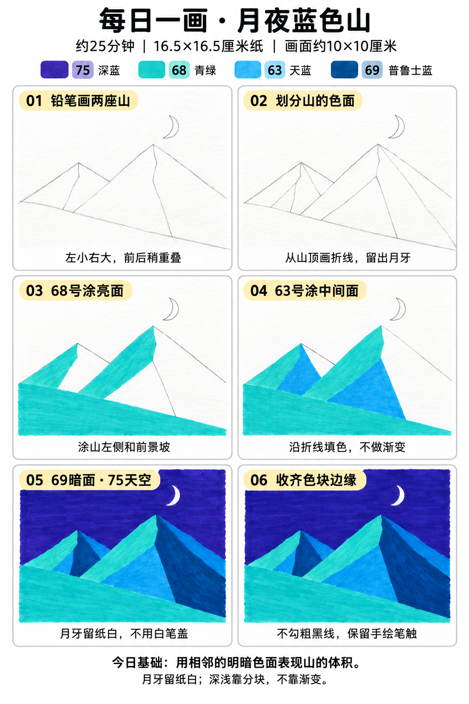

# 入门版练习 005｜月夜蓝色山

[每日一练总目录](../README.md) · [入门工具](README.md) · 约25分钟 · 4色

今天只学一个基础：**用相邻的明暗色面表现山的体积**。用少量大形状、浓郁色块和自然手绘线条完成，不要求把马克笔笔触涂到完全消失。

## 成品参考

两图均为AI教学示意，非真实手绘完成记录。跟画以正文顺序为准；颜色只作近似示意，以自己的纸上试色为准。

## 纸笔与色号

16.5×16.5厘米马克笔专用纸，画面约10×10厘米，四周留白，纸下垫废纸。铅笔轻起形，0.5mm针管笔画轮廓和小面积黑色，0.15mm可选画细节；1.0mm仅在需要更粗外轮廓时选用，粗勾线笔不必用。山景这幅不必黑色勾线。

| 已有Touchmark学生36色色号 | 用在哪里 |
| --- | --- |
| 75 Dark Blue Light | 夜空 |
| 68 Turquoise Blue | 山的亮面与前景坡 |
| 63 Cerulean Blue | 山的中间面 |
| 69 Prussian Blue | 山的暗面 |

针管笔耐酒精性未知，统一先上色、完全干透后勾线。纸白提前留，不把132当不透明白色或无色混色笔。深色不能靠浅色覆盖回来。

## 先练约3分钟

在废纸画一个三角山形，从山顶往下画两条折线，分成三个大面。并排试68、63、69，确认哪块亮、哪块暗；不追求真实光源计算。

## 六步跟画

按从左到右、从上到下阅读。第一、二步为铅笔起稿；图中提前显示的深色细节不要提前用针管笔画。图中的蓝紫夜空用75深蓝近似。六步图第一格提前显示了月牙和部分分面线，可以第二步再加；第五步与第六步色块相同，第六步仅检查收边，不增加黑色轮廓。

### 01 铅笔画两座山

画面约10厘米方形，左后山小一些，右前山大一些，山顶高低错开。下方用一条斜弧线安排前景坡；只用铅笔轻画。

### 02 划分山的色面

从两个山顶向下各画两条折线，留出左亮、中间、右暗三个大色面；右上轻画小月牙，提前标记为纸白。被前山挡住的后山线擦掉。

### 03 68号涂亮面

68填两座山左侧亮面和前景坡。相邻区域之间靠边缘交接，不需要黑线；先保留中间面和暗面纸白。

### 04 63号涂中间面

63填每座山的中间面，顺折线停笔。保持整块同色，不来回刷成渐变，山的体积来自相邻色块的深浅。

### 05 69暗面·75天空

69填山右侧暗面，75填天空。用笔尖慢慢绕开月牙，月牙内部始终不涂；不要涂满天空后用132画月亮。

### 06 收齐色块边缘

干透后查看是否有明显漏白，只轻补漏涂处，不反复叠满整面。本幅不勾粗黑线，铅笔线尽量被色面边缘自然带过。

## 常见问题

亮面和暗面不够明显怎么办？先在废纸对比68、63、69，只要亮暗有区别即可，不必为了追AI图追涂很多遍。若山面分得太碎，回到两三块大形。

## 最后检查约2分钟

暂时遮住天空，看每座山的左亮右暗是否清楚。 不为追求完美反复补深色。计划约25分钟包含试色、六步跟画和检查，不含额外干燥时间，可分次完成；不作为实际用时登记。

## 来源

成品与六步图由OpenAI内置imagegen生成；步骤图沿用[小鸡教程](001-chick.md)的版式。详见[提示词及检查说明](../../entries/beginner/005-moon-mountains/reference/generation-prompt.txt)，基础学习参考见[课程来源](../../docs/learning-references.md)。照片、用时和反馈可选，不要求拍过程；确认实际画完后再记录完成。
