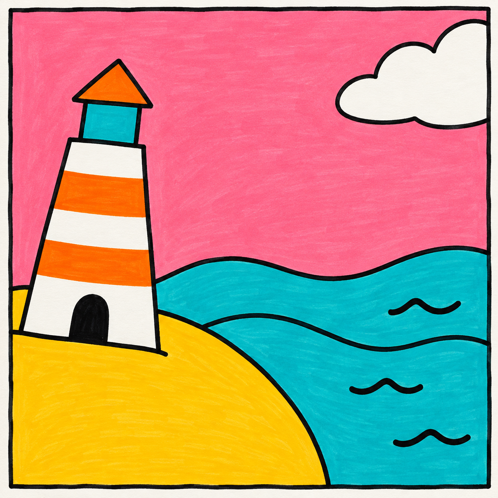
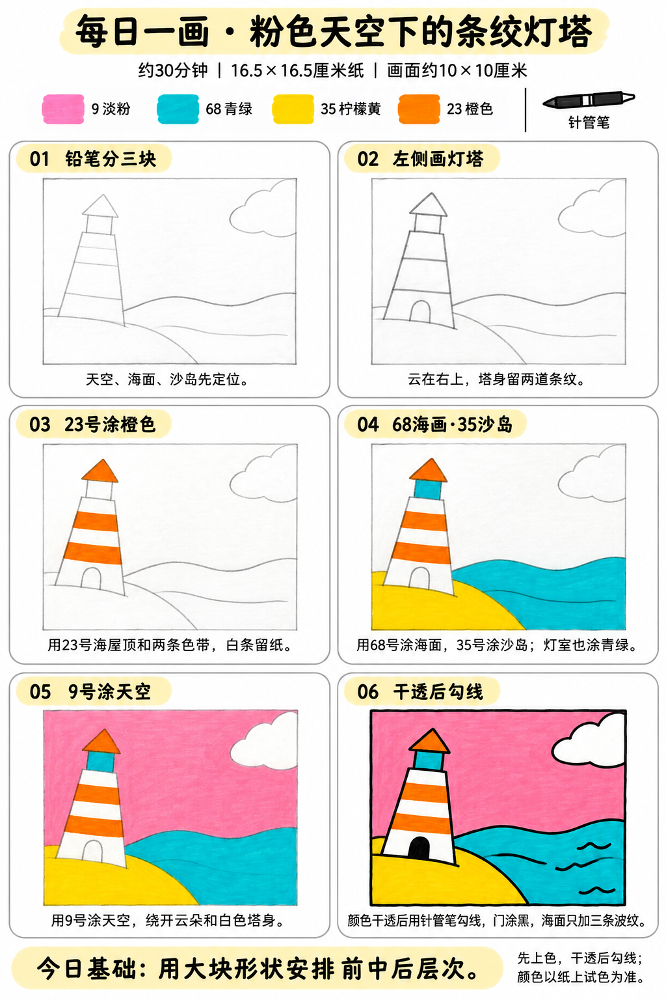

# 入门版练习 005｜粉色天空下的条纹灯塔

[全部教案](../README.md) · [入门工具](README.md) · [S001风格](../../styles/001-playful-color-block.md) · 约30分钟 · 4色

今天只学一个基础：**用大块形状安排前中后层次**。用大形、浓郁平涂与自然手绘线完成一幅小插画。

## 成品参考

成品参考与步骤图都是AI教学示意，不计为真实练习完成。颜色仅近似，实物以纸上试色为准；具体跟画以正文顺序为准。

## 纸笔与色号

16.5×16.5厘米马克笔专用纸，画面约10×10厘米，四周留白，纸下垫废纸。铅笔轻起形，0.5mm针管笔最后勾线与填小面积黑色；0.15mm按需用于细节，1.0mm可选加粗主要外轮廓，粗勾线笔本次不必用。

| 已有Touchmark学生36色色号 | 本次用途 |
| --- | --- |
| 9 Pale Pink | 天空 |
| 68 Turquoise Blue | 海面与灯室 |
| 35 Lemon Yellow | 沙岛 |
| 23 Orange | 塔身两条色带和屋顶 |

针管笔耐酒精性未知，统一先铅笔定位、上色、完全干透后勾线。高光和白色形状提前留纸白，不把132当不透明白色或无色混色笔，不用浅色反复覆盖深色。

## 先练约3分钟

在废纸用三条大弧线划分天空、海面和前景岛，试着让一座小塔立在岛内。只练谁挡住谁，不增加透视细节；试四色。

## 六步跟画｜约25分钟

按从左到右、从上到下阅读，灰色线视作铅笔。首格可能已展示完整浅色定位，可按标题分两步起稿；深色轮廓和眼嘴统一最后完成。原成品天空较鲜，教程只用已有9淡粉；可以保留实际试色的浅色效果，不必反复涂到与AI颜色相同。

### 01 铅笔分三块

轻画方形范围，以大弧线区分天空、海面与左下沙岛。岛的边缘挡住一部分海，先让这三块面积分配清楚。

### 02 左侧画灯塔

灯塔放左边岛内，用上窄下宽的梯形、方灯室和三角屋顶组合。塔身画两道橙条纹的边界；右上云朵可部分出框。塔底要在沙地上。

### 03 23号涂橙色

23涂屋顶和两道色带。塔身其他部分保留纸白，不用132画白条；门暂留铅笔轮廓。

### 04 68海面·35沙岛

68平涂海面和方灯室，35涂沙岛。海面层次主要靠大曲线，不需要再加深色渐变或倒影。

### 05 9号涂天空

9涂天空，绕开右上云朵与白塔。纸白与淡粉交界用笔尖轻轻停住，不反复描出很厚的边。

### 06 干透后勾线

完全干透后勾线，门用针管笔填黑；海面只加三条短波纹。岛挡住水、塔立在岛上这两处保持清楚。

## 常见问题

灯塔像浮在海里怎么办？起稿时把塔底放到沙岛里面，海岸线绕到塔后，不穿过塔身。已经上色后不要用浅色反复盖深色。

## 最后检查约2分钟

一眼能否分清前景沙岛、中间海面、后方天空。 少量排笔痕迹可以保留，不为消除笔痕反复刷深。约30分钟为试笔、跟画与检查的计划，不含额外干燥时间，可分次完成；不作为实际用时登记。

## 来源

成品参考和六步图由OpenAI内置imagegen生成，六步教学版式沿用本系列[圆滚滚小鸡](001-chick.md)。[生成提示词及检查说明](../../entries/beginner/005-striped-lighthouse/reference/generation-prompt.txt)；基础学习来源见[课程参考资料](../../docs/learning-references.md)。不要求过程拍照，实际完成后再登记，照片与用时可省略。
