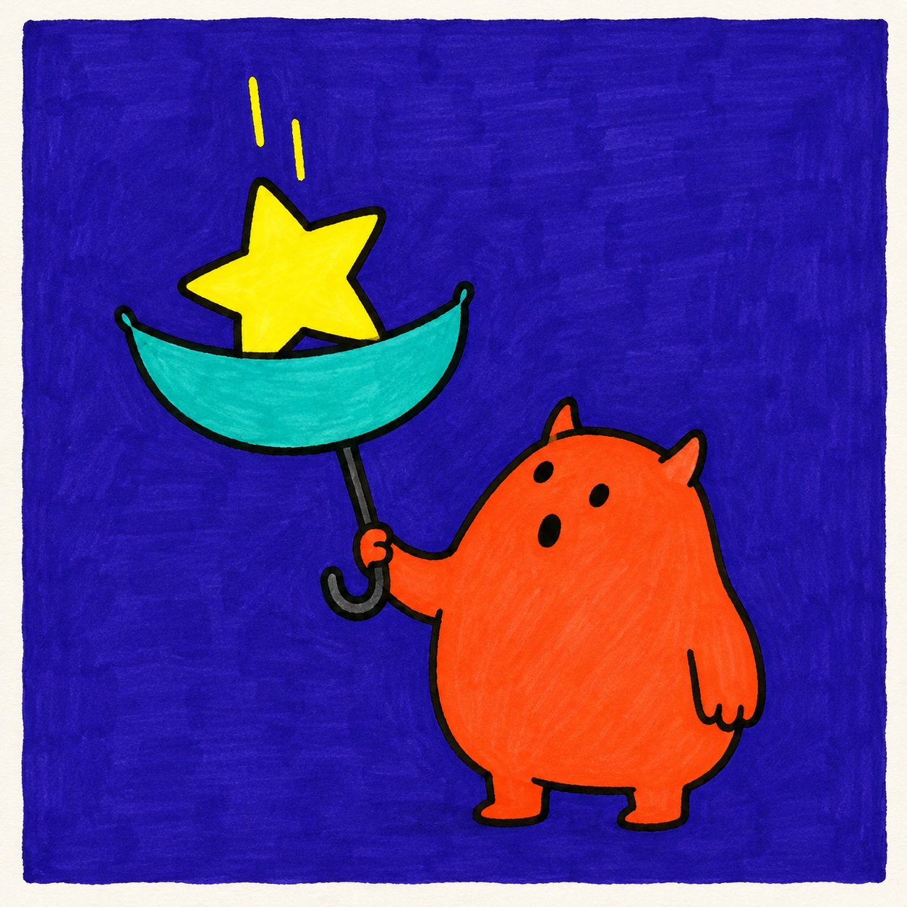
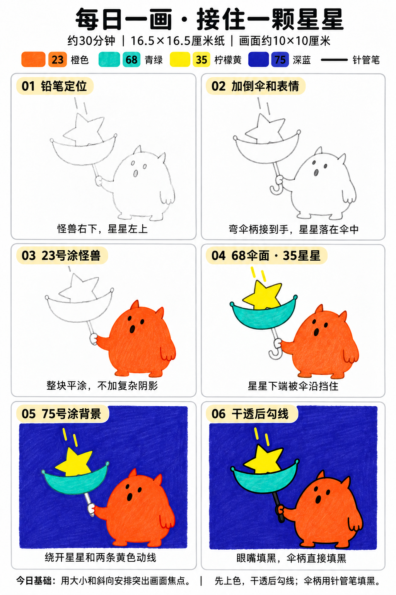

# 入门版练习 006｜接住一颗星星

[每日一练总目录](../README.md) · [入门工具](README.md) · 约30分钟 · 4色

今天只学一个基础：**用大小和斜向安排突出画面焦点**。用少量大形状、浓郁色块和自然手绘线条完成，不要求把马克笔笔触涂到完全消失。

## 成品参考

两图均为AI教学示意，非真实手绘完成记录。跟画以正文顺序为准；颜色只作近似示意，以自己的纸上试色为准。

## 纸笔与色号

16.5×16.5厘米马克笔专用纸，画面约10×10厘米，四周留白，纸下垫废纸。铅笔轻起形，0.5mm针管笔画轮廓和小面积黑色，0.15mm可选画细节；1.0mm仅在需要更粗外轮廓时选用，粗勾线笔不必用。山景这幅不必黑色勾线。

| 已有Touchmark学生36色色号 | 用在哪里 |
| --- | --- |
| 23 Orange | 怪兽身体、角与双手 |
| 68 Turquoise Blue | 倒伞的伞面 |
| 35 Lemon Yellow | 星星和两条下落动线 |
| 75 Dark Blue Light | 背景 |

针管笔耐酒精性未知，统一先上色、完全干透后勾线。纸白提前留，不把132当不透明白色或无色混色笔。深色不能靠浅色覆盖回来。

## 先练约3分钟

在废纸画一大一小两个椭圆，分别放右下和左上；用斜线连接，体会目光如何在两处移动。试四色，星星只需画得能辨认，不用标准五角。

## 六步跟画

按从左到右、从上到下阅读。第一、二步为铅笔起稿；图中提前显示的深色细节不要提前用针管笔画。原成品背景改用75深蓝，灰伞柄直接用针管笔填黑。步骤图中第三至第五格提前显示的黑眼、嘴和轮廓只是定位示意，实际都放第六步；握伞手应在第三步一起涂23。

### 01 铅笔定位

在方形画面右下画梨形小怪兽，左上留大星星的位置，星星宽约怪兽脑袋的一半到三分之二。先看两块大小是否有主次。

### 02 加倒伞和表情

星星下面接一片上翘的月牙形倒伞，画直伞杆和弯柄接到手里。添小角、短脚、点眼和圆嘴；星星下端被伞沿挡住，擦掉穿过伞面的线。

### 03 23号涂怪兽

23平涂怪兽、两只手、小角与短脚。握伞的那只小手也要涂橙色，不留白。眼睛、嘴的位置暂时只是铅笔定位。

### 04 68伞面·35星星

68涂伞面，35涂星星和两条短下落线。星星与伞的交界直接按铅笔边缘停笔；伞柄暂时留白，最后直接填黑。

### 05 75号涂背景

75填背景，绕开角色、伞、星星和两条黄色动线。小空隙先用笔尖填，再排笔填大面，避免深蓝进入黄色。

### 06 干透后勾线

完全干透后用0.5mm勾线，眼睛、圆嘴和伞柄填黑；伞柄用针管笔即可，不另加灰色马克笔。最后擦淡还露出的铅笔线。

## 常见问题

画面看起来太挤怎么办？先缩小怪兽，保留星星上方一小块空背景，动线只画两条。不要添加满天星或把星星压成很小一颗。

## 最后检查约2分钟

第一眼是否能看到大星星，并沿伞杆看到惊讶的小怪兽。 不为追求完美反复补深色。计划约30分钟包含试色、六步跟画和检查，不含额外干燥时间，可分次完成；不作为实际用时登记。

## 来源

成品与六步图由OpenAI内置imagegen生成；步骤图沿用[小鸡教程](001-chick.md)的版式。详见[提示词及检查说明](../../entries/beginner/006-catch-a-star/reference/generation-prompt.txt)，基础学习参考见[课程来源](../../docs/learning-references.md)。照片、用时和反馈可选，不要求拍过程；确认实际画完后再记录完成。
