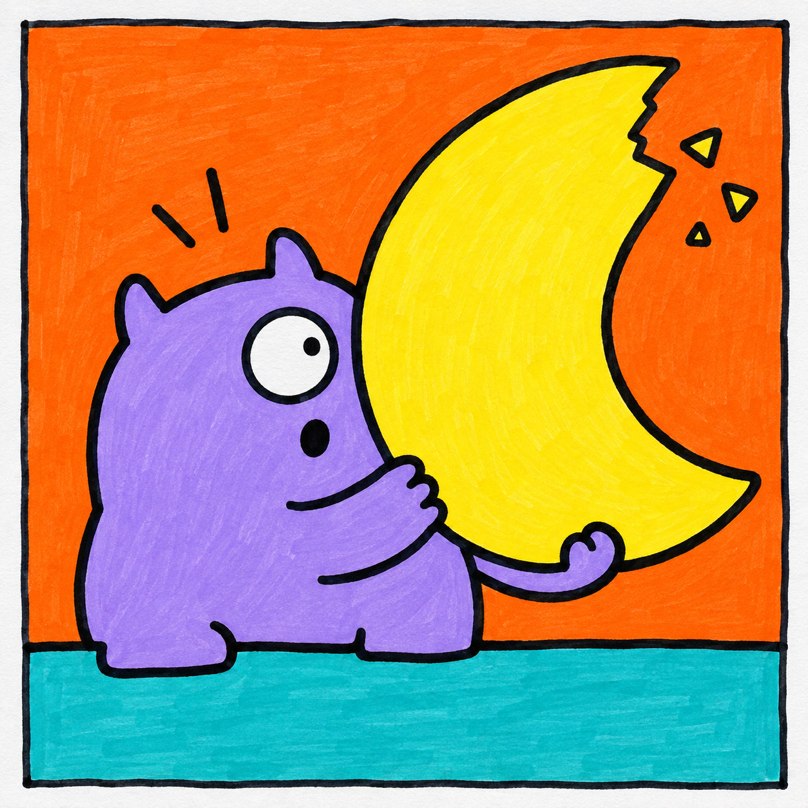
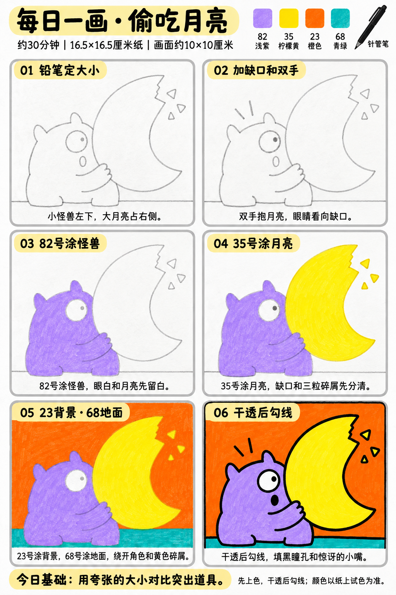

# 入门版练习 007｜偷吃月亮

[全部教案](../README.md) · [入门工具](README.md) · [S001风格](../../styles/001-playful-color-block.md) · 约30分钟 · 4色

今天只学一个基础：**用夸张的大小对比突出道具**。用大形、浓郁平涂与自然手绘线完成一幅小插画。

## 成品参考

成品参考与步骤图都是AI教学示意，不计为真实练习完成。颜色仅近似，实物以纸上试色为准；具体跟画以正文顺序为准。

## 纸笔与色号

16.5×16.5厘米马克笔专用纸，画面约10×10厘米，四周留白，纸下垫废纸。铅笔轻起形，0.5mm针管笔最后勾线与填小面积黑色；0.15mm按需用于细节，1.0mm可选加粗主要外轮廓，粗勾线笔本次不必用。

| 已有Touchmark学生36色色号 | 本次用途 |
| --- | --- |
| 82 Light Violet | 怪兽全身和手 |
| 35 Lemon Yellow | 大月亮与三粒碎屑 |
| 23 Orange | 背景 |
| 68 Turquoise Blue | 地面 |

针管笔耐酒精性未知，统一先铅笔定位、上色、完全干透后勾线。高光和白色形状提前留纸白，不把132当不透明白色或无色混色笔，不用浅色反复覆盖深色。

## 先练约3分钟

在废纸画一个小梨形和大月牙，把月牙画得比角色头大很多，再试同样大的月牙，比较哪种更有趣；试四色。

## 六步跟画｜约25分钟

按从左到右、从上到下阅读，灰色线视作铅笔。首格可能已展示完整浅色定位，可按标题分两步起稿；深色轮廓和眼嘴统一最后完成。步骤图略简化了抱月亮的手臂。首格展示的细节可以第二步再加；浅灰瞳孔为铅笔定位，最后才用针管笔填黑。

### 01 铅笔定大小

怪兽放左下，月亮占右侧，月亮高度可以接近角色的一倍半。地面只留底部一条窄色块，先让月亮成为视觉重点。

### 02 加缺口和双手

月亮右上加锯齿形小缺口和三粒碎屑，怪兽的手臂搭到月亮下方。手画一两段圆弧即可，擦掉穿过手臂的月亮线。眼睛看向缺口。

### 03 82号涂怪兽

82单层涂怪兽、角、脚与手臂，眼白留纸白。身体内部不用额外阴影或花纹，嘴只留铅笔定位。

### 04 35号涂月亮

35涂月牙和三粒小碎屑。缺口属于背景，不涂黄；若担心碎屑太小，可以只留两粒更大的形状。

### 05 23背景·68地面

23涂背景，68涂地面。先绕清碎屑和角色轮廓再连续排笔填大面，月牙内部不要刷进橙色。

### 06 干透后勾线

颜色干透后勾线，填黑瞳孔和圆嘴，添两条短惊讶线。手臂用一组简单抱住的轮廓即可，不需要逐根手指。

## 常见问题

月亮不够突出怎么办？起稿时把月亮放大，并减少碎屑和其他装饰。让道具的大小本身产生趣味。

## 最后检查约2分钟

第一眼是否先看到大月亮，再看到惊讶的小怪兽。 少量排笔痕迹可以保留，不为消除笔痕反复刷深。约30分钟为试笔、跟画与检查的计划，不含额外干燥时间，可分次完成；不作为实际用时登记。

## 来源

成品参考和六步图由OpenAI内置imagegen生成，六步教学版式沿用本系列[圆滚滚小鸡](001-chick.md)。[生成提示词及检查说明](../../entries/beginner/007-moon-snack/reference/generation-prompt.txt)；基础学习来源见[课程参考资料](../../docs/learning-references.md)。不要求过程拍照，实际完成后再登记，照片与用时可省略。
