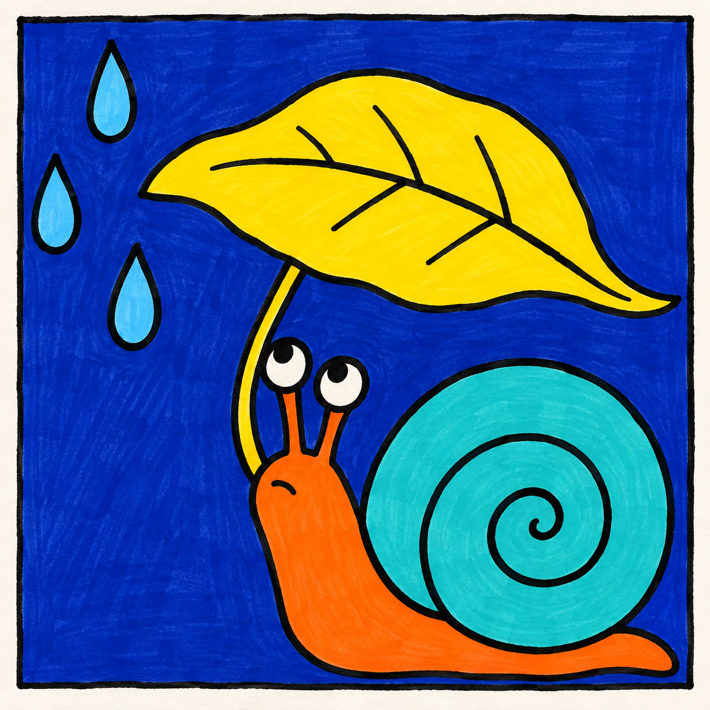
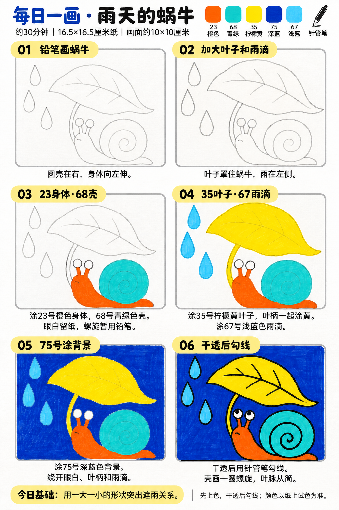

# 入门版练习 008｜雨天的蜗牛

[全部教案](../README.md) · [入门工具](README.md) · [S001风格](../../styles/001-playful-color-block.md) · 约30分钟 · 5色

今天只学一个基础：**用一大一小的形状突出遮雨关系**。用大形、浓郁平涂与自然手绘线完成一幅小插画。

## 成品参考

成品参考与步骤图都是AI教学示意，不计为真实练习完成。颜色仅近似，实物以纸上试色为准；具体跟画以正文顺序为准。

## 纸笔与色号

16.5×16.5厘米马克笔专用纸，画面约10×10厘米，四周留白，纸下垫废纸。铅笔轻起形，0.5mm针管笔最后勾线与填小面积黑色；0.15mm按需用于细节，1.0mm可选加粗主要外轮廓，粗勾线笔本次不必用。

| 已有Touchmark学生36色色号 | 本次用途 |
| --- | --- |
| 23 Orange | 蜗牛身体和眼柄 |
| 68 Turquoise Blue | 蜗牛壳 |
| 35 Lemon Yellow | 大叶子与叶柄 |
| 75 Dark Blue Light | 背景 |
| 67 Pastel Blue | 三滴雨水 |

针管笔耐酒精性未知，统一先铅笔定位、上色、完全干透后勾线。高光和白色形状提前留纸白，不把132当不透明白色或无色混色笔，不用浅色反复覆盖深色。

## 先练约3分钟

在废纸画一个小圆蜗牛壳，上方试画小叶子和大叶子，比较哪片更像能遮住蜗牛。再慢画一条向内收的螺旋；试五色。

## 六步跟画｜约25分钟

按从左到右、从上到下阅读，灰色线视作铅笔。首格可能已展示完整浅色定位，可按标题分两步起稿；深色轮廓和眼嘴统一最后完成。步骤图首格已轻画叶子，可第一步只画蜗牛、第二步再加叶子。壳螺旋不必画满很多圈，叶脉可比成品更少。

### 01 铅笔画蜗牛

右下画圆形大壳，身体从壳下向左伸，前端抬高，接两根短眼柄和白眼圈。尾巴只需一小段弧线。

### 02 加大叶子和雨滴

上方画一片大叶子，宽度罩住蜗牛身体与壳；叶柄弯到身体边。左侧安排三滴雨水，别塞满背景。叶脉暂用铅笔轻标。

### 03 23身体·68壳

23涂身体和眼柄，眼圈留白；68涂整个壳，螺旋先保留浅铅笔定位。壳无需叠深色外圈。

### 04 35叶子·67雨滴

35涂大叶子和细叶柄，67涂三滴雨水。雨滴每滴只用一层，不画高光渐变；眼白仍不涂色。

### 05 75号涂背景

75填背景。眼柄之间和细叶柄旁边先用笔尖处理，再连续排笔填大面，避免深蓝进入白眼圈。

### 06 干透后勾线

干透后勾线，壳中画一条简单向内收的螺旋。叶脉只留中线与两三条支线，最后画小瞳孔和短嘴线。

## 常见问题

大叶子看着像装饰而不是遮雨怎么办？把叶子移到蜗牛上方并画宽，保持雨滴在一侧。不要靠增加很多雨线来解释。

## 最后检查约2分钟

只看叶子大小和蜗牛位置，能否读懂遮雨关系。 少量排笔痕迹可以保留，不为消除笔痕反复刷深。约30分钟为试笔、跟画与检查的计划，不含额外干燥时间，可分次完成；不作为实际用时登记。

## 来源

成品参考和六步图由OpenAI内置imagegen生成，六步教学版式沿用本系列[圆滚滚小鸡](001-chick.md)。[生成提示词及检查说明](../../entries/beginner/008-snail-leaf/reference/generation-prompt.txt)；基础学习来源见[课程参考资料](../../docs/learning-references.md)。不要求过程拍照，实际完成后再登记，照片与用时可省略。
