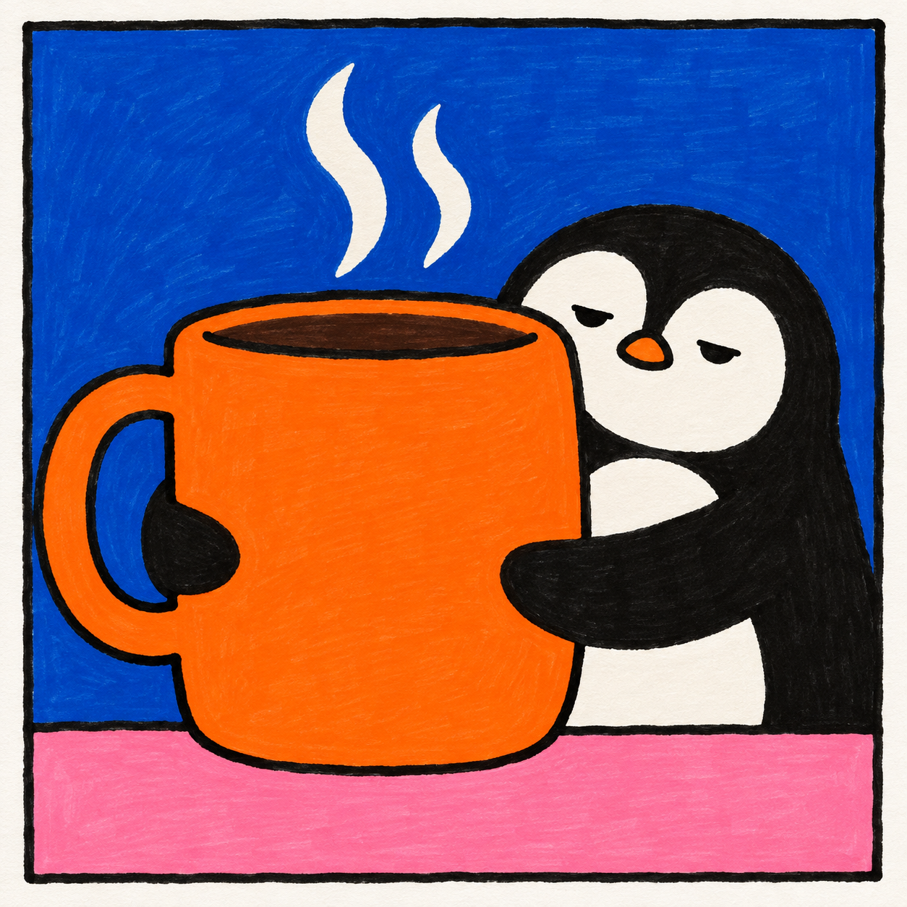
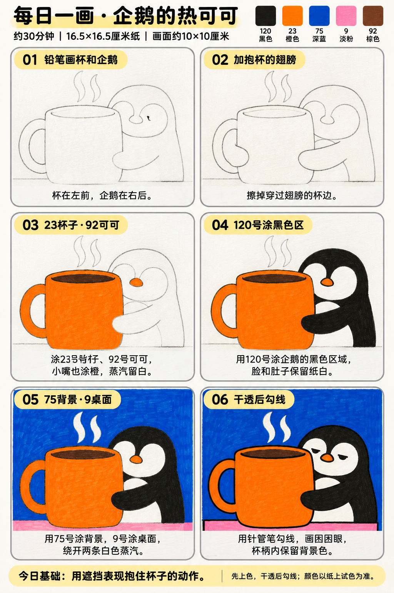

# 入门版练习 010｜企鹅的热可可

[全部教案](../README.md) · [入门工具](README.md) · [S001风格](../../styles/001-playful-color-block.md) · 约30分钟 · 5色

今天只学一个基础：**用遮挡表现抱住杯子的动作**。用大形、浓郁平涂与自然手绘线完成一幅小插画。

## 成品参考

成品参考与步骤图都是AI教学示意，不计为真实练习完成。颜色仅近似，实物以纸上试色为准；具体跟画以正文顺序为准。

## 纸笔与色号

16.5×16.5厘米马克笔专用纸，画面约10×10厘米，四周留白，纸下垫废纸。铅笔轻起形，0.5mm针管笔最后勾线与填小面积黑色；0.15mm按需用于细节，1.0mm可选加粗主要外轮廓，粗勾线笔本次不必用。

| 已有Touchmark学生36色色号 | 本次用途 |
| --- | --- |
| 120 Black | 企鹅黑色身体与翅膀 |
| 23 Orange | 杯子与企鹅小嘴 |
| 75 Dark Blue Light | 背景及杯柄空隙 |
| 9 Pale Pink | 桌面 |
| 92 Chocolate | 可可液面 |

针管笔耐酒精性未知，统一先铅笔定位、上色、完全干透后勾线。高光和白色形状提前留纸白，不把132当不透明白色或无色混色笔，不用浅色反复覆盖深色。

## 先练约3分钟

在废纸画一只杯子，再在杯边前面加一个长椭圆翅膀，把穿过翅膀的杯线擦掉。比较擦线前后是否像抱住；试五色。

## 六步跟画｜约25分钟

按从左到右、从上到下阅读，灰色线视作铅笔。首格可能已展示完整浅色定位，可按标题分两步起稿；深色轮廓和眼嘴统一最后完成。黑色大面使用已有120号，细轮廓仍最后用针管笔。步骤图第3格较深的杯口边缘可最后再勾，不必提前用墨线。

### 01 铅笔画杯和企鹅

大杯放左侧前方，右侧画圆胖企鹅，杯口用扁椭圆，不必画得标准。下方画桌沿，两条蒸汽先用铅笔圈出宽一点的白色形状。

### 02 加抱杯的翅膀

企鹅两只翅膀搭到杯前，擦掉穿过翅膀的杯子轮廓。白脸和白肚子轻轻定位，杯柄内是背景，不是杯身颜色。

### 03 23杯子·92可可

23涂杯身、杯柄和小嘴，92涂杯口的可可液面。翅膀和蒸汽暂时留白，杯口不用再做反光条。

### 04 120号涂黑色区

120涂企鹅黑色区与搭到杯前的两只翅膀，绕开白脸、白肚子和橙嘴。大面积用马克笔，眼睛等小细节最后用针管笔。

### 05 75背景·9桌面

75涂背景与杯柄内的空隙，9涂桌面，两条蒸汽保持纸白。蒸汽要在起稿时圈得够宽，不能先填深蓝再用132盖回白。

### 06 干透后勾线

完全干透后勾线、画困困眼。翅膀前面的轮廓连续，杯子的后方线在翅膀边停住。杯柄内部保留蓝色。

## 常见问题

翅膀像贴在杯子旁边怎么办？让翅膀确实伸到杯面内，并擦掉它后面的杯边；只加黑色线而不处理遮挡，动作会不清楚。

## 最后检查约2分钟

先遮住企鹅脸，看翅膀与杯子的关系能否表达拥抱。 少量排笔痕迹可以保留，不为消除笔痕反复刷深。约30分钟为试笔、跟画与检查的计划，不含额外干燥时间，可分次完成；不作为实际用时登记。

## 来源

成品参考和六步图由OpenAI内置imagegen生成，六步教学版式沿用本系列[圆滚滚小鸡](001-chick.md)。[生成提示词及检查说明](../../entries/beginner/010-penguin-cocoa/reference/generation-prompt.txt)；基础学习来源见[课程参考资料](../../docs/learning-references.md)。不要求过程拍照，实际完成后再登记，照片与用时可省略。
