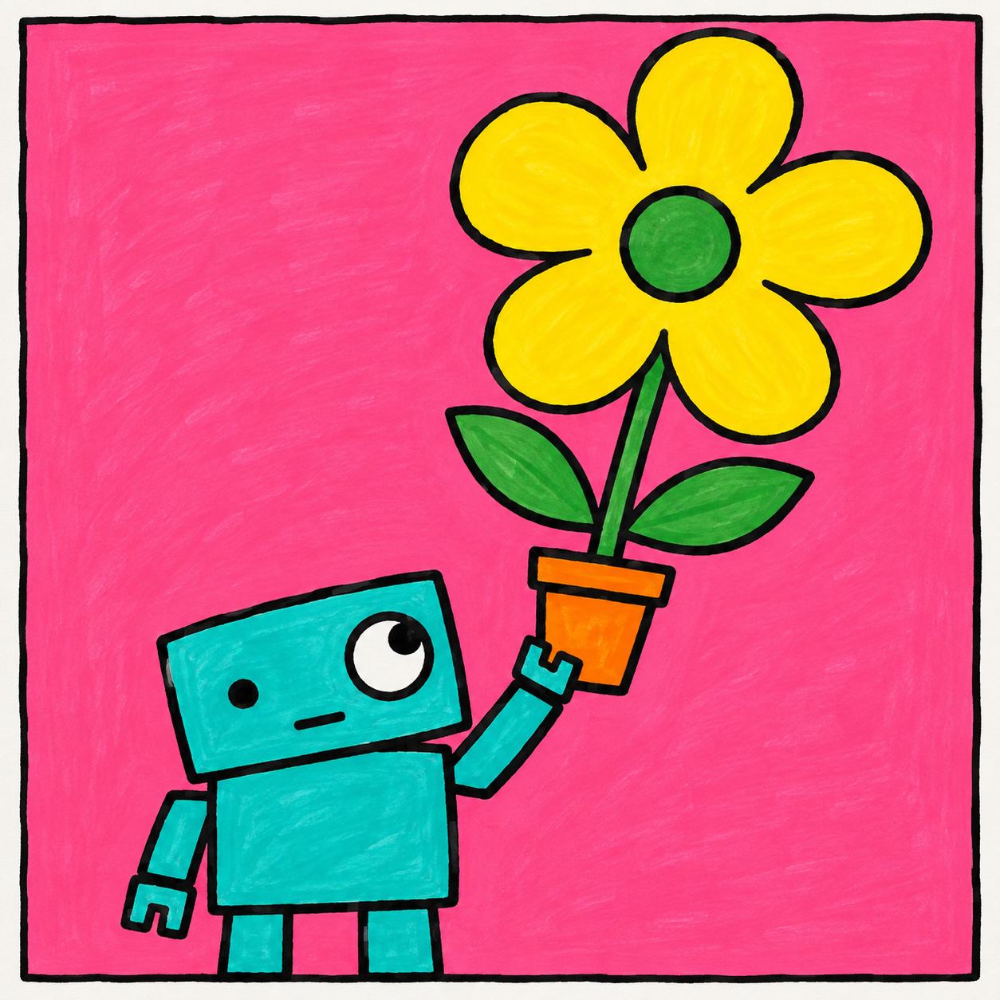
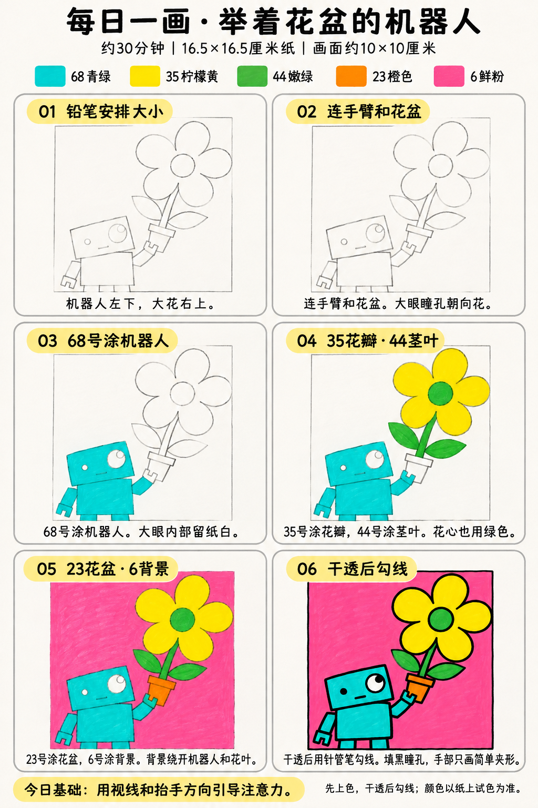

# 入门版练习 011｜举着花盆的机器人

[全部教案](../README.md) · [入门工具](README.md) · [S001风格](../../styles/001-playful-color-block.md) · 约30分钟 · 5色

今天只学一个基础：**用视线和抬手方向引导注意力**。用大形、浓郁平涂与自然手绘线完成一幅小插画。

## 成品参考

成品参考与步骤图都是AI教学示意，不计为真实练习完成。颜色仅近似，实物以纸上试色为准；具体跟画以正文顺序为准。

## 纸笔与色号

16.5×16.5厘米马克笔专用纸，画面约10×10厘米，四周留白，纸下垫废纸。铅笔轻起形，0.5mm针管笔最后勾线与填小面积黑色；0.15mm按需用于细节，1.0mm可选加粗主要外轮廓，粗勾线笔本次不必用。

| 已有Touchmark学生36色色号 | 本次用途 |
| --- | --- |
| 68 Turquoise Blue | 机器人身体、手臂和短腿 |
| 35 Lemon Yellow | 大花瓣 |
| 44 Fresh Green | 花心、茎和叶片 |
| 23 Orange | 花盆 |
| 6 Vivid Pink | 背景 |

针管笔耐酒精性未知，统一先铅笔定位、上色、完全干透后勾线。高光和白色形状提前留纸白，不把132当不透明白色或无色混色笔，不用浅色反复覆盖深色。

## 先练约3分钟

在废纸画小方头和一朵大花，用折线连出抬起的手臂。把瞳孔从朝前移到朝花，体会动作与视线如何一起引导注意力；试五色。

## 六步跟画｜约25分钟

按从左到右、从上到下阅读，灰色线视作铅笔。首格可能已展示完整浅色定位，可按标题分两步起稿；深色轮廓和眼嘴统一最后完成。第3格小眼也保留纸白定位，最终再用针管笔填黑即可。几何零件略歪不影响动作，不必用尺修直。

### 01 铅笔安排大小

机器人放左下，大花放右上，花朵可以比机器人头更大。用方形头、长方形身体、短腿和圆花瓣概括，不画齿轮螺丝。

### 02 连手臂和花盆

抬起的手臂用两段短长方形连接，末端接夹形手与花盆。花茎从盆里伸出，眼睛一大一小，大眼瞳孔轻标在朝花的一侧。

### 03 68号涂机器人

68涂机器人身体、手臂与腿，大眼内部留纸白，小眼暂留铅笔位置。手也用同色，不额外增加金属灰或明暗。

### 04 35花瓣·44茎叶

35涂大花瓣，44涂花心、茎和两片叶。叶脉可不画，保持大色块清楚；花盆仍暂留白。

### 05 23花盆·6背景

23涂花盆，6填背景。绕过机器人小手与细花茎，别为了填背景把它们挤得太细。

### 06 干透后勾线

干透后勾线，大小眼瞳孔填黑，嘴用一小段平线。大眼看向右上花朵，小手只用简单夹形，保留自然手绘线。

## 常见问题

机器人看着没有举起花盆怎么办？检查手臂是否确实连到手、手是否碰到盆；把大眼瞳孔朝花移动，让视线配合抬手方向。

## 最后检查约2分钟

视线能否从机器人顺着抬手到花盆，再到大花。 少量排笔痕迹可以保留，不为消除笔痕反复刷深。约30分钟为试笔、跟画与检查的计划，不含额外干燥时间，可分次完成；不作为实际用时登记。

## 来源

成品参考和六步图由OpenAI内置imagegen生成，六步教学版式沿用本系列[圆滚滚小鸡](001-chick.md)。[生成提示词及检查说明](../../entries/beginner/011-robot-flowerpot/reference/generation-prompt.txt)；基础学习来源见[课程参考资料](../../docs/learning-references.md)。不要求过程拍照，实际完成后再登记，照片与用时可省略。
