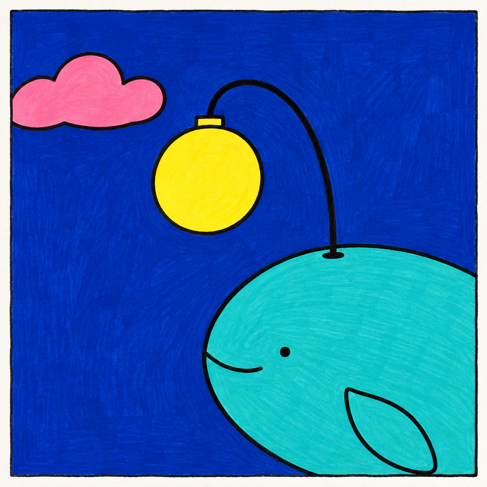
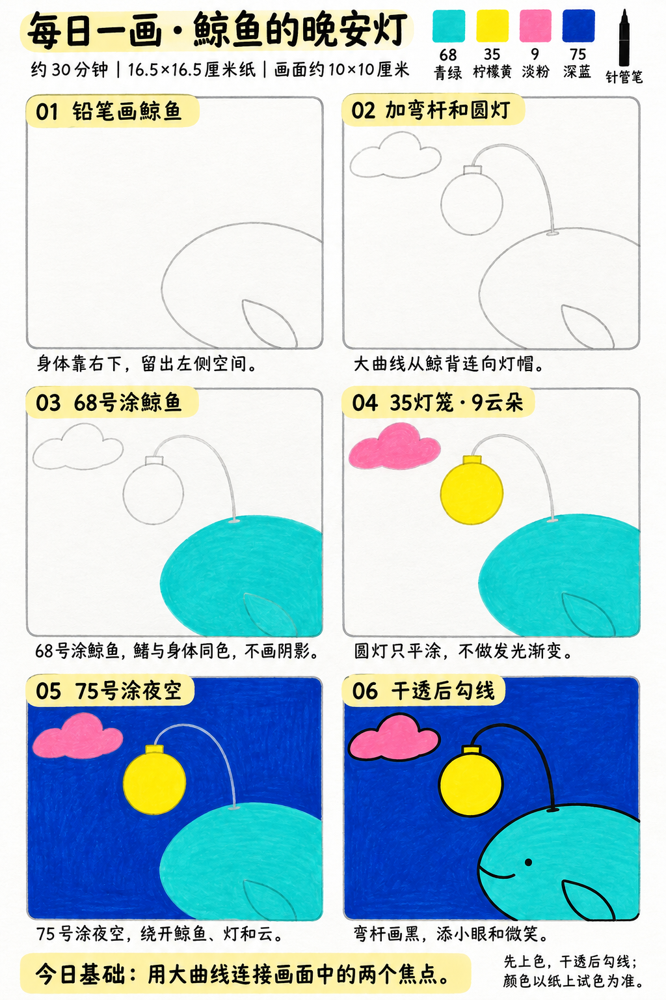

# 入门版练习 012｜鲸鱼的晚安灯

[全部教案](../README.md) · [入门工具](README.md) · [S001风格](../../styles/001-playful-color-block.md) · 约30分钟 · 4色

今天只学一个基础：**用大曲线连接画面中的两个焦点**。用大形、浓郁平涂与自然手绘线完成一幅小插画。

## 成品参考

成品参考与步骤图都是AI教学示意，不计为真实练习完成。颜色仅近似，实物以纸上试色为准；具体跟画以正文顺序为准。

## 纸笔与色号

16.5×16.5厘米马克笔专用纸，画面约10×10厘米，四周留白，纸下垫废纸。铅笔轻起形，0.5mm针管笔最后勾线与填小面积黑色；0.15mm按需用于细节，1.0mm可选加粗主要外轮廓，粗勾线笔本次不必用。

| 已有Touchmark学生36色色号 | 本次用途 |
| --- | --- |
| 68 Turquoise Blue | 鲸鱼身体与鳍 |
| 35 Lemon Yellow | 圆灯笼和小灯帽 |
| 9 Pale Pink | 云朵 |
| 75 Dark Blue Light | 夜空 |

针管笔耐酒精性未知，统一先铅笔定位、上色、完全干透后勾线。高光和白色形状提前留纸白，不把132当不透明白色或无色混色笔，不用浅色反复覆盖深色。

## 先练约3分钟

在废纸从右下向左上慢画一条大弧线，末端接一个圆，比较急转弯和舒展曲线的感觉。试四色，灯笼只要纯黄，不画发光渐变。

## 六步跟画｜约25分钟

按从左到右、从上到下阅读，灰色线视作铅笔。首格可能已展示完整浅色定位，可按标题分两步起稿；深色轮廓和眼嘴统一最后完成。步骤图第五格有细白弯杆，仅作定位，最后用黑线盖住即可。原成品鲸鱼更大，可按六步图简化，保留右下出框关系。

### 01 铅笔画鲸鱼

右下画大圆弧鲸鱼，让身体和鳍部分出框，左上留出灯和云的空间。形状先画大，不需要完整尾巴或海浪。

### 02 加弯杆和圆灯

从鲸背伸出一条向上再向左弯的大曲线，末端接小灯帽和圆灯笼。左上安排小云，曲线不穿过云；这是想象中的灯杆。

### 03 68号涂鲸鱼

68平涂鲸鱼，鳍也同色，不在身体里叠阴影。眼睛和嘴只保留铅笔定位，边缘笔触不必涂得像数码一样平整。

### 04 35灯笼·9云朵

35涂圆灯和小灯帽，9涂云。灯的颜色均匀即可，不加周围光晕或反射。

### 05 75号涂夜空

75涂夜空，绕开鲸鱼、灯和云。弯杆可以直接在蓝色干透后画黑，不必刻意留宽白带；若按图留了细白线，第六步用黑线覆盖干净。

### 06 干透后勾线

完全干透后用针管笔画顺畅的大弯杆和主要轮廓，再加一只小黑眼、短微笑。弯杆可分两三段连接，不要求一笔画完。

## 常见问题

灯杆像折断的线怎么办？起稿时先轻画舒展的弧线，转弯不要太急；最后分段勾线时让前后线段接顺，不必越描越粗。

## 最后检查约2分钟

大曲线是否自然连接鲸背与圆灯，目光能否在两处移动。 少量排笔痕迹可以保留，不为消除笔痕反复刷深。约30分钟为试笔、跟画与检查的计划，不含额外干燥时间，可分次完成；不作为实际用时登记。

## 来源

成品参考和六步图由OpenAI内置imagegen生成，六步教学版式沿用本系列[圆滚滚小鸡](001-chick.md)。[生成提示词及检查说明](../../entries/beginner/012-whale-lantern/reference/generation-prompt.txt)；基础学习来源见[课程参考资料](../../docs/learning-references.md)。不要求过程拍照，实际完成后再登记，照片与用时可省略。
