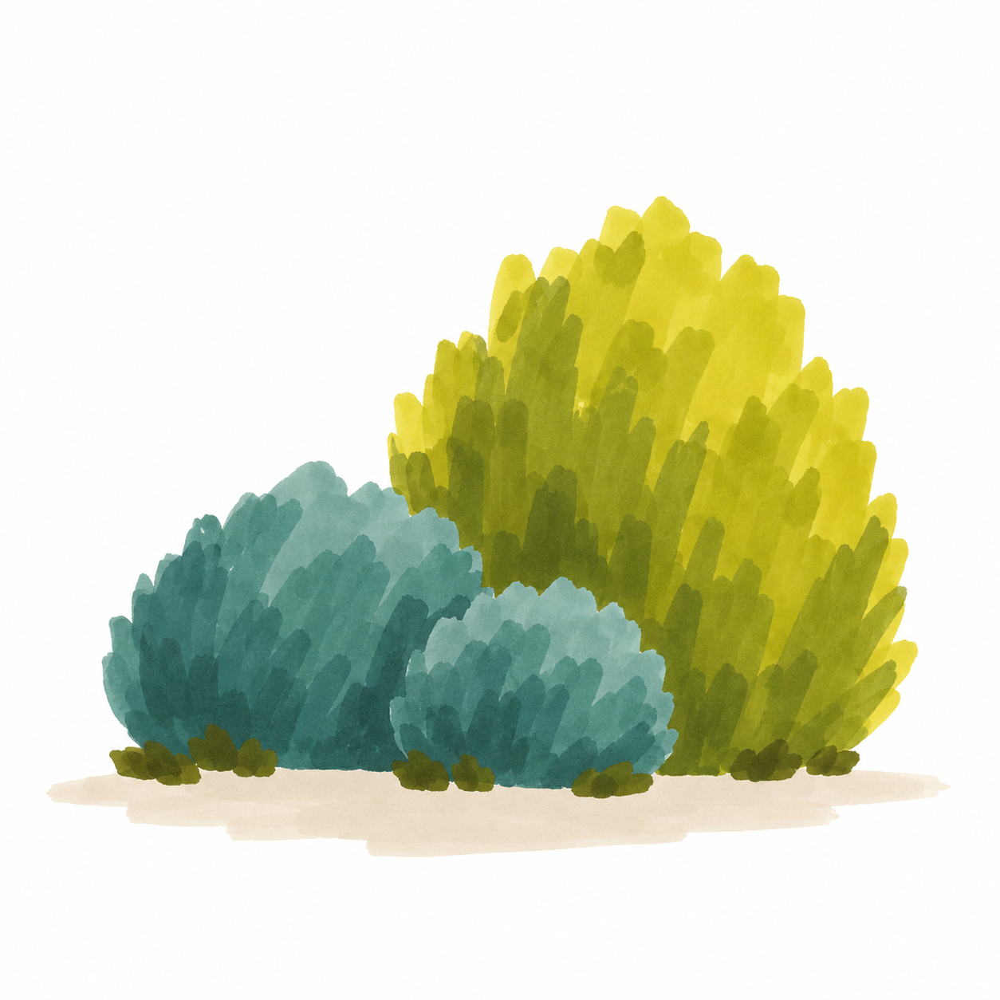
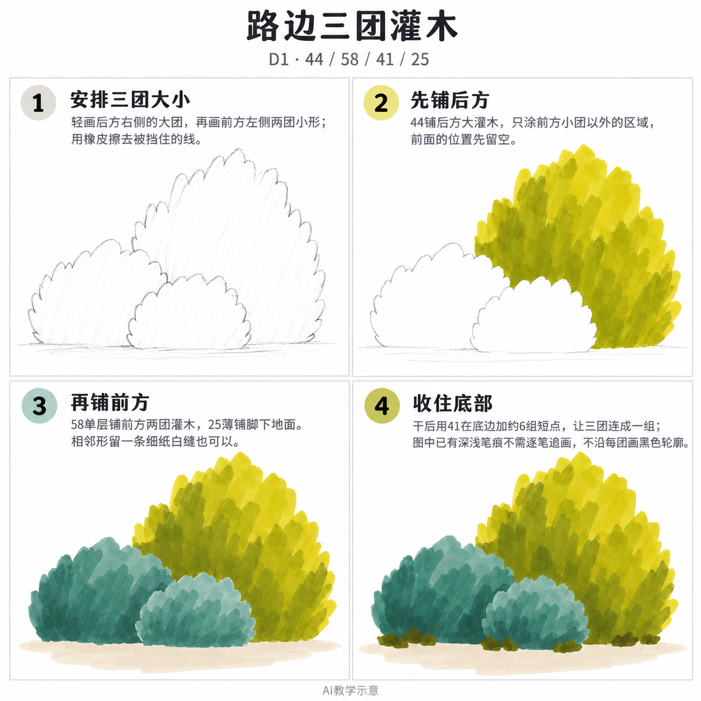

# S002-007 路边三团灌木

[S002七课入口](S002-README.md) · [风格档案](../../styles/002-sunlit-brushstroke-landscape.md) · [学习规则](../../docs/learning-system.md)

- 风格：S002 晴日笔触风景；D1基础大形；完整跟画（guided）。
- 主要目标：用大小与前后遮挡组织植物大形。
- 先修能力：能轻画圆形、弧线或简单线段；不要求先学S001。前课是可选铺垫，不是硬性门槛。
- 画面：16.5厘米方纸中画约8～10厘米小景，四周留白；示意图可缩小照画。
- 预计整幅：约35分钟，含试色与干燥；可分为定位铺色、干后收尾两次。
- 状态：可学习，尚未实际手绘完成。AI图不是实笔画作。

## 成品参考

## 工具与配色

马克笔专用纸、铅笔、橡皮、Touchmark学生36色油性马克笔。针管笔非必需；需要局部结构线时，待马克笔干透后再画细线，不画全轮廓粗黑线。

| 色号 | 实涂照片观察的相对色系 |
| --- | --- |
| 44 | 偏黄的橄榄绿（照片观察） |
| 58 | 灰调青绿，非浅薄荷绿（照片观察） |
| 41 | 较深橄榄绿（照片观察） |
| 25 | 很浅的灰米色、灰肤色（照片观察） |

具体区域分工见步骤。开始前在同种废纸上各试一小块，浅色干透后再比较。AI图片只近似实物，不能为追图中颜色改用跨色系笔号。25是极浅灰米，不是鲜黄；172是极浅灰绿；75浅紫、82较深紫。已有单色的叠笔深浅无需另找颜色或逐笔重现。

纸白即白色，不用132补白；白笔不是本课必要工具。深色误涂后不要用浅笔反复覆盖，宁可保留小偏差，下次提前留白。

## 递进步骤

四个环节按实际操作组织，铺色后必须等干再加深；每幅可以停下来休息。图片上的小笔触数量允许变化，以大形、留白和主要目标为准。

### 1. 安排三团大小

轻画后方右侧的大团，再画前方左侧两团小形；用橡皮擦去被挡住的线。

检查：大形之间的位置是否清楚，铅笔是否足够轻。

### 2. 先铺后方

44铺后方大灌木，只涂前方小团以外的区域，前面的位置先留空。

检查：浅色只铺一遍；应留白的地方仍是纸白。

### 3. 再铺前方

58单层铺前方两团灌木，25薄铺脚下地面。相邻形留一条细纸白缝也可以。

检查：连接处、遮挡与地面关系是否清楚。

### 4. 收住底部

干后用41在底边加约6组短点，让三团连成一组；图中已有深浅笔痕不需逐笔追画，不沿每团画黑色轮廓。

检查：完成本课主要目标即可停止，不靠加满纹理提高完成度。

## 常见问题与收尾

- 出现接笔痕：铺一个小区域时沿同方向相邻落笔；不要为抹平痕迹持续湿刷。保留少量马克笔痕符合本风格。
- 植物太碎：先停笔，退远看能否读成一个大形；后续暗点只放底部少量区域。
- 颜色发脏：等前层干透再加深，不用来回混色补救。浅部与纸白提前保留。
- 构图偏大：在新纸上把外框缩到8～10厘米，不必填满整张纸。

## 完成检查

1. 能否说出本课主要目标，并指出画面里对应位置？
2. 大形、连接或遮挡关系是否清楚，纸白是否有计划保留？
3. 是否保留大色块和少量自然笔触，没有靠密集细节掩盖问题？

可以只用文字反馈，不要求过程照片。仅在实际画完并确认后记录完成；本课成品与步骤生成不计手绘进度。第7课之后结合实际作品复盘，必要时补2～3幅，不按张数自动晋级。

## 来源

OpenAI内置imagegen生成的原创教学示意；以晴日色彩关系、植物笔触和简洁空间为视觉规则，独立设计主体与布局。提示词存于对应reference/generation.json。实笔适配依据当前工具档案，未作精确色度校准。
