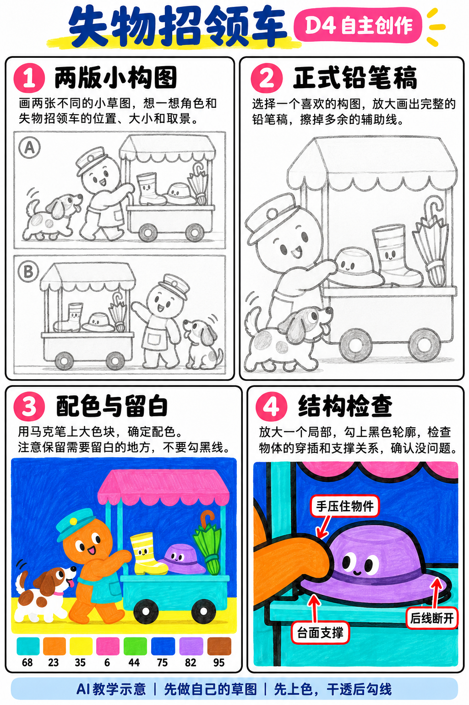
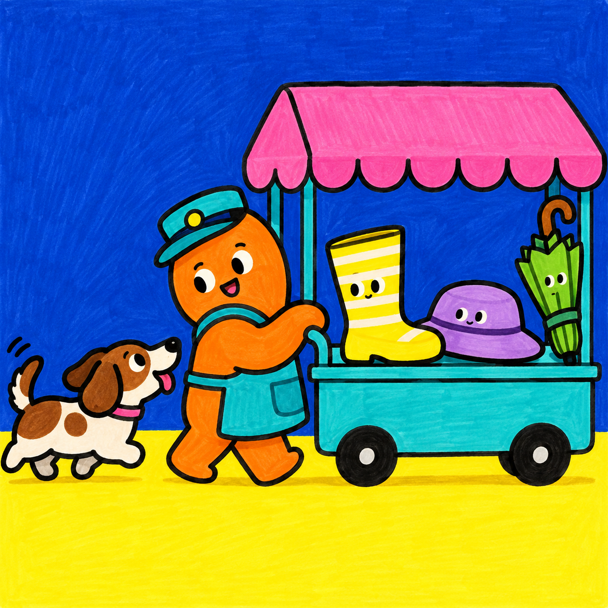

# S001-022｜失物招领车

> **配色待校正：** 本课成品与教学图尚未通过实笔色卡核对，图内色号、色名和填色不能直接作为用笔依据。造型步骤保留；问题详见[36色色卡与28课审查](../../docs/color-audit-2026-11-01.md)。

[全部教案](../README.md) · [本阶段](README.md) · [S001风格](../../styles/001-playful-color-block.md)

**D4 自主创作 · 自主任务 · 预计整幅约90分钟**

先修：已能组织多物件的主次与遮挡、选色并规划留白；先完成D3复盘，或有相同能力。

主要目标：**围绕主题自主安排物件组合与故事线索**。

计划时间包括试色、起稿、上色和检查，不含额外干燥等待，不登记为实际用时。可按每次20～30分钟分次：先完成草图与留白，再分批上色，最后干透后勾线。

## 纸笔与画面大小

使用16.5×16.5厘米马克笔专用纸，纸下垫废纸；本课主体约12～13厘米，四周留白。普通铅笔轻定位，0.5mm针管笔收轮廓，0.15mm用于少量细节，1.0mm外轮廓可选。

使用Touchmark学生36色油性马克笔。针管笔耐酒精性未知时统一先上色，完全干透后勾线。大块白形留纸白，132不当覆盖白笔或混色笔；白色高光工具仅可选，需先试效果，本课不依赖。

## 色号与区域

| 色号 | 本套色名 | 计划区域 |
| --- | --- | --- |
| 68 | Turquoise Blue | 车身 |
| 23 | Orange | 管理者与小暖色 |
| 35 | Lemon Yellow | 标签和物品 |
| 6 | Vivid Pink | 雨棚与小物 |
| 44 | Fresh Green | 植物 |
| 75 | Dark Blue Light | 背景 |
| 82 | Light Violet | 帽子或失物 |
| 95 | Burnt Sienna | 宠物暖色 |

AI图颜色仅近似实物。先在废纸试色，以此表为准；同色深浅只允许在完全干后小面积轻叠，不依赖浅色覆盖深色。D4可自行替换为本套已有色号并记录，保持主次和冷暖关系，单幅不超过10色。

## 先练3～5分钟

把车、管理者、寻找者分别画成方块，交换左右位置；选故事能读懂且物品不堆满的一版。

## 留纸白

车上标签和物品之间的空隙先预留；不要求写可读小字。

## 自主任务

设计一辆失物招领车，让一个寻找者与一个管理者通过物件产生联系；至少有一件物品能暗示它的主人。

- 先画两张不同布局的缩略草图再选一张
- 车上物品限3～5件，选择一件作为故事焦点
- 至少两处明确遮挡，车轮与车体有连接

先完成自己的两张小构图，再查看示例；示例不作为唯一答案。

## 构图与结构提示

四格分别为两版构图、正式铅笔稿、配色留白与局部结构检查；它们对应下方多个操作环节，不代表整幅只需四步。

图文检查说明：图03的五官仅帮助识别角色，实际可等全部颜色干透后再画。图04为局部结构检查，不是额外一幅作品。

## 10个操作环节

### 01 写一句情节

用一句话确定谁来找什么，例如寻找一只遗失的帽子；不要先复制参考中的所有失物。

### 02 做两张缩略稿

各用3厘米小方框，分别试车在左和车在右。只画大块，看寻找者视线能否落到目标物。

### 03 选主次与裁切

选一张，车约占半幅，其余留给角色。物件只留3～5件，重复颜色可用来串联故事。

### 04 确定接触

画管理者拿或递物的手，让失物与手、车台面有接触；远侧车轮被车体挡住一部分。

### 05 画正式铅笔稿

放大到12厘米左右，先画车再画角色，最后加失物。删除被挡住的轮廓。

### 06 试配色

先用计划色号做小色块，把背景与车身、失物与角色分开。允许在本套已有色号中替换，但不超过10色，并记录替换。

### 07 浅色与留白

先涂35标签与浅物件，44植物，保留纸白标签边；不要把整车涂满后再补标签。

### 08 主体与背景

68车身，23管理者，6雨棚，75背景，82和95分配小失物；背景可减少面积，避免抢掉目标物。

### 09 暗部与轮廓

干透后勾车轮、支架、手与失物，外轮廓略粗，车内物件略细，不用每件都加表情。

### 10 自查与改版

遮住标题，确认能看出谁在找什么；删一件不必要物品，再比较故事是否更清楚。

## 常见问题

失物很多却没有故事：只让一件失物与寻找者共享颜色或形状，弱化其他物品，而不是继续添加标牌。

## 完成检查

- 缩略稿至少两版且有选择理由
- 寻找者的视线或动作指向目标失物
- 物品能由手或台面支撑

## 换题迁移

保留同一辆车，只换目标失物，做一张小系列续作草图。

本页小草图与局部试练不另算一幅完成作品。只有实际画完正式作品后才登记；日期、照片、用时与反馈可省略。每阶段7幅后结合实际能力复盘，需要巩固再补练，不自动晋级。

成品示例：完成自己的草图后再展开

## 来源

成品与教学提示图为AI生成示意，使用OpenAI内置imagegen；不计实际手绘完成。

[本课提示词与检查说明](../../entries/independent/022-lost-and-found-cart/reference/generation-prompts.json) · [基础学习资料](../../docs/learning-references.md) · [完整进阶规则](../../docs/learning-system.md)
