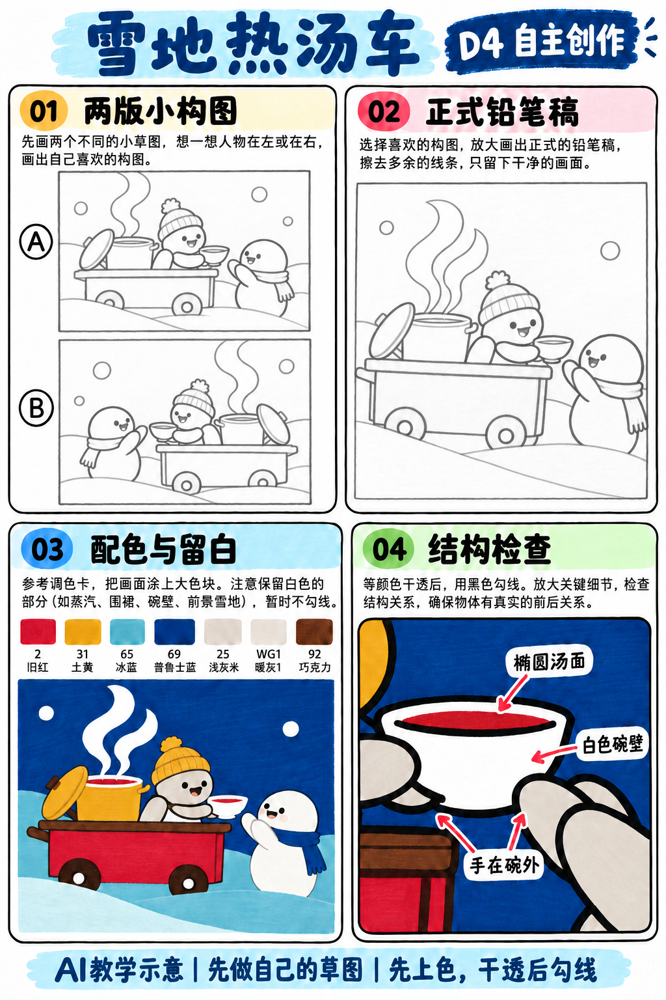
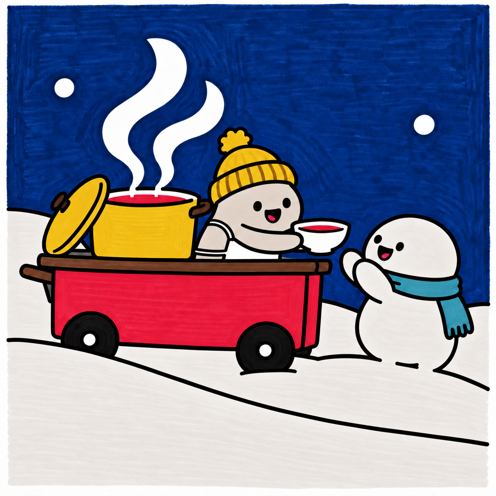

# S001-023｜雪地热汤车

> **配色已修订：** 成品、教学图与正文按实涂色卡的相对色相重新配套；浅色以同纸单层试色为准，屏幕图不作精确色值。旧图只作历史留存。

[全部教案](../README.md) · [本阶段](README.md) · [S001风格](../../styles/001-playful-color-block.md)

**D4 自主创作 · 自主任务 · 预计整幅约90分钟**

先修：已能组织多物件的主次与遮挡、选色并规划留白；先完成D3复盘，或有相同能力。

主要目标：**自主设计冷暖配色与主题情节**。

计划时间包括试色、起稿、上色和检查，不含额外干燥等待，不登记为实际用时。可按每次20～30分钟分次：先完成草图与留白，再分批上色，最后干透后勾线。

## 纸笔与画面大小

使用16.5×16.5厘米马克笔专用纸，纸下垫废纸；本课主体约12～13厘米，四周留白。普通铅笔轻定位，0.5mm针管笔收轮廓，0.15mm用于少量细节，1.0mm外轮廓可选。

使用Touchmark学生36色油性马克笔。针管笔耐酒精性未知时统一先上色，完全干透后勾线。大块白形留纸白，132不当覆盖白笔或混色笔；白色高光工具仅可选，需先试效果，本课不依赖。

## 色号与区域

| 色号 | 本套色名 | 计划区域 |
| --- | --- | --- |
| 2 | 偏玫红的红色 | 汤车与汤 |
| 31 | 偏芥末的黄色 | 锅与帽子 |
| 65 | 蓝绿色，非很浅冰蓝 | 雪地浅色 |
| 69 | 深靛蓝 | 夜空与围巾 |
| 25 | 很浅的灰米色、灰肤色 | 摊主 |
| WG1 | 近纸白的浅暖灰 | 顾客 |
| 92 | 深棕 | 台面与把手 |

AI图颜色仅近似实物。先在废纸试色，以此表为准；同色深浅只允许在完全干后小面积轻叠，不依赖浅色覆盖深色。D4可自行替换为本套已有色号并记录，保持主次和冷暖关系，单幅不超过10色。

## 先练3～5分钟

画三个椭圆碗口与杯壁，再把手搭在碗外侧；选择能看见汤面的视角。

## 留纸白

蒸汽、围裙、碗壁与前景雪留纸白，汤只在碗口椭圆里上色。

## 自主任务

设计雪地里的暖食小车，表现递出一碗热汤的瞬间；顾客与摊主的关系应比装饰更醒目。

- 两版缩略稿比较顾客在左或右
- 主要暖色集中在车和食物，冷色放在环境
- 锅口、碗口与握持关系必须清楚

先完成自己的两张小构图，再查看示例；示例不作为唯一答案。

## 构图与结构提示

四格分别为两版构图、正式铅笔稿、配色留白与局部结构检查；它们对应下方多个操作环节，不代表整幅只需四步。

图文检查说明：图04放大碗口结构：汤面在内口椭圆里，碗壁留白，手握在外壁。图03的深色五官可延后到干透后再画。

## 10个操作环节

### 01 确定情节

先写谁递给谁、递的是什么，选递汤而非单纯并排站立。

### 02 两版缩略稿

试顾客左与右的两种布局，让两只手之间留出碗的位置。

### 03 分冷暖区域

用小色块把夜空与雪地归冷色，把锅、汤和车归暖色；不把全页都涂成暖色。

### 04 安排容器结构

先画锅口和碗口椭圆，再接锅身与碗壁，汤面在内口里，手握在碗壁外。

### 05 正式铅笔稿

车体、车轮、锅和人物从大到小画；远侧手和轮被前方物体遮挡。

### 06 规划蒸汽与雪

轻标两条蒸汽宽带、围裙、白碗和雪前景，背景绕开这些区域。

### 07 浅色与角色

65涂中景雪，WG1涂顾客，25涂摊主；纸白雪与浅灰顾客靠轮廓区分。

### 08 暖色车与食物

2涂车和汤，31涂锅和帽，92涂台面与把手。锅盖与锅体有前后，不让把手长在汤面里。

### 09 夜空与勾线

69涂夜空和围巾；干透后勾线，顾客接碗的手不要穿过碗口。蒸汽保持纸白。

### 10 自查冷暖与动作

不看文字能否读出递热汤；检查汤面椭圆、碗壁厚度、锅的支撑和车轮落地。

## 常见问题

碗像黄色圆片：先画椭圆汤面，再加下方弧形碗壁和窄口沿，手只能遮碗外壁的一部分。

## 完成检查

- 汤面在碗口内部且能看见碗壁
- 蒸汽与雪提前留白
- 冷环境衬托暖食物而非平均分色

## 换题迁移

用同一构图换为热饮，只改杯口、杯把与递接动作。

本页小草图与局部试练不另算一幅完成作品。只有实际画完正式作品后才登记；日期、照片、用时与反馈可省略。每阶段7幅后结合实际能力复盘，需要巩固再补练，不自动晋级。

成品示例：完成自己的草图后再展开

## 来源

成品与教学提示图为AI生成示意，使用OpenAI内置imagegen；不计实际手绘完成。

[本课提示词与检查说明](../../entries/independent/023-snow-soup-cart/reference/generation-prompts.json) · [基础学习资料](../../docs/learning-references.md) · [完整进阶规则](../../docs/learning-system.md)

[本次配色修订提示词与核对](../../entries/independent/023-snow-soup-cart/reference/color-revision-v5.json)
