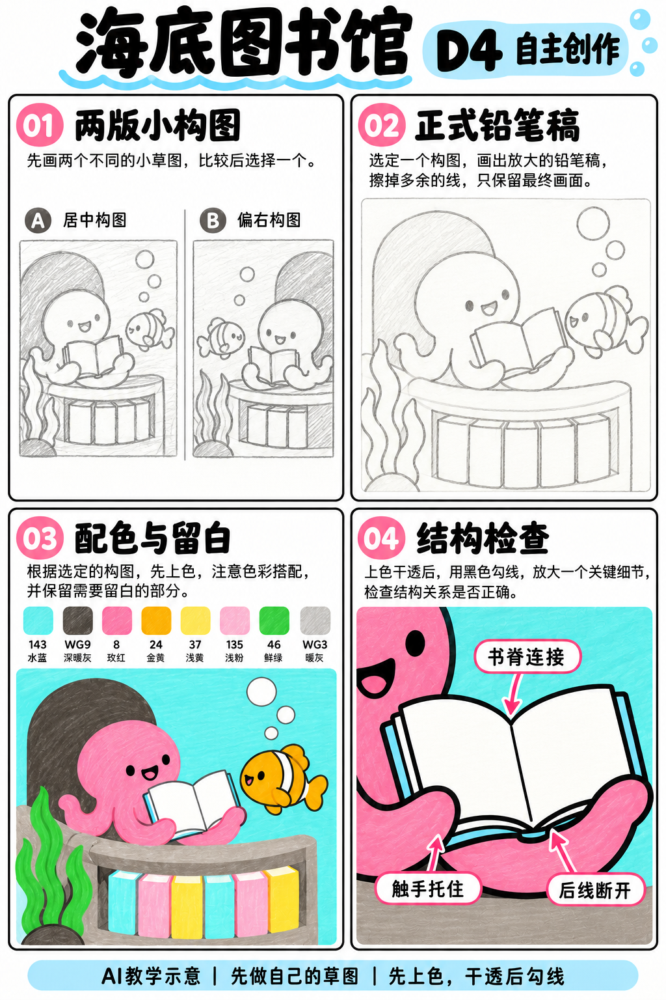
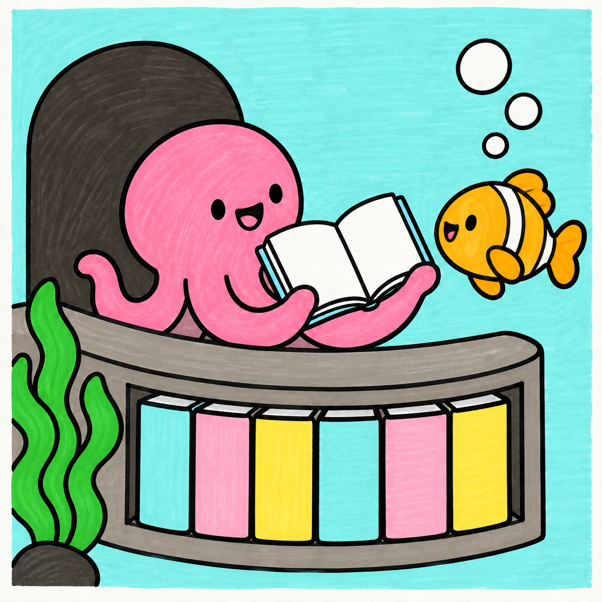

# S001-024｜海底图书馆

> **配色待校正：** 本课成品与教学图尚未通过实笔色卡核对，图内色号、色名和填色不能直接作为用笔依据。造型步骤保留；问题详见[36色色卡与28课审查](../../docs/color-audit-2026-11-01.md)。

[全部教案](../README.md) · [本阶段](README.md) · [S001风格](../../styles/001-playful-color-block.md)

**D4 自主创作 · 自主任务 · 预计整幅约95分钟**

先修：已能组织多物件的主次与遮挡、选色并规划留白；先完成D3复盘，或有相同能力。

主要目标：**自主组织空间、角色关系与重复形状节奏**。

计划时间包括试色、起稿、上色和检查，不含额外干燥等待，不登记为实际用时。可按每次20～30分钟分次：先完成草图与留白，再分批上色，最后干透后勾线。

## 纸笔与画面大小

使用16.5×16.5厘米马克笔专用纸，纸下垫废纸；本课主体约12～13厘米，四周留白。普通铅笔轻定位，0.5mm针管笔收轮廓，0.15mm用于少量细节，1.0mm外轮廓可选。

使用Touchmark学生36色油性马克笔。针管笔耐酒精性未知时统一先上色，完全干透后勾线。大块白形留纸白，132不当覆盖白笔或混色笔；白色高光工具仅可选，需先试效果，本课不依赖。

## 色号与区域

| 色号 | 本套色名 | 计划区域 |
| --- | --- | --- |
| 143 | Mint Blue | 海水和部分书脊 |
| WG9 | Warm Grey 9 | 壁龛与石头 |
| 8 | Rose Pink | 章鱼 |
| 24 | Marigold | 鱼 |
| 37 | Pastel Yellow | 浅黄色书脊 |
| 135 | Pale Cherry Pink | 浅粉书脊 |
| 46 | Vivid Green | 水草 |
| WG3 | Warm Grey 3 | 书架 |

AI图颜色仅近似实物。先在废纸试色，以此表为准；同色深浅只允许在完全干后小面积轻叠，不依赖浅色覆盖深色。D4可自行替换为本套已有色号并记录，保持主次和冷暖关系，单幅不超过10色。

## 先练3～5分钟

画打开的书：中间书脊、两侧弧形书页，再把触手搭在书外侧，擦掉被挡住的书边。

## 留纸白

书页、书页顶边、气泡和鱼白纹留纸白；亮点可省略。

## 自主任务

设计一次水下阅读活动，让一个讲读者和一个听众共享一本书；书架与气泡帮助说明环境。

- 两版草图比较书的位置与读者大小
- 书页、鱼的白纹与气泡留纸白
- 书架重复形状有节奏，最多6本可见书

先完成自己的两张小构图，再查看示例；示例不作为唯一答案。

## 构图与结构提示

四格分别为两版构图、正式铅笔稿、配色留白与局部结构检查；它们对应下方多个操作环节，不代表整幅只需四步。

图文检查说明：图04是书脊与托举局部；书内白页靠留纸白实现，不用132或浅色覆盖。图03出现的五官可延后到干透后。

## 10个操作环节

### 01 写阅读情节

确定谁在讲、谁在听，书是共同焦点；不必照抄章鱼与小丑鱼，可以换同样简单的海洋形。

### 02 比较两版草图

一版书居中，一版书偏一侧。选择触手与听众视线都能围绕书的方案。

### 03 控制重复节奏

书架只画约4～6本书，宽窄略变，留一处间隙；水草集中一侧。

### 04 设计打开的书

中间书脊连接左右书页，页外缘略弯；触手从下方托住，不能穿过书页。

### 05 正式铅笔稿

先定位壁龛和书架，再画角色、书和听众，最后点出气泡。反复擦掉交叉轮廓。

### 06 规划纸白

书页、白纹、气泡预留，书与背景之间留清楚轮廓，不能先染满海水。

### 07 浅色与角色

143涂海水和部分书脊，8涂章鱼，24涂鱼，37与135涂交替书脊。保持白页。

### 08 中深色结构

WG3涂书架，WG9涂壁龛与石头，46涂水草；暗壁龛集中在主角后面。

### 09 干透后线条

外轮廓略粗，书内折线与气泡边略细。检查触手托住书、书架书本都被层板支撑。

### 10 自查视觉焦点

缩小看时书仍在视线汇聚处，删掉抢眼气泡；记录自己改了哪处布局。

## 常见问题

书像两个白色方块：用中间书脊和两条页弧连接两边，再让触手托住书外边，减少无意义的内页线。

## 完成检查

- 讲读者和听众都朝向同一本书
- 书页留白且有书脊结构
- 重复书脊不是机械等宽排队

## 换题迁移

保持书架配色，换一位听众，形成第二场阅读活动的草图。

本页小草图与局部试练不另算一幅完成作品。只有实际画完正式作品后才登记；日期、照片、用时与反馈可省略。每阶段7幅后结合实际能力复盘，需要巩固再补练，不自动晋级。

成品示例：完成自己的草图后再展开

## 来源

成品与教学提示图为AI生成示意，使用OpenAI内置imagegen；不计实际手绘完成。

[本课提示词与检查说明](../../entries/independent/024-underwater-library/reference/generation-prompts.json) · [基础学习资料](../../docs/learning-references.md) · [完整进阶规则](../../docs/learning-system.md)
