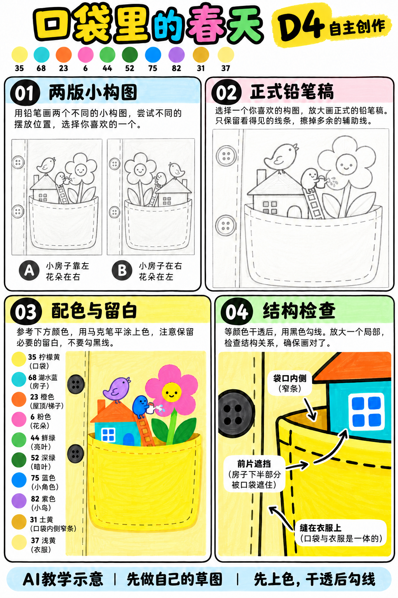
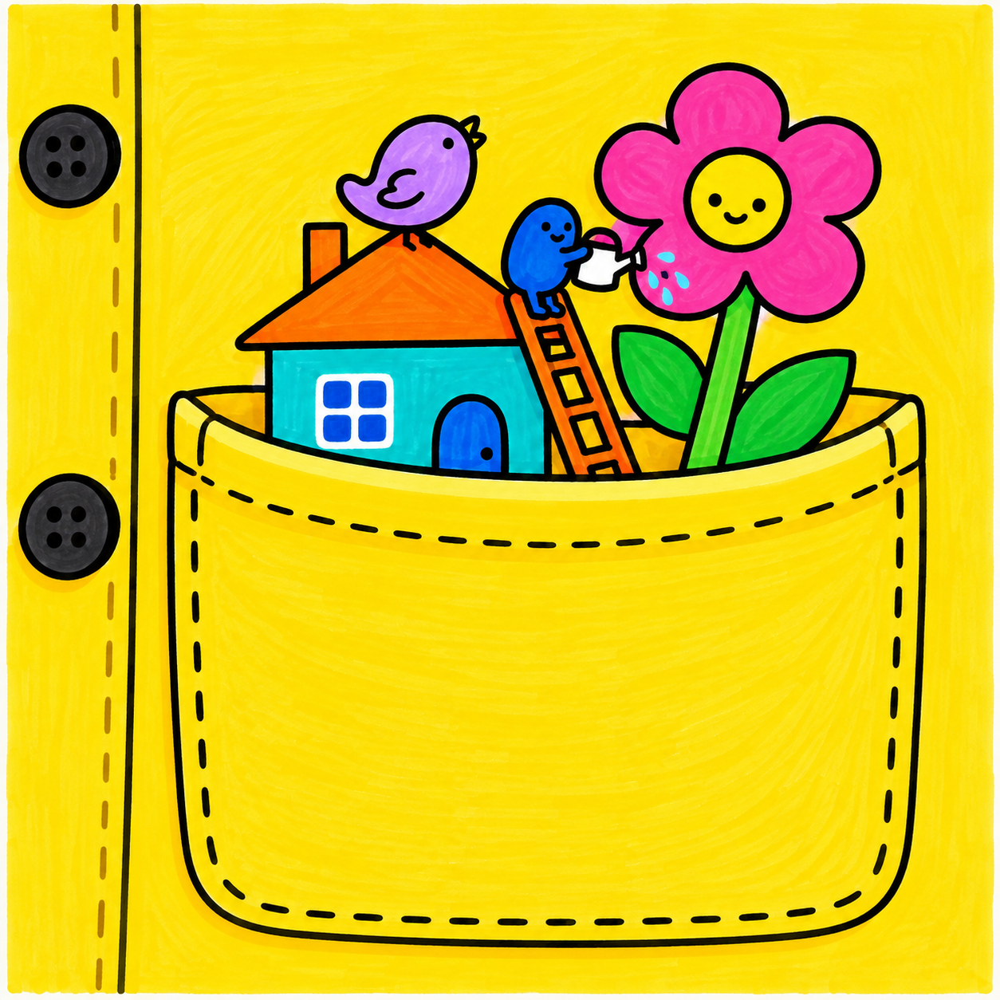

# S001-025｜口袋里的春天

> **配色待校正：** 本课成品与教学图尚未通过实笔色卡核对，图内色号、色名和填色不能直接作为用笔依据。造型步骤保留；问题详见[36色色卡与28课审查](../../docs/color-audit-2026-11-01.md)。

[全部教案](../README.md) · [本阶段](README.md) · [S001风格](../../styles/001-playful-color-block.md)

**D4 自主创作 · 自主任务 · 预计整幅约100分钟**

先修：已能组织多物件的主次与遮挡、选色并规划留白；先完成D3复盘，或有相同能力。

主要目标：**自主组织尺度、布料开口与前后遮挡**。

计划时间包括试色、起稿、上色和检查，不含额外干燥等待，不登记为实际用时。可按每次20～30分钟分次：先完成草图与留白，再分批上色，最后干透后勾线。

## 纸笔与画面大小

使用16.5×16.5厘米马克笔专用纸，纸下垫废纸；本课主体约12～13厘米，四周留白。普通铅笔轻定位，0.5mm针管笔收轮廓，0.15mm用于少量细节，1.0mm外轮廓可选。

使用Touchmark学生36色油性马克笔。针管笔耐酒精性未知时统一先上色，完全干透后勾线。大块白形留纸白，132不当覆盖白笔或混色笔；白色高光工具仅可选，需先试效果，本课不依赖。

## 色号与区域

| 色号 | 本套色名 | 计划区域 |
| --- | --- | --- |
| 35 | Lemon Yellow | 口袋前片（旧配色，待校正） |
| 68 | Turquoise Blue | 小屋墙面 |
| 23 | Orange | 屋顶与梯子 |
| 6 | Vivid Pink | 花瓣 |
| 44 | Fresh Green | 叶片 |
| 52 | Deep Green | 较深叶片 |
| 75 | Dark Blue Light | 小角色与门 |
| 82 | Light Violet | 小鸟或花细节 |
| 31 | Dark Yellow | 袋口内侧 |
| 37 | Pastel Yellow | 衣服浅分面 |

AI图颜色仅近似实物。先在废纸试色，以此表为准；同色深浅只允许在完全干后小面积轻叠，不依赖浅色覆盖深色。D4可自行替换为本套已有色号并记录，保持主次和冷暖关系，单幅不超过10色。

## 先练3～5分钟

画口袋开口的弧线和外口沿，再画伸出开口的圆柱，擦去口袋前片遮住的底部。

## 留纸白

窗格、浇水壶与少量花瓣可留纸白，缝线可最后用黑细虚线完成。

## 自主任务

在衣服口袋里设计一个小世界，口袋必须先被识别为缝在衣服上的布袋，再表现里面的春天。

- 两版缩略稿改变口袋里主要建筑或植物的位置
- 保留衣服门襟、纽扣等上下文
- 袋口有厚度，袋内物体被前片遮住一部分

先完成自己的两张小构图，再查看示例；示例不作为唯一答案。

## 构图与结构提示

四格分别为两版构图、正式铅笔稿、配色留白与局部结构检查；它们对应下方多个操作环节，不代表整幅只需四步。

图文检查说明：37是Pastel Yellow浅黄，不是紫色；44为Fresh Green，52为Deep Green。以正文色号和实际试色为准。图04为口袋结构局部，正式画需保留门襟与纽扣上下文。

## 10个操作环节

### 01 确定小世界主题

选春天的一件活动，例如给花浇水，不把所有季节符号放进同一口袋。

### 02 比较两版草图

分别试小屋靠左与靠右，角色动作朝向口袋中心；先不画细缝线。

### 03 建立衣服上下文

在口袋旁安排衣服门襟和两颗纽扣，让袋体明确附着在衣服上。

### 04 画出袋口

袋口用前后两条弧线和窄内侧构成，前片从弧线下接出。它不是独立的碗，也不画餐桌支撑。

### 05 安排袋内遮挡

建筑与花茎的底部被前片挡住，梯脚也藏在袋内；保留顶端与角色动作。

### 06 正式铅笔稿与纸白

放大到约12厘米，窗格和浇水壶预留白，花瓣先定位再上色。

### 07 衣服大色块

37轻涂衣服浅区，35涂口袋前片，31涂窄袋内侧；前后只需平涂分面，不用写实渐变。

### 08 小世界主体

68涂屋墙，23涂屋顶和梯子，6涂花瓣，44与52分配叶，75涂门或角色，82点小鸟。

### 09 干透后结构线

先勾袋口与前片，再勾里面物体的可见轮廓，最后加疏朗缝线和纽扣。不要把隐藏物体底部画透。

### 10 缩小检查辨识

缩小看是否先认出衣服口袋，再看见春天。若像容器，强化门襟纽扣，减少口沿的碗状厚边。

## 常见问题

口袋又像碗：补足门襟和纽扣，袋体两侧贴着衣服，袋口弧度不夸张成圆碗口；保留缝线而非独立碗底。

## 完成检查

- 口袋附着在衣服而非摆在桌上
- 袋内物体底部被前片遮挡
- 有自己的布局选择而非只换色

## 换题迁移

换成口袋里的秋天，只改变袋内主体与配色，保持口袋结构。

本页小草图与局部试练不另算一幅完成作品。只有实际画完正式作品后才登记；日期、照片、用时与反馈可省略。每阶段7幅后结合实际能力复盘，需要巩固再补练，不自动晋级。

成品示例：完成自己的草图后再展开

## 来源

成品与教学提示图为AI生成示意，使用OpenAI内置imagegen；不计实际手绘完成。

[本课提示词与检查说明](../../entries/independent/025-spring-in-a-pocket/reference/generation-prompts.json) · [基础学习资料](../../docs/learning-references.md) · [完整进阶规则](../../docs/learning-system.md)
