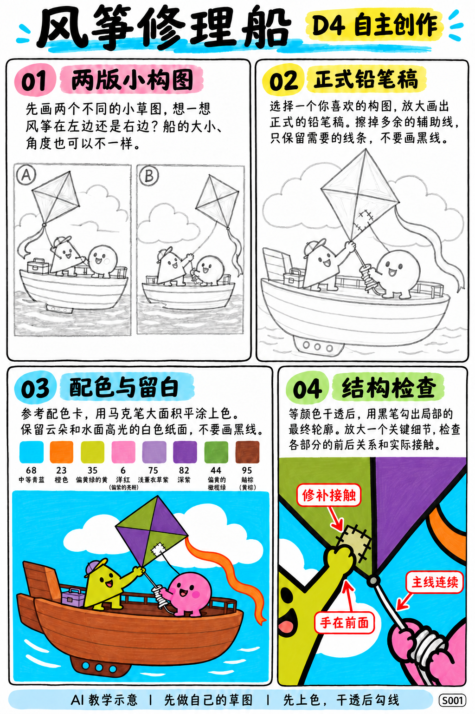
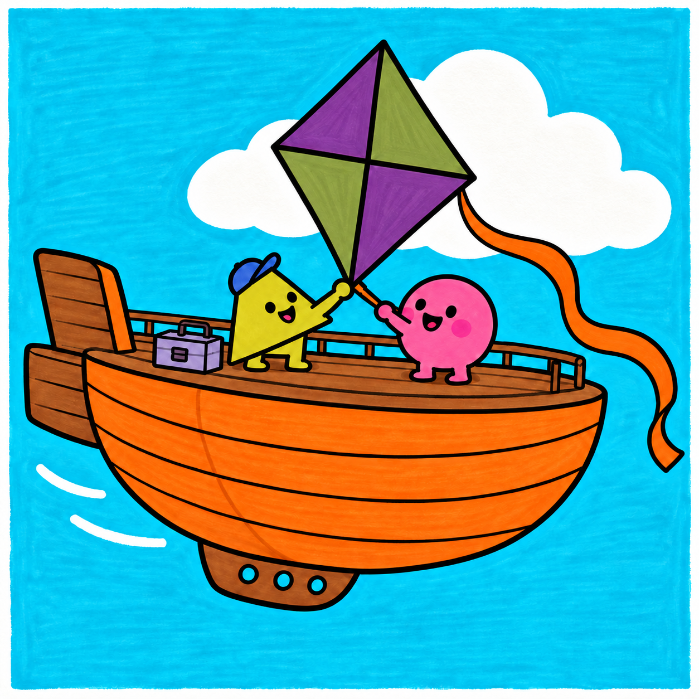

# S001-026｜风筝修理船

> **配色已修订：** 成品、教学图与正文按实涂色卡的相对色相重新配套；浅色以同纸单层试色为准，屏幕图不作精确色值。旧图只作历史留存。

[全部教案](../README.md) · [本阶段](README.md) · [S001风格](../../styles/001-playful-color-block.md)

**D4 自主创作 · 自主任务 · 预计整幅约95分钟**

先修：已能组织多物件的主次与遮挡、选色并规划留白；先完成D3复盘，或有相同能力。

主要目标：**围绕想象主题自行设计主体、动势与道具关系**。

计划时间包括试色、起稿、上色和检查，不含额外干燥等待，不登记为实际用时。可按每次20～30分钟分次：先完成草图与留白，再分批上色，最后干透后勾线。

## 纸笔与画面大小

使用16.5×16.5厘米马克笔专用纸，纸下垫废纸；本课主体约12～13厘米，四周留白。普通铅笔轻定位，0.5mm针管笔收轮廓，0.15mm用于少量细节，1.0mm外轮廓可选。

使用Touchmark学生36色油性马克笔。针管笔耐酒精性未知时统一先上色，完全干透后勾线。大块白形留纸白，132不当覆盖白笔或混色笔；白色高光工具仅可选，需先试效果，本课不依赖。

## 色号与区域

| 色号 | 本套色名 | 计划区域 |
| --- | --- | --- |
| 68 | 中等青蓝 | 水面 |
| 23 | 橙色 | 船体与风筝尾 |
| 35 | 偏黄绿的黄色 | 角色 |
| 6 | 洋红、偏紫的亮粉 | 另一角色 |
| 75 | 浅薰衣草紫 | 远处船内小物 |
| 82 | 较深紫色 | 风筝一面 |
| 95 | 赭棕、黄棕 | 木纹暖色 |
| 44 | 偏黄的橄榄绿 | 风筝另一面 |

AI图颜色仅近似实物。先在废纸试色，以此表为准；同色深浅只允许在完全干后小面积轻叠，不依赖浅色覆盖深色。D4可自行替换为本套已有色号并记录，保持主次和冷暖关系，单幅不超过10色。

## 先练3～5分钟

画一个菱形风筝，用十字骨架连接四角，再用一条柔软曲线把它连到手边线轴。

## 留纸白

云、水面亮线和船沿少量亮边提前留纸白，不靠白笔覆盖。

## 自主任务

设计一艘为风筝提供修理服务的小船，画出一个明确的修理动作和一个连贯的牵线关系。

- 两张缩略稿比较风筝高低与船体大小
- 风筝线只能有一条主路线，不能缠绕脸部
- 船沿、船内人物和水面前后清楚

先完成自己的两张小构图，再查看示例；示例不作为唯一答案。

## 构图与结构提示

四格分别为两版构图、正式铅笔稿、配色留白与局部结构检查；它们对应下方多个操作环节，不代表整幅只需四步。

图文检查说明：本课要求自己补出工具或补丁与风筝的接触；成品例图只说明主题与风格。构图提示图的线可按自己的方案调整，不照抄绳线数量。

## 10个操作环节

### 01 确定修理动作

选补洞、整理线或检查风筝骨架的一种，让工具与风筝真的接触。

### 02 两版缩略稿

试风筝在左上或右上，留足尾带空间，船体维持稳定水平。

### 03 安排牵线动势

用一条曲线把风筝连到手或线轴，避开角色面部与船沿混线的位置。

### 04 画船体结构

先画船沿长椭圆与下方弧形船身，再安排船内人物。人物下半身被船沿挡住。

### 05 正式铅笔稿

风筝菱形、骨架、尾带和船上小物逐项加上；最多保留两件修理工具。

### 06 试色与留白

云和水亮线提前留白。试风筝44、82两面能否区分，必要时换成本套其他现有色号并记录。

### 07 环境与船体

68涂水，23涂船身和尾带，95少量画木纹；一遍排笔即可，不为纹理反复重涂。

### 08 角色与风筝

35和6涂角色，75涂小物，44与82涂风筝分面。两面的分界线应沿骨架。

### 09 干透后连接线

勾船沿、手和工具，再画一条连贯风筝线，尾带不与主线混成同一根。

### 10 自查服务情节

看得出哪只手在修、修哪里；若只像乘船放风筝，增加工具接触点而非装饰文字。

## 常见问题

像普通划船：把补丁或工具放到风筝破损处，修理者的手直接参与，减少与主题无关的船饰。

## 完成检查

- 风筝线从手或线轴连续连到风筝
- 船沿挡住人物下半身
- 修理工具有明确接触点

## 换题迁移

保留船与角色，改为更换风筝尾带，另画一张小草图。

本页小草图与局部试练不另算一幅完成作品。只有实际画完正式作品后才登记；日期、照片、用时与反馈可省略。每阶段7幅后结合实际能力复盘，需要巩固再补练，不自动晋级。

成品示例：完成自己的草图后再展开

## 来源

成品与教学提示图为AI生成示意，使用OpenAI内置imagegen；不计实际手绘完成。

[本课提示词与检查说明](../../entries/independent/026-kite-repair-ship/reference/generation-prompts.json) · [基础学习资料](../../docs/learning-references.md) · [完整进阶规则](../../docs/learning-system.md)

[本次配色修订提示词与核对](../../entries/independent/026-kite-repair-ship/reference/color-revision-v5.json)
