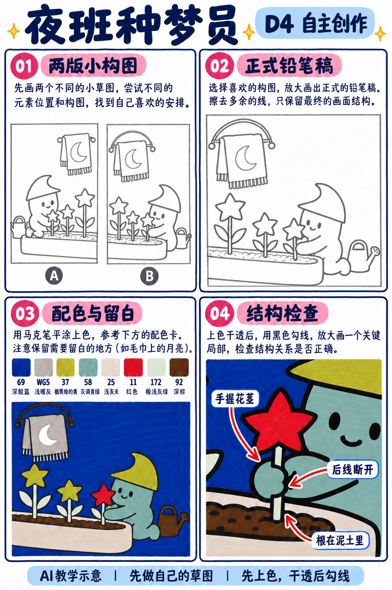

# S001-027｜夜班种梦员

> **配色已修订：** 成品、教学图与正文按实涂色卡的相对色相重新配套；浅色以同纸单层试色为准，屏幕图不作精确色值。旧图只作历史留存。

[全部教案](../README.md) · [本阶段](README.md) · [S001风格](../../styles/001-playful-color-block.md)

**D4 自主创作 · 自主任务 · 预计整幅约90分钟**

先修：已能组织多物件的主次与遮挡、选色并规划留白；先完成D3复盘，或有相同能力。

主要目标：**自主建立视觉母题与有节奏的画面组织**。

计划时间包括试色、起稿、上色和检查，不含额外干燥等待，不登记为实际用时。可按每次20～30分钟分次：先完成草图与留白，再分批上色，最后干透后勾线。

## 纸笔与画面大小

使用16.5×16.5厘米马克笔专用纸，纸下垫废纸；本课主体约12～13厘米，四周留白。普通铅笔轻定位，0.5mm针管笔收轮廓，0.15mm用于少量细节，1.0mm外轮廓可选。

使用Touchmark学生36色油性马克笔。针管笔耐酒精性未知时统一先上色，完全干透后勾线。大块白形留纸白，132不当覆盖白笔或混色笔；白色高光工具仅可选，需先试效果，本课不依赖。

## 色号与区域

| 色号 | 本套色名 | 计划区域 |
| --- | --- | --- |
| 69 | 深靛蓝 | 夜空 |
| WG5 | 浅暖灰、灰米调 | 挂布 |
| 37 | 黄绿色，非奶油浅黄 | 帽子与星花 |
| 58 | 灰调青绿，非浅薄荷绿 | 角色 |
| 25 | 很浅的灰米色、灰肤色 | 花槽 |
| 11 | 红色 | 焦点红花 |
| 172 | 极浅灰绿 | 叶与茎 |
| 92 | 深棕 | 泥土与水壶 |

AI图颜色仅近似实物。先在废纸试色，以此表为准；同色深浅只允许在完全干后小面积轻叠，不依赖浅色覆盖深色。D4可自行替换为本套已有色号并记录，保持主次和冷暖关系，单幅不超过10色。

## 先练3～5分钟

画三棵星花，高、中、低排列；再画一只手抱住花茎，茎的线在手里中断。

## 留纸白

挂布月牙和少量星点留纸白；发光不依赖白笔或复杂渐变。

## 自主任务

把种植与梦境结合，自主设计一个夜间种梦的动作；让星形植物成为重复母题。

- 两张草图比较主角靠左或靠右
- 只选一种重复母题并变化高低疏密
- 角色手、花与花槽的接触顺序清楚

先完成自己的两张小构图，再查看示例；示例不作为唯一答案。

## 构图与结构提示

四格分别为两版构图、正式铅笔稿、配色留白与局部结构检查；它们对应下方多个操作环节，不代表整幅只需四步。

## 10个操作环节

### 01 确定种梦动作

选择种下一朵、抱着一朵或给星花浇水，写清动作对象。

### 02 两版缩略稿

主角左右各试一版，挂布或小标志放对角，不抢走花的焦点。

### 03 设计重复节奏

三朵花高低错开，中间留一处空隙；焦点花可用不同颜色，但外形属于同一母题。

### 04 建立接触关系

手围住花茎或托住花盆，茎根插入泥土，花槽前沿遮住底部。

### 05 正式铅笔稿

角色、花槽和挂布用简单大形，水壶作为次要物缩小；删去过密叶片。

### 06 试色与留白

月牙留纸白，试69夜空、58角色与25花槽对比；不照图强加光晕。

### 07 主体浅色

58涂角色，37涂帽与星花，25涂花槽，11涂焦点红花。

### 08 环境与小物

69涂夜空，WG5涂挂布，172涂叶茎，92涂土与壶，绕开月牙。

### 09 干透后强调

先勾抱花的手与前景花，再勾挂布细线，星花轮廓保持清楚，不画满小星点。

### 10 自查母题与故事

数出一种形状的重复与变化，并说明哪朵是故事焦点。减少一片叶看画面是否更安静。

## 常见问题

只有星星装饰没有种植感：让花茎插进泥土，手真实抱住或栽种，花槽前沿挡住根部。

## 完成检查

- 重复形状有高低与疏密变化
- 手、花茎、泥土有接触关系
- 夜景靠色块对比而非复杂光晕

## 换题迁移

同一母题换成月牙植物，先确认动作和主次仍然可读。

本页小草图与局部试练不另算一幅完成作品。只有实际画完正式作品后才登记；日期、照片、用时与反馈可省略。每阶段7幅后结合实际能力复盘，需要巩固再补练，不自动晋级。

成品示例：完成自己的草图后再展开

## 来源

成品与教学提示图为AI生成示意，使用OpenAI内置imagegen；不计实际手绘完成。

[本课提示词与检查说明](../../entries/independent/027-night-dream-gardener/reference/generation-prompts.json) · [基础学习资料](../../docs/learning-references.md) · [完整进阶规则](../../docs/learning-system.md)

[本次配色修订提示词与核对](../../entries/independent/027-night-dream-gardener/reference/color-revision-v5.json)
