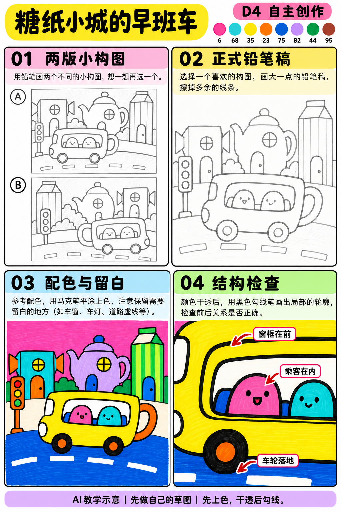
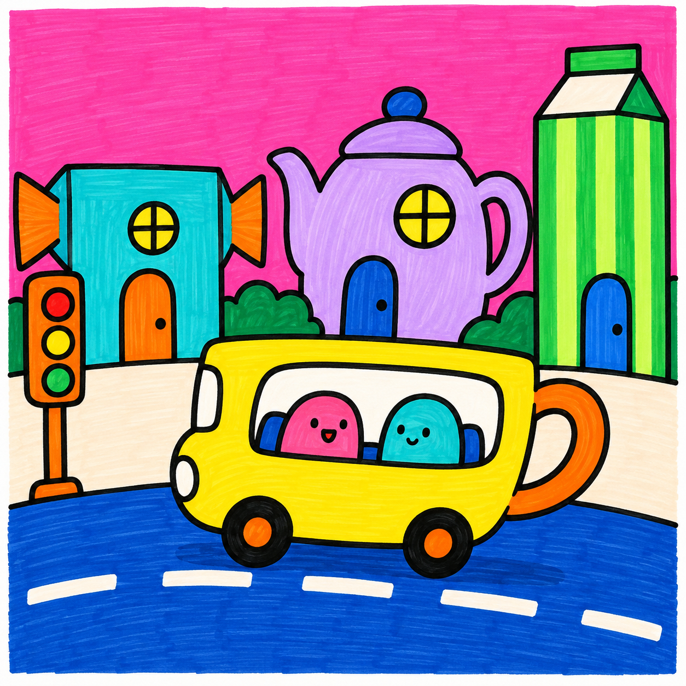

# S001-028｜糖纸小城的早班车

[全部教案](../README.md) · [本阶段](README.md) · [S001风格](../../styles/001-playful-color-block.md)

**D4 自主创作 · 自主任务 · 预计整幅约105分钟**

先修：已能组织多物件的主次与遮挡、选色并规划留白；先完成D3复盘，或有相同能力。

主要目标：**综合主题设定、系列配色、主次与空间取舍**。

计划时间包括试色、起稿、上色和检查，不含额外干燥等待，不登记为实际用时。可按每次20～30分钟分次：先完成草图与留白，再分批上色，最后干透后勾线。

## 纸笔与画面大小

使用16.5×16.5厘米马克笔专用纸，纸下垫废纸；本课主体约12～13厘米，四周留白。普通铅笔轻定位，0.5mm针管笔收轮廓，0.15mm用于少量细节，1.0mm外轮廓可选。

使用Touchmark学生36色油性马克笔。针管笔耐酒精性未知时统一先上色，完全干透后勾线。大块白形留纸白，132不当覆盖白笔或混色笔；白色高光工具仅可选，需先试效果，本课不依赖。

## 色号与区域

| 色号 | 本套色名 | 计划区域 |
| --- | --- | --- |
| 6 | Vivid Pink | 背景与部分建筑 |
| 68 | Turquoise Blue | 车窗与建筑 |
| 35 | Lemon Yellow | 公交车 |
| 23 | Orange | 屋顶或门 |
| 75 | Dark Blue Light | 道路 |
| 82 | Light Violet | 部分建筑 |
| 44 | Fresh Green | 植物 |
| 95 | Burnt Sienna | 少量暖色细节 |

AI图颜色仅近似实物。先在废纸试色，以此表为准；同色深浅只允许在完全干后小面积轻叠，不依赖浅色覆盖深色。D4可自行替换为本套已有色号并记录，保持主次和冷暖关系，单幅不超过10色。

## 先练3～5分钟

用圆、长方和三角分别做三个建筑剪影，再用同一种窗形把它们统一起来。

## 留纸白

云、车窗亮部、车灯与道路标线提前留纸白；小招牌不必写字。

## 自主任务

设计糖纸小城的一次早班车，用一种形状或配色规则统一建筑与车辆，保留清楚的行驶路线。

- 两张不同城市布局的缩略稿
- 建筑最多3～4栋，避免每栋都成为主角
- 公交车、乘客、路面之间的尺度与遮挡清楚

先完成自己的两张小构图，再查看示例；示例不作为唯一答案。

## 构图与结构提示

四格分别为两版构图、正式铅笔稿、配色留白与局部结构检查；它们对应下方多个操作环节，不代表整幅只需四步。

## 10个操作环节

### 01 设定城市规则

选一种重复规则，例如圆窗与折纸屋顶，写成一句话，后续建筑都服从它。

### 02 两版城市草图

试车在前景偏左或偏右，楼群错落而非整齐一排；保留车前行驶空间。

### 03 选择焦点

车为主角，建筑只留3～4栋。挑一栋最有趣的建筑，其余减少窗和装饰。

### 04 道路与尺度

路面放下方，公交车轮落地，远建筑底部被车或植物遮住；车内乘客明显小于车窗。

### 05 正式铅笔稿

按楼群、车体、乘客、细节的顺序画，前景车挡住后方楼的线要擦掉。

### 06 小色稿与留白

用6、68、35、23、75、82、44、95做小色稿，不超过10色。道路标线、云和车灯先留白。

### 07 建筑大色块

68和82分配主要建筑，23和35给小屋顶或门，44用于少量植物；同一色在不同位置呼应。

### 08 车辆与道路

35涂车身，68涂窗，6涂背景和一位乘客，75涂道路，95用于小暖细节。窗和乘客分开留边。

### 09 干透后主次线

车外轮廓较粗，楼群内窗线较细，最后画乘客表情与路标；不要所有边都勾得一样重。

### 10 删减与系列复盘

缩小看车是否第一眼可见，删除一项装饰。对照D1第一幅，说明自己已能决定的构图、配色和遮挡。

## 常见问题

像不同贴纸拼一起：统一一种窗形或屋顶角度，并让相邻建筑互相遮挡；减少色块种类比添加细节更有效。

## 完成检查

- 能说出一条城市视觉规则
- 车与乘客尺度合理且轮子落地
- 道路标线留白且车前有行驶空间
- 能说明至少一处自主删减

## 换题迁移

用同一城市规则设计晚班车的小色稿，改变环境冷暖但保留识别特征。

本页小草图与局部试练不另算一幅完成作品。只有实际画完正式作品后才登记；日期、照片、用时与反馈可省略。每阶段7幅后结合实际能力复盘，需要巩固再补练，不自动晋级。

成品示例：完成自己的草图后再展开

## 来源

成品与教学提示图为AI生成示意，使用OpenAI内置imagegen；不计实际手绘完成。

[本课提示词与检查说明](../../entries/independent/028-candy-wrapper-town-bus/reference/generation-prompts.json) · [基础学习资料](../../docs/learning-references.md) · [完整进阶规则](../../docs/learning-system.md)
