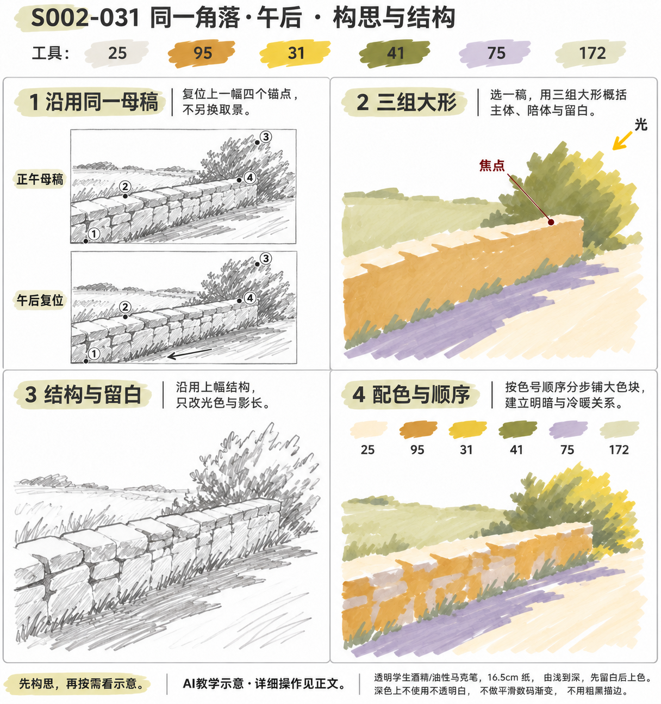
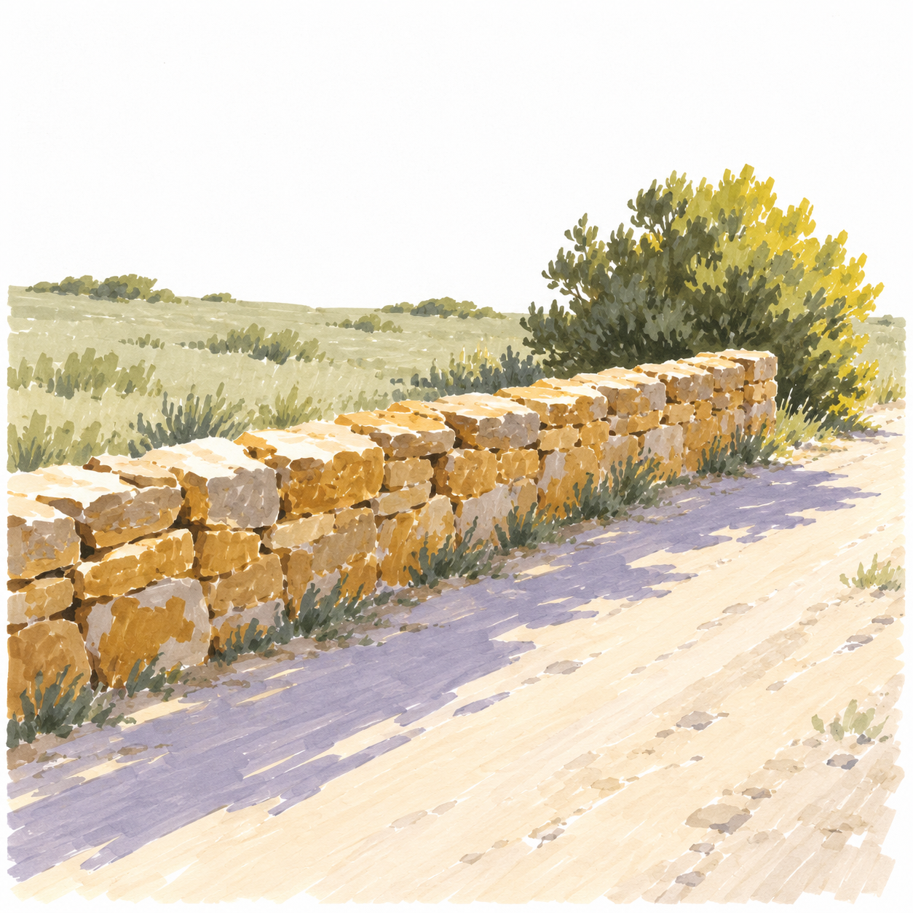

# S002-031 同一角落·午后

[S002本阶段入口](S002-README.md) · [28课节奏总览](../../styles/previews/S002-28-2026-11-02/README.md) · [风格档案](../../styles/002-sunlit-brushstroke-landscape.md)

- 风格与等级：S002 晴日笔触风景 · D4 自主创作。
- 主要目标：同构图中自主改变光色与投影。
- 教学帮助：自主练习，配详细决策与操作支架；需要逐笔帮助时可以进一步补专项示意。
- 先修能力：能基本组织主次、远近与光向；本课自主决策多，可以按需增加帮助，不以细节多少判断等级。
- 画幅：16.5厘米方形马克笔纸，画面约11～13厘米，四周留至少1厘米纸白；植物叶触通常约3～7毫米，不要求复制缩小后难辨认的微细纹理。
- 整幅预计：约75～120分钟；这是教学估计，不是实际用时。
- 当前状态：教案与帮助图已备，待实际练习。全部图片为AI示意，不是真实手绘。

## 分次与停笔位置

建议三次：主题与两张小稿约20～30分钟；按自定顺序铺色约35～45分钟；干后调整、比较与复盘约20～35分钟。构思需要更多时间时另加，不限于单次预算。

暂停时盖好笔帽，等颜色完全干再合本；恢复后先看最后一个检查点，再继续下一环节，不重复重刷所有旧区域。

## 工具、色号与区域分工

铅笔、橡皮、Touchmark学生36色油性马克笔，纸下垫隔墨废纸；针管笔为可选结构工具。笔头形状未确认时，先用现有笔的侧面或轻压试出宽窄，不要求另购画笔。

| 色号 | 当前实涂照片观察 | 本课用途 |
| --- | --- | --- |
| 25 | 很浅的灰米色、灰肤色（照片观察） | 铺浅地与墙顶 |
| 95 | 赭棕、黄棕（照片观察） | 只改光色方案、铺暖墙和叶群、收墙缝与叶暗 |
| 31 | 偏芥末的黄色（照片观察） | 只改光色方案、铺暖墙和叶群 |
| 41 | 较深橄榄绿（照片观察） | 收墙缝与叶暗 |
| 75 | 浅薰衣草紫（照片观察） | 只改光色方案、画长浅紫影 |
| 172 | 极浅灰绿（照片观察） | 铺浅地与墙顶 |

先在同种废纸上画每色小块和一组浅底叠深色，干后再比较。照片与AI图只支持近似色系；25是极浅灰米、172是极浅灰绿、75是浅紫、82是较深紫，不能按旧英文名猜色。示意中同一色的笔痕明暗不必逐块另配色，不为追求屏幕色反复湿叠。

本课区域色号以本表及步骤为操作依据，黑色细线不算大面积配色。浅色不能盖回深色；132不是覆盖白，白色高光笔的覆盖能力未验证，均不列为必须工具。白云、亮花、反光与重要亮边提前留纸白。

## 结构难点：先在废纸弄清再上色

沿用上幅母稿，只改光色与影长；AI预览有细小取景差异，实际练习不能随之移动主体。

用铅笔在废纸缩小画一次关键结构，只要轮廓、开口、支撑或遮挡能解释清楚即可。看不懂时先停在此处；不要靠增加阴影、草叶或黑轮廓掩盖错误。

## 准备：三分钟试笔

1. 一笔轻压拖出宽触，再逐渐提起形成尖端；用较少笔触保留自然方向，避免规则圆团或外圈深点。
2. 两个浅色小块干后分别加深一小段，观察是否变脏、渗开或不易区分；不满意就缩小叠色面积。
3. 擦淡正式画面内的铅笔线，试一下橡皮是否会带走湿墨。针管笔兼容性未知时一律先上色、完全干透后才局部勾线。

## 详细操作

先完成下面的主题、小稿与配色决定，再按需展开后面的示意。步骤提供可执行路径，主体位置、配色取舍与删减由自己决定。

### 1. 沿用上一张母稿

**工具与区域：** 铅笔。

拿出正午作品的缩略图，先复位地平线、墙前角、墙远端、灌木顶四点；不新增树、房子或路岔。

**操作节奏：** 先轻画或单层落笔。每做完一小区域就离开观察，不为消除接笔痕持续来回摩擦。

**这一环节检查：** 四个锚点与上张一致，物件没有漂移。

### 2. 只改光色方案

**工具与区域：** 31、75、95。

废纸试暖黄受光与浅紫投影的搭配，写明与正午版相比只改变光向、光色和影长。

**操作节奏：** 若前层仍发亮或手边同纸试色摸着发凉潮湿，先停笔。等待以实际干燥为准，通常至少留几分钟；时间到但仍湿就继续等。

**这一环节检查：** 变化不依靠增加细节或更换地点。

### 3. 标长影与来光

**工具与区域：** 铅笔。

把光设在右上较低处，墙脚影向左下拉长；让影顺地面走，不跨越墙顶发出。

**操作节奏：** 先轻画或单层落笔。每做完一小区域就离开观察，不为消除接笔痕持续来回摩擦。

**这一环节检查：** 投影从墙脚接出，长影与母稿道路相容。

### 4. 规划亮边与影区

**工具与区域：** 铅笔。

墙顶和灌木受光边提前留浅，长影内可留少量地面断口，但不画一堆叶形小洞。

**操作节奏：** 先轻画或单层落笔。每做完一小区域就离开观察，不为消除接笔痕持续来回摩擦。

**这一环节检查：** 亮部和影区在铺色前已经分开。

### 5. 铺浅地与墙顶

**工具与区域：** 172、25。

172浅地、25路和墙顶；若天空想留白，可全部不涂，不为凑齐色号硬加颜色。

**操作节奏：** 先轻画或单层落笔。每做完一小区域就离开观察，不为消除接笔痕持续来回摩擦。

**这一环节检查：** 与正午版取景相同，画面更暖但不更脏。

### 6. 铺暖墙和叶群

**工具与区域：** 95、31。

95单层墙面，31少量搭灌木受光叶和暖地色；在同纸试色中31是芥末黄，不是荧光亮黄。

**操作节奏：** 先轻画或单层落笔。每做完一小区域就离开观察，不为消除接笔痕持续来回摩擦。

**这一环节检查：** 暖色成组，墙顶窄亮边仍清楚。

### 7. 画长浅紫影

**工具与区域：** 75。

前层全干后，沿地面用浅紫平涂长影，接墙处略窄深、远端边界简；每段只刷一遍。

**操作节奏：** 若前层仍发亮或手边同纸试色摸着发凉潮湿，先停笔。等待以实际干燥为准，通常至少留几分钟；时间到但仍湿就继续等。

**这一环节检查：** 影长明显不同于上张，且全片统一光向。

### 8. 收墙缝与叶暗

**工具与区域：** 95、41。

95少量加墙侧暗，41在灌木背光处点小组，不把全部植物压暗；远石缝继续省略。

**操作节奏：** 先轻画或单层落笔。每做完一小区域就离开观察，不为消除接笔痕持续来回摩擦。

**这一环节检查：** 暖亮、冷影、叶暗三组能分开。

### 9. 并排比较两张

**工具与区域：** 笔记。

把正午与午后并排，检查四锚点、影长、暖冷和主体数量；若构图漂移，记录下次先固定哪一点。

**操作节奏：** 先轻画或单层落笔。每做完一小区域就离开观察，不为消除接笔痕持续来回摩擦。

**这一环节检查：** 能把时间变化与构图变化区分开。

### 10. 系列复盘

**工具与区域：** 橡皮、笔记。

全干后各写一句两张的光线特点。AI两张石块有细节变化，不作为精确描摹标准；以自己的同一母稿为准。

**操作节奏：** 若前层仍发亮或手边同纸试色摸着发凉潮湿，先停笔。等待以实际干燥为准，通常至少留几分钟；时间到但仍湿就继续等。

**这一环节检查：** 系列有明确共同点与受控变量。

## 帮助图与成品示意

已完成自己的小稿后，按需展开构思与结构帮助

完成自主构思后，再查看一种成品解法

## 可以省略什么，哪些不能省

可以省略示意中的细碎草尖、远树枝叶、木纹、石裂和小装饰；保留主要色块与本课主要目标即可。不能省掉主体连接、开口厚度、接地、主要遮挡、光向判断和上深色前的干燥等待。

## 出错时怎么处理

| 现象 | 先检查 | 当前能做的调整 |
| --- | --- | --- |
| 植物成了整齐色球或一圈深点 | 是否先把自然边界画成圆、暗点平均分布 | 停止描边；下一处用长短不等的独立叶触与纸白缺口。本课不要求规则对称 |
| 细节太密看不清主体 | 是否每一处都追画示意 | 当下停止加笔；先在废纸画删去一半细节的小稿，再决定下张怎么改 |
| 深色发脏或浅色盖不回去 | 是否湿底上反复刷、想用浅色覆盖深色 | 等干后只补必要深处，保留误差；大面积错误另画小稿，不用132补白 |
| 物件悬空或透视不合理 | 支撑、口沿、接触面及被挡住的线 | 先用铅笔另画结构解释，必要时重做局部练习，不用草叶遮盖 |
| 光影方向互相打架 | 主体暗侧、地面影与来光箭头 | 以最初光向为准检查，不再加第二个方向的影；大改留到下一版 |
| 马克笔洇出边界 | 是否纸太湿、边缘反复停留 | 停笔等干，之后在边界内侧提笔；不要补一圈粗黑线修边 |

## 完成检查与记录

1. 指出本课主要目标在画面中的位置，用一句话说明自己怎么做到。
2. 大形、连接、遮挡、接地和主要留白都可读；暗色与细节没有淹没主体。
3. 光向与前后层次一致；可以明确指出一处主动保留的空隙和一处主动省掉的细节。
4. 只在实际画完并确认后记录完成。照片、实际用时和文字复盘可省略；没有信息就留空，不把预计时间当实际时间。

每阶段七幅实际完成后结合能力回看，需要时补2～3幅针对性练习；不按生成数量自动晋级。D4主线后仍可持续自主创作。

## 来源与示意边界

内置imagegen生成的原创晴日笔触风景成品与关键教学图；生成提示词见本作品reference/generation.json。关键图服务构图、顺序、结构和大色块，AI细节可能概括变化，不要求逐笔复制。配色以现有工具实涂照片的相对色系和同纸试色为准，未作精确色度校准或实笔完成验证。
