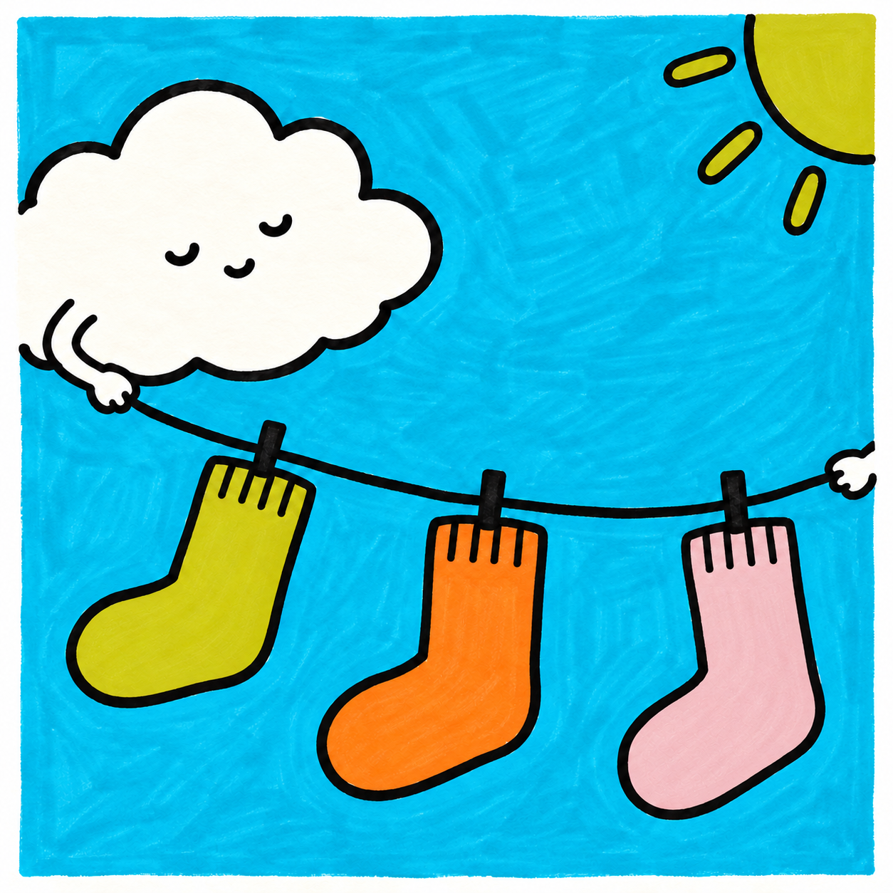
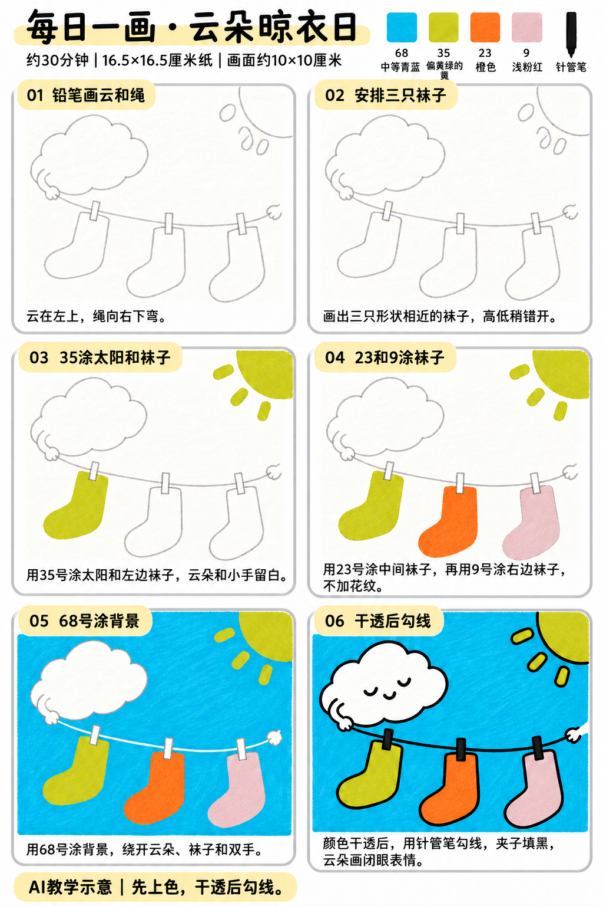

# S001-011｜云朵晾衣日 · D2专项控制

> **配色已修订：** 成品、教学图与正文按实涂色卡的相对色相重新配套；浅色以同纸单层试色为准，屏幕图不作精确色值。旧图只作历史留存。

**阶段与教学方式：D2专项控制 · 提示练习。**

先修：已能概括大形、基本平涂与留纸白；先完成D1复盘，或能独立达到相同能力。

本课主要目标：控制重复形状的疏密与节奏。预计整幅约45分钟，可分两次：先完成小练习与铅笔稿，另一次上色、干透后勾线；干燥等待另计。

先做3～5分钟专项：只用六条短线表示衣物，比较等距与疏密两种节奏，选有一处留空的布局。

检查重点：衣物重复但大小和间距有变化；绳子受两端支撑，夹子与衣物接触。 先自主起稿，遇到困难再看下方原有六格造型示意；不要求逐格照描。

[全部教案](../README.md) · [入门工具](../beginner/README.md) · [S001风格](../../styles/001-playful-color-block.md) · 约45分钟 · 4色

造型提示：**用重复形状和疏密节奏安排画面**。用大形、浓郁平涂与自然手绘线完成一幅小插画。

## 成品参考

成品参考与步骤图都是AI教学示意，不计为真实练习完成。颜色仅近似，实物以纸上试色为准；具体跟画以正文顺序为准。

## 纸笔与色号

16.5×16.5厘米马克笔专用纸，画面约10×10厘米，四周留白，纸下垫废纸。铅笔轻起形，0.5mm针管笔最后勾线与填小面积黑色；0.15mm按需用于细节，1.0mm可选加粗主要外轮廓，粗勾线笔本次不必用。

| 已有Touchmark学生36色色号 | 本次用途 |
| --- | --- |
| 68 中等青蓝 | 背景 |
| 35 偏黄绿的黄色 | 太阳和左边袜子 |
| 23 橙色 | 中间袜子 |
| 9 浅粉红 | 右边袜子 |

针管笔耐酒精性未知，统一先铅笔定位、上色、完全干透后勾线。高光和白色形状提前留纸白，不把132当不透明白色或无色混色笔，不用浅色反复覆盖深色。

## 先练约3分钟

在废纸画三个相近的L形袜子，先挤在一起，再留不同间隔，比较画面节奏。试四个色块，云朵用纸白。

## 六个操作提示｜按需查看

按从左到右、从上到下阅读，灰色线视作铅笔。首格可能已展示完整浅色定位，可按标题分两步起稿；深色轮廓和眼嘴统一最后完成。首格的袜子完整定位可第二步再细画。云和小手直接留纸，不用132覆盖背景。

### 01 铅笔画云和绳

云放左上，用四五段圆弧组成；晾衣绳从左侧小手向右边弯下，再轻轻抬起。右边小手可出框，只是想象画面，不必连接写实长手臂。

### 02 安排三只袜子

绳下画三只相近的L形袜子，高低稍错开，之间留空。夹子用小长方形，先画浅铅笔线。右上太阳可以只露四分之一圆。

### 03 35涂太阳和袜子

35涂太阳、几根短光芒和左边袜子。云朵和双手一直留纸白，夹子暂不填黑。

### 04 23和9涂袜子

23填中间袜子，9填右边袜子。三只袜子不加条纹花纹，让形状重复和颜色变化形成节奏。

### 05 68号涂背景

68涂背景，绕开云、手、袜子、太阳。晾衣绳不必特意留出宽白带，最后针管笔可以直接在干透的青绿上画线；图中细白预留线也可最后盖成黑线。

### 06 干透后勾线

干透后用针管笔勾线，夹子填黑，云画两段闭眼弧线和小嘴。袜口的小竖线只画两三根或省略。

## 常见问题

三只袜子排得像僵硬的图标怎么办？轻调高低和间隔，保留相近大小；无需每只都画成完全不同的形状。

## 最后检查约2分钟

袜子的重复是否清楚，之间是否有舒服的空隙。 少量排笔痕迹可以保留，不为消除笔痕反复刷深。约45分钟为试笔、跟画与检查的计划，不含额外干燥时间，可分次完成；不作为实际用时登记。

## 来源

成品参考和六步图由OpenAI内置imagegen生成，六步教学版式采用本系列[第一课](../beginner/001-headphone-mushroom.md)。[生成提示词及检查说明](../../entries/intermediate/009-cloud-laundry/reference/generation-prompt.txt)；基础学习来源见[课程参考资料](../../docs/learning-references.md)。不要求过程拍照，实际完成后再登记，照片与用时可省略。

## 换题迁移与阶段检查

减少一件衣物，用剩余形状重新组织疏密。 只做小草图即可，不另计一幅完成作品。

完成时先不看参考，检查能否自主使用本课专项。做完本阶段7幅后结合实际作品复盘；未掌握时再补2～3幅，不按数量自动晋级。

[本次配色修订提示词与核对](../../entries/intermediate/009-cloud-laundry/reference/color-revision-v5.json)
