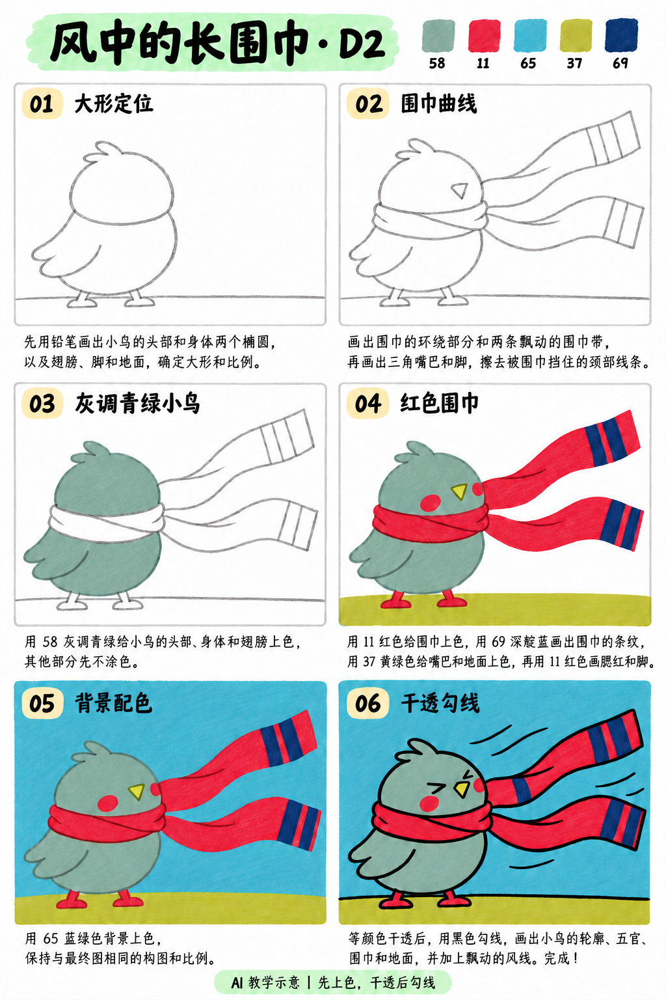
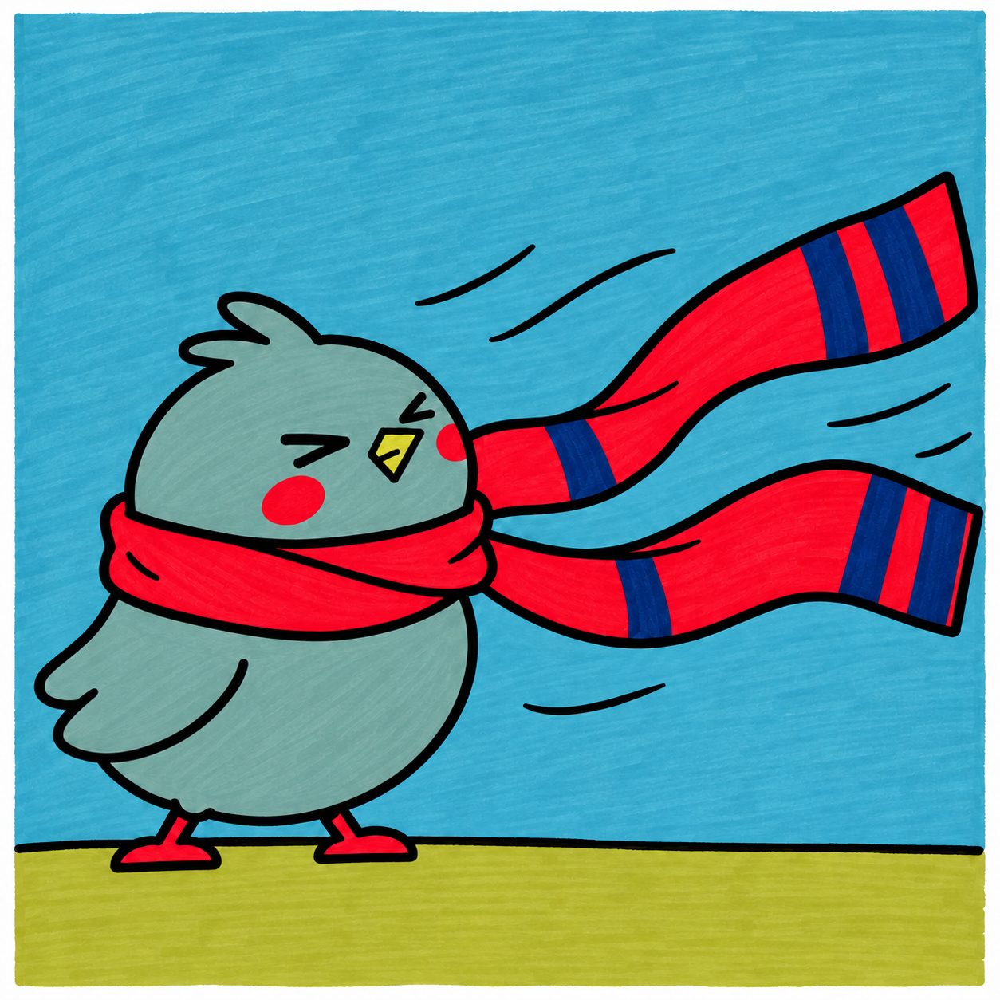

# S001-013｜风中的长围巾

> **配色已修订：** 成品、教学图与正文按实涂色卡的相对色相重新配套；浅色以同纸单层试色为准，屏幕图不作精确色值。旧图只作历史留存。

[全部教案](../README.md) · [本阶段](README.md) · [S001风格](../../styles/001-playful-color-block.md)

**D2 专项控制 · 提示练习 · 预计整幅约45分钟**

先修：已能概括大形、基本平涂与留纸白；先完成D1复盘，或能独立达到相同能力。

主要目标：**用连续曲线与线条粗细表现风向和前后**。

计划时间包括试色、起稿、上色和检查，不含额外干燥等待，不登记为实际用时。可按每次20～30分钟分次：先完成草图与留白，再分批上色，最后干透后勾线。

## 纸笔与画面大小

使用16.5×16.5厘米马克笔专用纸，纸下垫废纸；本课主体约10～11厘米，四周留白。普通铅笔轻定位，0.5mm针管笔收轮廓，0.15mm用于少量细节，1.0mm外轮廓可选。

使用Touchmark学生36色油性马克笔。针管笔耐酒精性未知时统一先上色，完全干透后勾线。大块白形留纸白，132不当覆盖白笔或混色笔；白色高光工具仅可选，需先试效果，本课不依赖。

## 色号与区域

| 色号 | 本套色名 | 计划区域 |
| --- | --- | --- |
| 58 | 灰调青绿，非浅薄荷绿 | 小鸟 |
| 11 | 红色 | 围巾、脚与脸颊 |
| 65 | 蓝绿色，非很浅冰蓝 | 大片天空 |
| 37 | 黄绿色，非奶油浅黄 | 嘴与窄地面 |
| 69 | 深靛蓝 | 围巾条纹 |

AI图颜色仅近似实物。先在废纸试色，以此表为准；同色深浅只允许在完全干后小面积轻叠，不依赖浅色覆盖深色。更换配色时仍从本套已有色号中选择，保持主次关系，并更新本课色号记录。

## 先练3～5分钟

用两条间距稳定的S形线画围巾；做向左、向右两张拇指大小的草图，选风向最清楚的一张。

## 留纸白

眼睛白点可省略，围巾与鸟之间的细缝提前留白。

## 成品与递进示意

从左到右、从上到下阅读。灰线表示铅笔，黑轮廓等颜色完全干透后再画；示意若提前出现少量五官，按正文延后。

## 6个操作环节

### 01 大形定位

鸟放左下，头与身体连成一个向风缩起的轮廓，右上留出围巾摆动的空间。轻铅笔标出落脚地面。

### 02 围巾曲线

先画围住脖子的一圈，再接两条向右伸出的长带。两条边一起转弯，避免带宽突然变窄；围巾挡住脖子处擦掉后方线。

### 03 灰调青绿小鸟

58平涂头、翅膀和身体；围巾和嘴先空着。顺着大形排笔，不用画羽毛。

### 04 红色围巾

11涂围巾、脚和脸颊，干后用69画条纹；37涂嘴和窄地面。条纹方向随围巾转弯，不能每段都垂直于纸边。

### 05 背景配色

65涂背景，绕开围巾两条长带。若细缝难控制就保留纸白，不用浅色盖深色。

### 06 干透勾线

完全干透后勾外轮廓，围巾交接处适当强调，远端线略轻。最后点眼睛和嘴，风线与围巾朝同一方向。

## 常见问题

围巾像两根木板：先在铅笔稿里把中线改成缓慢S形，再让两边保持近似等宽；不要靠加纹理补救。

## 完成检查

- 不看风线也能读出风向
- 围巾绕过脖子而非插进身体
- 条纹跟随布带的弯曲

## 换题迁移

换成向左吹，保持小鸟外形，只改变围巾与眼睛朝向。

本页小草图与局部试练不另算一幅完成作品。只有实际画完正式作品后才登记；日期、照片、用时与反馈可省略。每阶段7幅后结合实际能力复盘，需要巩固再补练，不自动晋级。

成品示例：完成自己的草图后再展开

## 来源

成品与教学提示图为AI生成示意，使用OpenAI内置imagegen；不计实际手绘完成。

[本课提示词与检查说明](../../entries/intermediate/013-windy-scarf-bird/reference/generation-prompts.json) · [基础学习资料](../../docs/learning-references.md) · [完整进阶规则](../../docs/learning-system.md)

[本次配色修订提示词与核对](../../entries/intermediate/013-windy-scarf-bird/reference/color-revision-v5.json)
