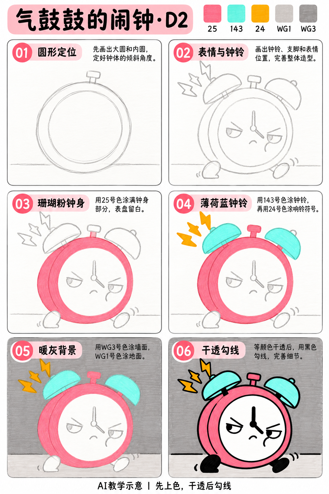
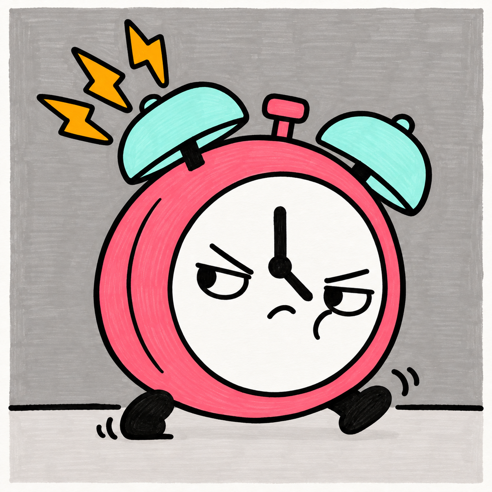

# S001-014｜气鼓鼓的闹钟

[全部教案](../README.md) · [本阶段](README.md) · [S001风格](../../styles/001-playful-color-block.md)

**D2 专项控制 · 提示练习 · 预计整幅约45分钟**

先修：已能概括大形、基本平涂与留纸白；先完成D1复盘，或能独立达到相同能力。

主要目标：**用眼皮、嘴与倾斜姿态组织明确情绪**。

计划时间包括试色、起稿、上色和检查，不含额外干燥等待，不登记为实际用时。可按每次20～30分钟分次：先完成草图与留白，再分批上色，最后干透后勾线。

## 纸笔与画面大小

使用16.5×16.5厘米马克笔专用纸，纸下垫废纸；本课主体约10～11厘米，四周留白。普通铅笔轻定位，0.5mm针管笔收轮廓，0.15mm用于少量细节，1.0mm外轮廓可选。

使用Touchmark学生36色油性马克笔。针管笔耐酒精性未知时统一先上色，完全干透后勾线。大块白形留纸白，132不当覆盖白笔或混色笔；白色高光工具仅可选，需先试效果，本课不依赖。

## 色号与区域

| 色号 | 本套色名 | 计划区域 |
| --- | --- | --- |
| 25 | Salmon Pink | 钟身与顶钮 |
| 143 | Mint Blue | 钟铃 |
| 24 | Marigold | 响声符号 |
| WG1 | Warm Grey 1 | 地面 |
| WG3 | Warm Grey 3 | 背景墙 |

AI图颜色仅近似实物。先在废纸试色，以此表为准；同色深浅只允许在完全干后小面积轻叠，不依赖浅色覆盖深色。更换配色时仍从本套已有色号中选择，保持主次关系，并更新本课色号记录。

## 先练3～5分钟

画三个空表盘，只改变眉毛、眼皮和嘴，试出不悦、困倦、惊讶；正式画只选气鼓鼓的一种。

## 留纸白

表盘始终留纸白，指针和五官最后画黑。

## 成品与递进示意

从左到右、从上到下阅读。灰线表示铅笔，黑轮廓等颜色完全干透后再画；示意若提前出现少量五官，按正文延后。

## 6个操作环节

### 01 圆形定位

轻画略倾斜的大圆，再画内圆留出一圈钟壳。圆不必绝对规整，但内外圆之间的壳厚要大致一致。

### 02 表情与钟铃

两只钟铃随钟身一起倾斜；下方两脚支住钟体。先标眼皮倾角与嘴的位置，再安排指针，避免针尖戳到眼睛。

### 03 珊瑚粉钟身

25涂钟壳和顶钮，绕开表盘。先试色再连续排笔，保留自然笔痕。

### 04 薄荷蓝钟铃

143涂钟铃，24涂左上响声符号。响声形状集中在一侧，不围满一圈。

### 05 暖灰背景

WG3涂墙，WG1涂窄地面，表盘不涂。先试灰阶是否能区分，接近时只轻涂一遍地面。

### 06 干透勾线

颜色干透后加黑脚、外轮廓、指针和气鼓鼓的表情。主外轮廓略粗，表情和指针用较细线，不让钟面变拥挤。

## 常见问题

气鼓鼓变成普通笑脸：上眼皮向中间压低，嘴朝下弯；指针先避开五官，不靠加许多符号表示生气。

## 完成检查

- 去掉响声符号仍能读出不悦
- 指针与五官互不遮挡
- 钟铃和钟脚属于同一个倾斜方向

## 换题迁移

保持钟身不变，另做一张困倦表情的小草图，比较只改哪些线就够。

本页小草图与局部试练不另算一幅完成作品。只有实际画完正式作品后才登记；日期、照片、用时与反馈可省略。每阶段7幅后结合实际能力复盘，需要巩固再补练，不自动晋级。

成品示例：完成自己的草图后再展开

## 来源

成品与教学提示图为AI生成示意，使用OpenAI内置imagegen；不计实际手绘完成。

[本课提示词与检查说明](../../entries/intermediate/014-grumpy-alarm-clock/reference/generation-prompts.json) · [基础学习资料](../../docs/learning-references.md) · [完整进阶规则](../../docs/learning-system.md)
