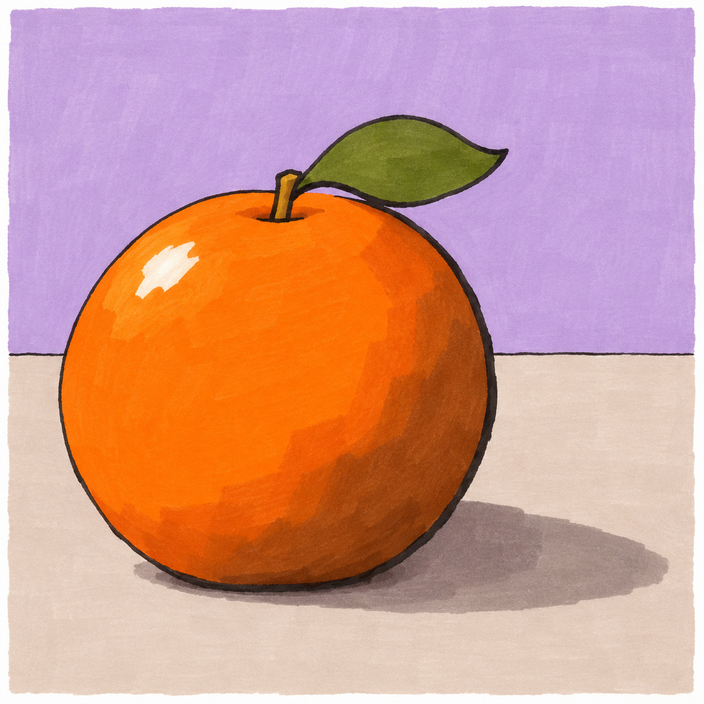
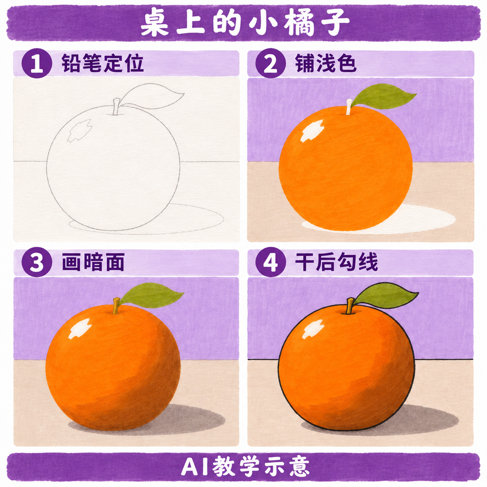

# S001-031 桌上的小橘子

[D2 课程](README.md) · [全部教案](../README.md)

S001 童趣色块手绘 · D2 专项控制 · 完整跟画加练，预计45分钟。目标是用弧形暗面和贴地投影画出果实的体积。先具备基本的平涂和留白能力。

用16.5厘米方形马克笔纸，画面约10～12厘米。准备铅笔、橡皮、Touchmark学生36色油性马克笔和黑色勾线笔。浅色和深色先在同纸试色，纸白在起稿时留出。

| 色号 | 区域 |
| --- | --- |
| 23 | 橘子底色 |
| 95 | 右下暗面、果梗和极窄接触暗 |
| 41 | 叶片 |
| 75 | 墙面 |
| 25 | 桌面 |
| WG5 | 向右的投影 |

### 1. 铅笔定位

用铅笔轻画略扁的果实，底部收平一点。桌面后沿被橘子挡住，只画露出的两段。预留左上高光，轻标右侧投影。

### 2. 铺浅色

先用25铺桌面、75铺墙面，留出投影。23铺橘子，41填叶片，预留白色高光。等干后在废纸试23叠95。

### 3. 画暗面

沿右下弧面铺一块95暗色，保留左上大亮面。用95点果梗和果底的短接触暗。用WG5把投影从果底往右拉，贴紧底缘。

### 4. 干后勾线

干透后轻勾果实、叶梗与叶片，受光侧细一些。退远看，亮面、暗面和右侧投影应一眼可读。

第2步后可以停笔，等色层完全干透再继续。试色观察到渗边时，缩小叠色区域并等干。黑线最后画。

**完成检查** · 如果暗部像一圈边框，下一张只在右下画一块宽窄变化的暗面。影子与果底有空隙时，在接触处补一小段。 两处亮面与投影应对应同一个左上光源。

成品与步骤图均为内置 imagegen 生成的教学示意，实际颜色以同纸试色为准。[生成记录](../../entries/intermediate/057-orange-volume/reference/generation.json)
