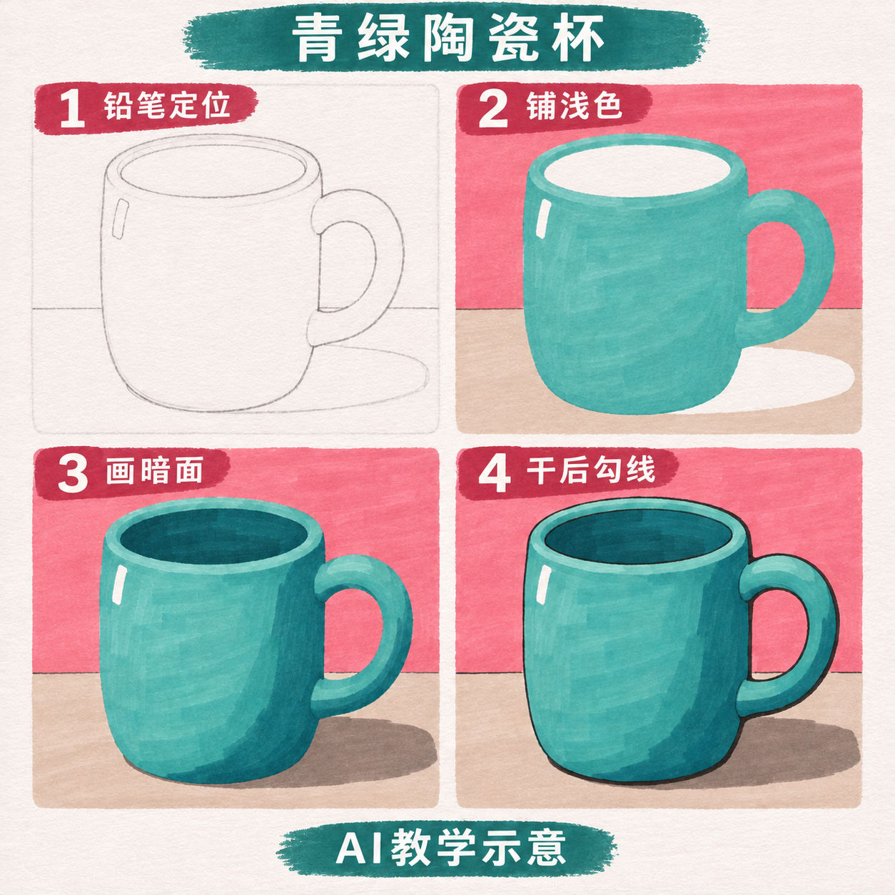

# S001-032 青绿陶瓷杯

[D2 课程](README.md) · [全部教案](../README.md)

S001 童趣色块手绘 · D2 专项控制 · 完整跟画加练，预计45分钟。目标是用双椭圆、杯内暗面和侧面色块表现中空杯身。先具备基本的平涂和留白能力。

用16.5厘米方形马克笔纸，画面约10～12厘米。准备铅笔、橡皮、Touchmark学生36色油性马克笔和黑色勾线笔。浅色和深色先在同纸试色，纸白在起稿时留出。

| 色号 | 区域 |
| --- | --- |
| 58 | 杯身和杯柄亮面、杯沿 |
| 52 | 杯内壁、杯身右侧和杯柄下侧 |
| 9 | 墙面 |
| 25 | 桌面 |
| WG5 | 向右的桌面投影 |
| WG7 | 杯内最深处、杯底接触暗 |

### 1. 铅笔定位

用铅笔画同轴的内外椭圆，内椭圆略小。杯身从外沿两侧往下收，底线是浅弧。杯柄用两条弧线，检查上下两端都接到杯身。

### 2. 铺浅色

25铺桌面、9铺墙面，穿过杯柄孔的背景线和外侧对齐。58铺杯身、杯沿与杯柄，留纸白高光，给杯内和右侧深色区留位置。

### 3. 画暗面

52填杯内，保留一圈杯沿，再沿杯身右侧和杯柄下缘铺暗色。WG5从杯底向右铺投影。WG7只点杯底接触处和杯内极小一块，先试色。

### 4. 干后勾线

墨干后勾外轮廓，杯沿内圈画细。确认杯柄孔、内壁和桌面投影彼此分明，杯口两侧没有尖角。

第2步后可以停笔，等色层完全干透再继续。试色观察到渗边时，缩小叠色区域并等干。黑线最后画。

**完成检查** · 杯口像一个平面圆片时，先检查双椭圆是否同轴、杯沿是否有厚度。杯柄孔里的背景线只在孔中露出。 两处亮面与投影应对应同一个左上光源。

成品与步骤图均为内置 imagegen 生成的教学示意，实际颜色以同纸试色为准。[生成记录](../../entries/intermediate/058-teal-ceramic-mug/reference/generation.json)
