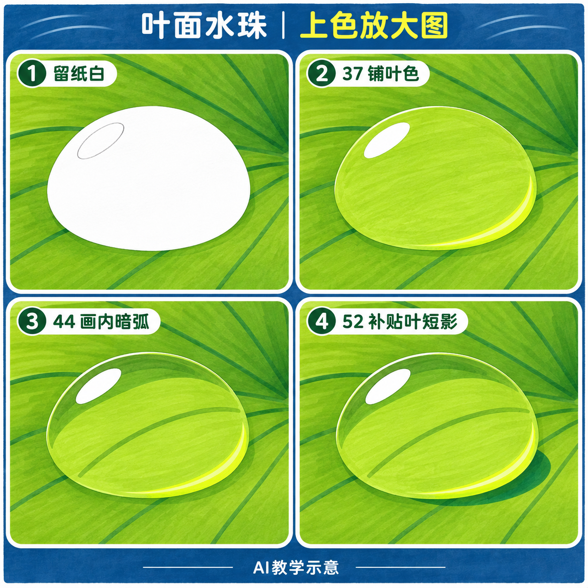
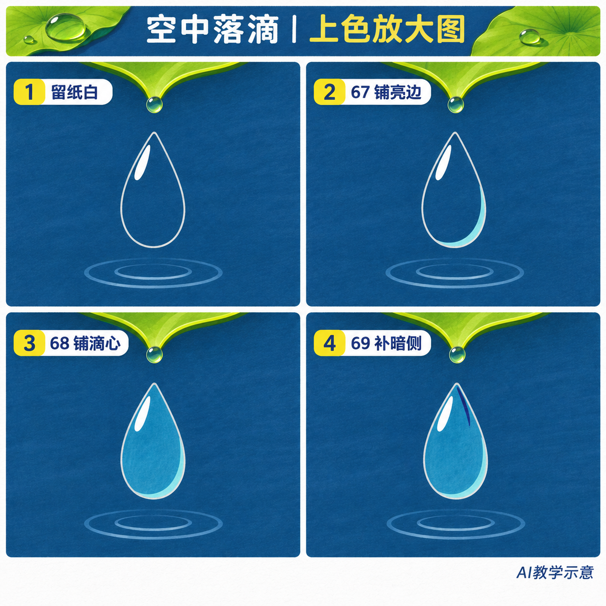

# S001-033 荷叶上的水滴

[D2 课程](README.md) · [全部教案](../README.md)

S001 童趣色块手绘 · D2 立体感加练 · 完整跟画，预计约55分钟。练习用卷边、留白与短影画出体积，并用叶尖下方的空隙表现滴落。先具备基本的平涂与留白能力。

用16.5厘米方形马克笔纸，画面约12～14厘米。准备轻铅笔、橡皮和Touchmark学生36色油性马克笔。先同纸试色，检查37、44的明暗差与67、68的对比。图中颜色为近似效果。

| 色号 | 部位 |
| --- | --- |
| 37 黄绿色 | 荷叶受光面与窄亮边、叶上水珠透出的亮叶色 |
| 44 偏黄橄榄绿 | 叶心凹处、叶脉、叶上水珠内的弧形暗带 |
| 52 深蓝绿色 | 卷边露出的叶背、叶上水珠贴叶的短影 |
| 67 浅青蓝 | 落滴的亮侧、池面浅水纹 |
| 68 中等青蓝 | 池面、落滴的主体 |
| 69 深靛蓝 | 荷叶下方的池水暗块、落滴内极窄的暗侧 |
| 纸白 | 水滴左上高光，起稿时留出 |

### 1. 铅笔定位

画一个略扁的荷叶轮廓，让叶脉朝偏右的叶心汇拢。前缘画一段翘起的弧线，用第二条短弧限定可见的叶背，再让边缘在中间收成向下的小尖。叶面左侧画一颗底部较平的大水珠。叶尖处画小挂珠，正下方另画一颗上窄下圆的落滴。挂珠、落滴和水纹之间各留一段空隙。

### 2. 铺底色

用37平涂荷叶的受光面，空出卷边叶背与各颗水珠。先留出池面浅水纹和落滴轮廓，再用68铺池水。用67填浅水纹。所有水滴的左上高光都留纸白，等颜色干透后再继续。

### 3. 刻画卷边

用44从叶心往外画疏密有别的叶脉，遇到大水珠边缘先停笔。在叶心附近铺一小块44，留下两侧的37亮面。用52填翘起边缘露出的叶背，上沿保留窄亮边。用69在叶缘下方铺一小块贴着叶缘的池水暗部。退远看，叶背应读成连着叶面折下去的一整块。

### 4. 完成水滴

总览最后一格用于核对整幅效果。跟画时按下面两张放大图各自的编号操作，从左上、右上读到左下、右下。两颗水滴都以左上方为光源：**左上白点是表面反光，滴内的暗弧和亮边表现透明体积，右下的短影落在叶面上。** 先在废纸上用同样的色号画一颗小水滴，确认深浅能分开。

#### 4a. 叶面大水珠

1. **先留两处亮。** 用铅笔轻圈左上一个斜椭圆高光，里面完全留纸白。右下内缘留一条由细变宽、再变细的弧形亮带，这条稍后用单层37表现。两处之间留出足够面积给滴内的叶色。
2. **用37铺透出的叶色。** 从滴内中间向两侧铺一层，绕过白点。右下亮带也用37，但后续不上深色。如果单层37和滴心几乎一样亮，可以提前在右下亮带靠外缘留一小截纸白，其他部分仍用37。
3. **用44画滴内暗带。** 等37干透，从左上内缘沿弧形往上方和右侧带一小段。贴近上缘处稍宽，向两端收窄，绕开高光，留下中央大块37和右下亮带。先画一层就停。若需要透出叶脉，只用44续一条与滴外叶脉大致对得上、但略弯的细线，画到亮带前收笔。
4. **用52补贴叶短影。** 在水珠轮廓**外侧**，从底缘贴着画一笔，再向右拖成略宽的小影块，末端收细。水珠和影子之间不留白缝。52集中在底缘外侧，滴内上方的44暗带保持独立。
5. **看清亮暗再停。** 左上白点最亮，右下有一段浅亮弧，中间还能看见叶色，底下有一小块贴叶暗影。两颗小水珠各保留一个白点、一小块37底色和一笔52贴底影即可。

#### 4b. 叶尖挂珠与空中的落滴

放大图前两格借用池水蓝标示待填的滴心。实画先按总览留出整颗落滴，直到第3格才用68填滴心。图中的浅色外框只用来提示轮廓，画时依靠高光和底部亮边表现边界。

1. **区分挂珠和落滴。** 叶尖挂珠用37铺极小一块，左上留白点，下缘轻点44。落滴单独画在正下方，先确认它和挂珠、下方水纹之间都看得见池水。
2. **先在落滴留高光、铺亮边。** 左上留一条短而细的纸白反光，沿水滴的长方向倾斜。用67沿圆底内侧画一段弧形亮边，在右下最宽，向左右两头收细。可在最亮处再留一小截纸白。先规划这两处亮，再填深色。
3. **用68铺中间的蓝色。** 从尖端往圆底轻铺一层，沿着67亮边的内侧收笔，保留纸白高光与浅蓝弧。68和池水同色时，主要靠这两处亮把滴形从背景里分出来。
4. **干后用69加暗侧。** 只在尖端下方、靠一侧的内缘补一小段细暗带，向中部逐渐收窄。圆底的67亮边保持完整。暗带如果一笔已经够明显，就停笔。
5. **最后检查下坠感。** 落滴下端圆、上端窄，水纹单独留在下方。水滴悬在空中，暗色只画在滴内，贴底短影留给叶面上的水珠。

**停笔与检查** · 第2步后可以分次。落滴如果像挂在叶尖上，检查两者中间的蓝色有没有连通。叶上水珠如果像一块绿圆片，检查是否保留高光、滴内透出的叶色，以及贴底短影。先在废纸试深色边缘，避免给水滴描一整圈黑线。

成品与步骤图为内置 imagegen 生成的教学示意。色号按现有色卡的相对色相安排，实笔以同纸试色为准。[生成记录](../../entries/intermediate/059-lotus-falling-drop/reference/generation.json)

[水滴放大图生成记录](../../entries/intermediate/059-lotus-falling-drop/reference/generation-detail.json)
