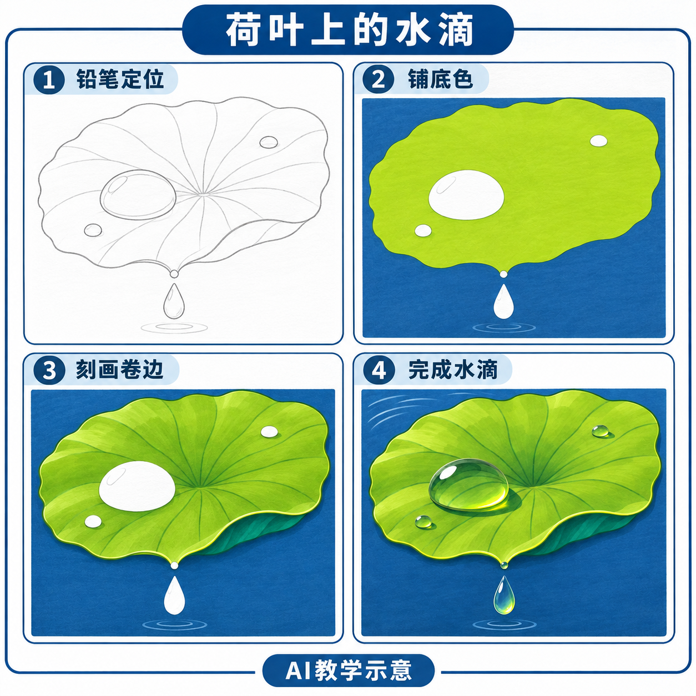

# S001-033 荷叶上的水滴

[D2 课程](README.md) · [全部教案](../README.md)

S001 童趣色块手绘 · D2 立体感加练 · 完整跟画，预计约55分钟。练习用卷边、留白与短影画出体积，并用叶尖下方的空隙表现滴落。先具备基本的平涂与留白能力。

用16.5厘米方形马克笔纸，画面约12～14厘米。准备轻铅笔、橡皮和Touchmark学生36色油性马克笔。先同纸试色，检查37、44的明暗差与67、68的对比。图中颜色为近似效果。

| 色号 | 部位 |
| --- | --- |
| 37 黄绿色 | 荷叶受光面与窄亮边、叶上水珠透出的亮叶色 |
| 44 偏黄橄榄绿 | 叶心凹处、叶脉、叶上水珠内的弧形暗带 |
| 52 深蓝绿色 | 卷边露出的叶背、叶上水珠贴叶的短影 |
| 67 浅青蓝 | 落滴的亮侧、池面浅水纹 |
| 68 中等青蓝 | 池面、落滴的主体 |
| 69 深靛蓝 | 荷叶下方的池水暗块、落滴内极窄的暗侧 |
| 纸白 | 水滴左上高光，起稿时留出 |

### 1. 铅笔定位

画一个略扁的荷叶轮廓，让叶脉朝偏右的叶心汇拢。前缘画一段翘起的弧线，用第二条短弧限定可见的叶背，再让边缘在中间收成向下的小尖。叶面左侧画一颗底部较平的大水珠。叶尖处画小挂珠，正下方另画一颗上窄下圆的落滴。挂珠、落滴和水纹之间各留一段空隙。

### 2. 铺底色

用37平涂荷叶的受光面，空出卷边叶背与各颗水珠。先留出池面浅水纹和落滴轮廓，再用68铺池水。用67填浅水纹。所有水滴的左上高光都留纸白，等颜色干透后再继续。

### 3. 刻画卷边

用44从叶心往外画疏密有别的叶脉，遇到大水珠边缘先停笔。在叶心附近铺一小块44，留下两侧的37亮面。用52填翘起边缘露出的叶背，上沿保留窄亮边。用69在叶缘下方铺一小块贴着叶缘的池水暗部。退远看，叶背应读成连着叶面折下去的一整块。

### 4. 完成水滴

先画叶面大水珠。除留白高光外，用37铺透出的叶色，沿顶部内侧加一段44暗弧，在滴内续一小段稍弯的叶脉。用52在底缘右侧补短影，影子贴住水珠底部。小水珠保留高光和短影即可。

再画叶尖的小挂珠和下方的落滴。落滴先保留左上高光和下部一线67亮边，再用68填中间，干后用69补极窄的一段暗侧。落滴的顶端与叶尖对齐，底端和池面水纹之间留出蓝色空隙。

**停笔与检查** · 第2步后可以分次。落滴如果像挂在叶尖上，检查两者中间的蓝色有没有连通。叶上水珠如果像一块绿圆片，检查是否保留高光、滴内透出的叶色，以及贴底短影。先在废纸试深色边缘，避免给水滴描一整圈黑线。

成品与步骤图为内置 imagegen 生成的教学示意。色号按现有色卡的相对色相安排，实笔以同纸试色为准。[生成记录](../../entries/intermediate/059-lotus-falling-drop/reference/generation.json)
