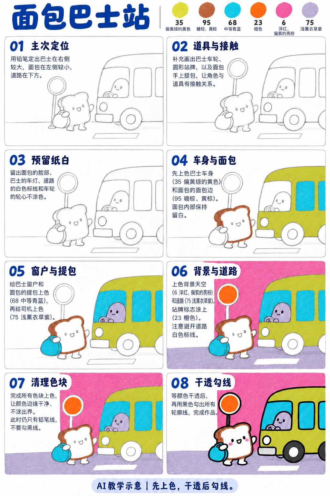
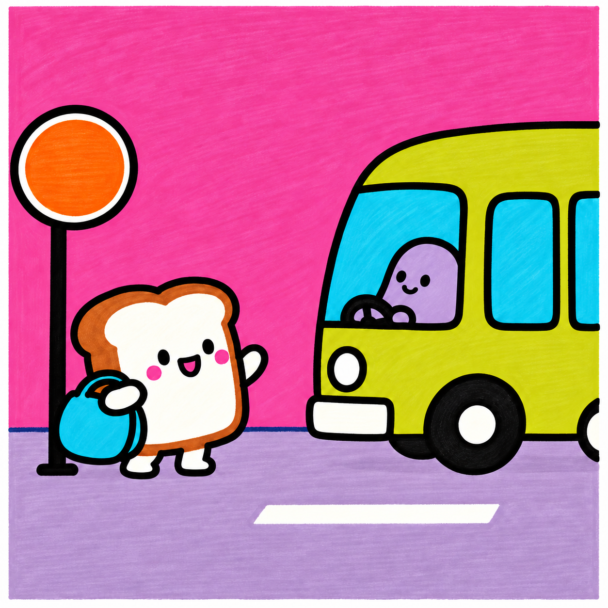

# S001-015｜面包巴士站

> **配色已修订：** 成品、教学图与正文按实涂色卡的相对色相重新配套；浅色以同纸单层试色为准，屏幕图不作精确色值。旧图只作历史留存。

[全部教案](../README.md) · [本阶段](README.md) · [S001风格](../../styles/001-playful-color-block.md)

**D3 综合组织 · 提示练习 · 预计整幅约65分钟**

先修：已能控制曲线、表情、线条与简单遮挡；先完成D2复盘，或有相同能力。

主要目标：**组织两个角色与站牌、车辆的主次关系**。

计划时间包括试色、起稿、上色和检查，不含额外干燥等待，不登记为实际用时。可按每次20～30分钟分次：先完成草图与留白，再分批上色，最后干透后勾线。

## 纸笔与画面大小

使用16.5×16.5厘米马克笔专用纸，纸下垫废纸；本课主体约12～13厘米，四周留白。普通铅笔轻定位，0.5mm针管笔收轮廓，0.15mm用于少量细节，1.0mm外轮廓可选。

使用Touchmark学生36色油性马克笔。针管笔耐酒精性未知时统一先上色，完全干透后勾线。大块白形留纸白，132不当覆盖白笔或混色笔；白色高光工具仅可选，需先试效果，本课不依赖。

## 色号与区域

| 色号 | 本套色名 | 计划区域 |
| --- | --- | --- |
| 35 | 偏黄绿的黄色 | 巴士车身 |
| 95 | 赭棕、黄棕 | 面包边壳 |
| 68 | 中等青蓝 | 车窗与提包 |
| 23 | 橙色 | 站牌圆心 |
| 6 | 洋红、偏紫的亮粉 | 天空与脸颊 |
| 75 | 浅薰衣草紫 | 路面与司机 |

AI图颜色仅近似实物。先在废纸试色，以此表为准；同色深浅只允许在完全干后小面积轻叠，不依赖浅色覆盖深色。更换配色时仍从本套已有色号中选择，保持主次关系，并更新本课色号记录。

## 先练3～5分钟

用三个方块替代公交车、面包和站牌，先比较公交大、面包小与大小相近的两种布局。

## 留纸白

面包内部、车灯、路标线、轮心与保险杠提前留纸白；图中浅灰或奶油色统一简化为纸白，不额外加笔。

## 成品与递进示意

从左到右、从上到下阅读。灰线表示铅笔，黑轮廓等颜色完全干透后再画；示意若提前出现少量五官，按正文延后。

图文检查说明：步骤图05～07的少量深色司机线可忽略，实际五官和黑轮廓统一第08步。原图的奶油色面包内侧、灰保险杠与轮心统一留纸白；不额外加笔。

## 8个操作环节

### 01 主次定位

巴士占右侧约半幅并可出画，面包放左下。地面线保持一致，让两者脚和车轮都落在路上。

### 02 道具与接触

画圆站牌、轮子和提包。先找面包手与提把的接触点；包挡住身体，手压住提把。

### 03 预留纸白

轻标面包内部、车灯、路标线与轮心。车窗留给68，不能把整辆车先涂黄再覆盖回蓝。

### 04 车身与面包

35涂车身，95涂面包壳，面包内部保留纸白。色块边缘先慢后快，大面连续排笔。

### 05 窗户与提包

68涂窗和包，75涂司机。窗框不急着勾黑，让司机在窗内被下沿挡住。

### 06 背景与道路

6涂天空，75涂路面，23涂站牌圆心。绕开白色路标线，路面线不能穿过脚和轮子。

### 07 清理色块

检查包与身体、司机与窗的交界。脸颊可用6小点，保险杠和轮心保留白，不照图增加灰色。

### 08 干透勾线

干透后勾外形、黑轮胎与站牌杆，最后画表情。后方边线在前方物体边缘停住。

## 常见问题

车和面包抢主角：放大巴士、减少车窗细节，再用举手动作让面包成为故事焦点；不要把每个物体都放画面正中。

## 完成检查

- 能读出等车或打招呼的情节
- 司机被窗框合理遮挡
- 白色道路标线完整保留

## 换题迁移

只换站牌位置，比较人物与车之间的空隙是否仍然清楚。

本页小草图与局部试练不另算一幅完成作品。只有实际画完正式作品后才登记；日期、照片、用时与反馈可省略。每阶段7幅后结合实际能力复盘，需要巩固再补练，不自动晋级。

成品示例：完成自己的草图后再展开

## 来源

成品与教学提示图为AI生成示意，使用OpenAI内置imagegen；不计实际手绘完成。

[本课提示词与检查说明](../../entries/scene/015-toast-bus-stop/reference/generation-prompts.json) · [基础学习资料](../../docs/learning-references.md) · [完整进阶规则](../../docs/learning-system.md)

[本次配色修订提示词与核对](../../entries/scene/015-toast-bus-stop/reference/color-revision-v5.json)
