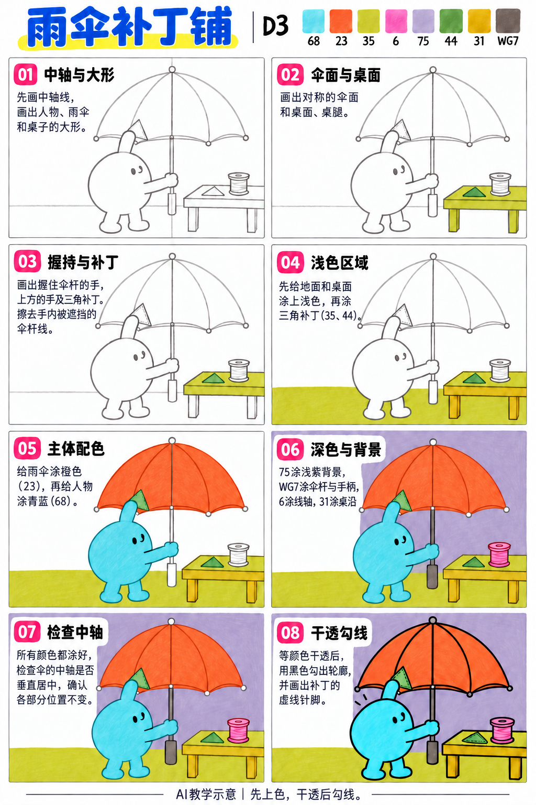
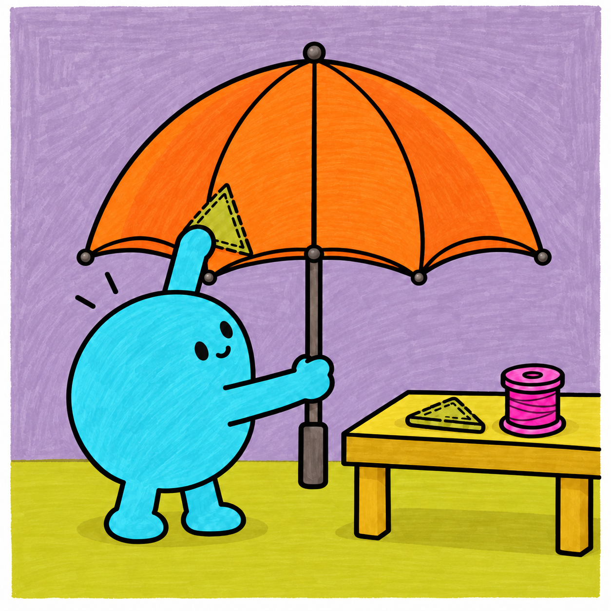

# S001-016｜雨伞补丁铺

> **配色已修订：** 成品、教学图与正文按实涂色卡的相对色相重新配套；浅色以同纸单层试色为准，屏幕图不作精确色值。旧图只作历史留存。

[全部教案](../README.md) · [本阶段](README.md) · [S001风格](../../styles/001-playful-color-block.md)

**D3 综合组织 · 提示练习 · 预计整幅约75分钟**

先修：已能控制曲线、表情、线条与简单遮挡；先完成D2复盘，或有相同能力。

主要目标：**用明确握持与支撑关系组织修伞动作**。

计划时间包括试色、起稿、上色和检查，不含额外干燥等待，不登记为实际用时。可按每次20～30分钟分次：先完成草图与留白，再分批上色，最后干透后勾线。

## 纸笔与画面大小

使用16.5×16.5厘米马克笔专用纸，纸下垫废纸；本课主体约12～13厘米，四周留白。普通铅笔轻定位，0.5mm针管笔收轮廓，0.15mm用于少量细节，1.0mm外轮廓可选。

使用Touchmark学生36色油性马克笔。针管笔耐酒精性未知时统一先上色，完全干透后勾线。大块白形留纸白，132不当覆盖白笔或混色笔；白色高光工具仅可选，需先试效果，本课不依赖。

## 色号与区域

| 色号 | 本套色名 | 计划区域 |
| --- | --- | --- |
| 68 | 中等青蓝 | 修伞角色 |
| 23 | 橙色 | 对称伞面 |
| 35 | 偏黄绿的黄色 | 地面与桌面 |
| 6 | 洋红、偏紫的亮粉 | 线轴 |
| 75 | 浅薰衣草紫 | 墙面 |
| 44 | 偏黄的橄榄绿 | 补丁 |
| 31 | 偏芥末的黄色 | 桌侧与轻暗面 |
| WG7 | 深暖灰、略偏棕 | 伞杆与直握柄 |

AI图颜色仅近似实物。先在废纸试色，以此表为准；同色深浅只允许在完全干后小面积轻叠，不依赖浅色覆盖深色。更换配色时仍从本套已有色号中选择，保持主次关系，并更新本课色号记录。

## 先练3～5分钟

画一条竖中轴，左右各画半个伞顶，比较两端高度；再用一个小圆包住直杆，练被手挡住的杆线停住。

## 留纸白

不需要白笔；伞杆可在WG7旁留一条窄纸白亮边。

## 成品与递进示意

从左到右、从上到下阅读。灰线表示铅笔，黑轮廓等颜色完全干透后再画；示意若提前出现少量五官，按正文延后。

图文检查说明：步骤图02桌上的绿色小块只提示补丁位置，实际第04步才上色；不用提前涂。中轴是铅笔辅助线，最后擦掉，不勾成穿过伞面的直线。

## 8个操作环节

### 01 中轴与大形

用很轻的竖线贯穿伞顶、伞面中点和直柄。角色放左，桌子放右，伞左右端点等高且离中轴距离相近。

### 02 伞面与桌面

从伞顶画对称穹顶和分面弧线，伞下沿在中轴处与杆连接。桌面只露上面和窄侧面，桌腿接住四角。

### 03 握持与补丁

下手绕杆握住，上手触碰伞面补丁；擦掉手掌里的伞杆线。桌上另放一片补丁和线轴。

### 04 浅色区域

35涂地面和桌面，44涂两片补丁。教学图02的桌上小绿块只是位置提示，实际统一到本步才上色。

### 05 主体配色

23涂伞面，68涂角色。伞面保持少量大块分面，不用复杂渐变；手和身体同色。

### 06 深色与背景

75涂墙，WG7涂伞杆和直握柄，6涂线轴，31涂桌侧。伞杆从伞顶正下方垂直延伸，不画斜杆或弯钩。

### 07 检查中轴

用纸边比对伞顶、伞杆和握柄中心，铅笔中轴擦除。若位置不对，在勾黑前修正；分面可用23干后轻叠一遍局部，避免浸透。

### 08 干透勾线

干透后勾线并补少量虚线针脚。手前的轮廓连续，杆在手后断开；不要把定位辅助线勾成实线。

## 常见问题

伞柄看起来歪：检查顶点与直握柄是否在同一竖线，而不是只检查伞杆局部；左右伞端不等高也会制造歪斜感。

## 完成检查

- 伞顶、杆与握柄中心共线
- 手实际握住杆，杆线在掌内断开
- 桌腿与桌面有支撑关系

## 换题迁移

只改变补丁形状和线轴颜色，保留对称伞和同一竖中轴。

本页小草图与局部试练不另算一幅完成作品。只有实际画完正式作品后才登记；日期、照片、用时与反馈可省略。每阶段7幅后结合实际能力复盘，需要巩固再补练，不自动晋级。

成品示例：完成自己的草图后再展开

## 来源

成品与教学提示图为AI生成示意，使用OpenAI内置imagegen；不计实际手绘完成。

[本课提示词与检查说明](../../entries/scene/016-umbrella-patch-workshop/reference/generation-prompts.json) · [基础学习资料](../../docs/learning-references.md) · [完整进阶规则](../../docs/learning-system.md)

[本次配色修订提示词与核对](../../entries/scene/016-umbrella-patch-workshop/reference/color-revision-v5.json)
