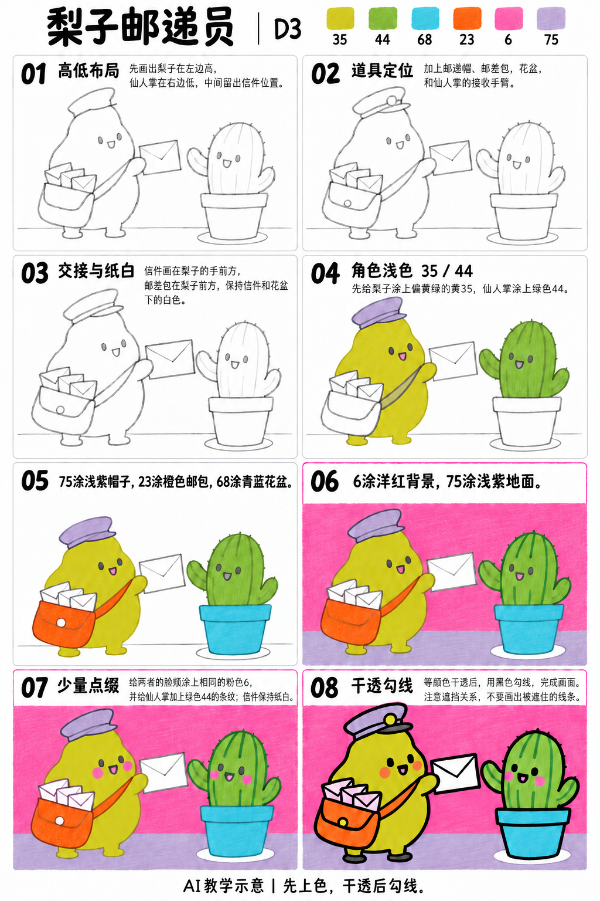

# S001-017｜梨子邮递员

> **配色已修订：** 成品、教学图与正文按实涂色卡的相对色相重新配套；浅色以同纸单层试色为准，屏幕图不作精确色值。旧图只作历史留存。

[全部教案](../README.md) · [本阶段](README.md) · [S001风格](../../styles/001-playful-color-block.md)

**D3 综合组织 · 提示练习 · 预计整幅约65分钟**

先修：已能控制曲线、表情、线条与简单遮挡；先完成D2复盘，或有相同能力。

主要目标：**通过朝向与高低位置形成角色间的信息传递**。

计划时间包括试色、起稿、上色和检查，不含额外干燥等待，不登记为实际用时。可按每次20～30分钟分次：先完成草图与留白，再分批上色，最后干透后勾线。

## 纸笔与画面大小

使用16.5×16.5厘米马克笔专用纸，纸下垫废纸；本课主体约12～13厘米，四周留白。普通铅笔轻定位，0.5mm针管笔收轮廓，0.15mm用于少量细节，1.0mm外轮廓可选。

使用Touchmark学生36色油性马克笔。针管笔耐酒精性未知时统一先上色，完全干透后勾线。大块白形留纸白，132不当覆盖白笔或混色笔；白色高光工具仅可选，需先试效果，本课不依赖。

## 色号与区域

| 色号 | 本套色名 | 计划区域 |
| --- | --- | --- |
| 35 | 偏黄绿的黄色 | 梨子与帽徽 |
| 44 | 偏黄的橄榄绿 | 仙人掌 |
| 68 | 中等青蓝 | 花盆 |
| 23 | 橙色 | 邮差包与梨脸颊 |
| 6 | 洋红、偏紫的亮粉 | 背景与小信 |
| 75 | 浅薰衣草紫 | 帽子与地面 |

AI图颜色仅近似实物。先在废纸试色，以此表为准；同色深浅只允许在完全干后小面积轻叠，不依赖浅色覆盖深色。更换配色时仍从本套已有色号中选择，保持主次关系，并更新本课色号记录。

## 先练3～5分钟

用两团圆形表示寄信和收信的角色，中间只放一张信，试出手能碰到而身体不挤在一起的距离。

## 留纸白

交接的信和花盆下的窄光圈留纸白。包内小信可用6轻涂，不能当成新增浅粉色号。

## 成品与递进示意

从左到右、从上到下阅读。灰线表示铅笔，黑轮廓等颜色完全干透后再画；示意若提前出现少量五官，按正文延后。

图文检查说明：步骤图06的脸颊与叶纹可延后到第07步，黑五官统一第08步。两张交接主信始终以留纸白处理，包内小信可用6薄涂。

## 8个操作环节

### 01 高低布局

梨子左高、仙人掌右低，中间留出信件位置。先让两者视线相对，再决定地面高度。

### 02 道具定位

添帽、斜挎包和花盆。肩带从一肩落向另一侧包口，包的位置不能漂在身外。

### 03 交接与纸白

梨子手压住信的一侧，信主体在身体前；仙人掌伸手朝向信件。擦掉后方被挡住的线，信与盆下光圈留白。

### 04 角色浅色

35平涂梨子，44平涂仙人掌。不要先涂到信或帽内。

### 05 帽包花盆

75涂帽，23涂包和梨脸颊，68涂盆；包扣用35。上下盆沿应能区分。

### 06 背景地面

6涂背景，75涂地面。信周围留出几毫米干净边界，注意花盆底的白圈。

### 07 少量点缀

44在干后轻叠几条仙人掌条纹，6点脸颊并涂包内小信。不要增加密集刺点，避免转移焦点。

### 08 干透勾线

最后勾手、信、包和表情。信边被手遮住的部分不补回，帽檐与身体也有前后关系。

## 常见问题

信件像悬空贴纸：让一只手覆盖信的一小段边，手臂与身体连起来，并让接收方的手和眼睛朝向信。

## 完成检查

- 角色朝向和信的方向一致
- 信与身体之间有明确遮挡
- 包肩带能连到身体

## 换题迁移

把收信者换为另一种简单植物，仍保留一高一低和中间交接物。

本页小草图与局部试练不另算一幅完成作品。只有实际画完正式作品后才登记；日期、照片、用时与反馈可省略。每阶段7幅后结合实际能力复盘，需要巩固再补练，不自动晋级。

成品示例：完成自己的草图后再展开

## 来源

成品与教学提示图为AI生成示意，使用OpenAI内置imagegen；不计实际手绘完成。

[本课提示词与检查说明](../../entries/scene/017-pear-mail-delivery/reference/generation-prompts.json) · [基础学习资料](../../docs/learning-references.md) · [完整进阶规则](../../docs/learning-system.md)

[本次配色修订提示词与核对](../../entries/scene/017-pear-mail-delivery/reference/color-revision-v5.json)
