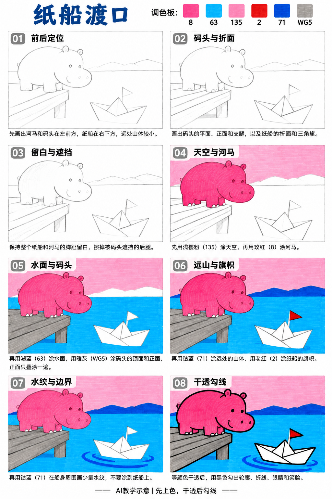
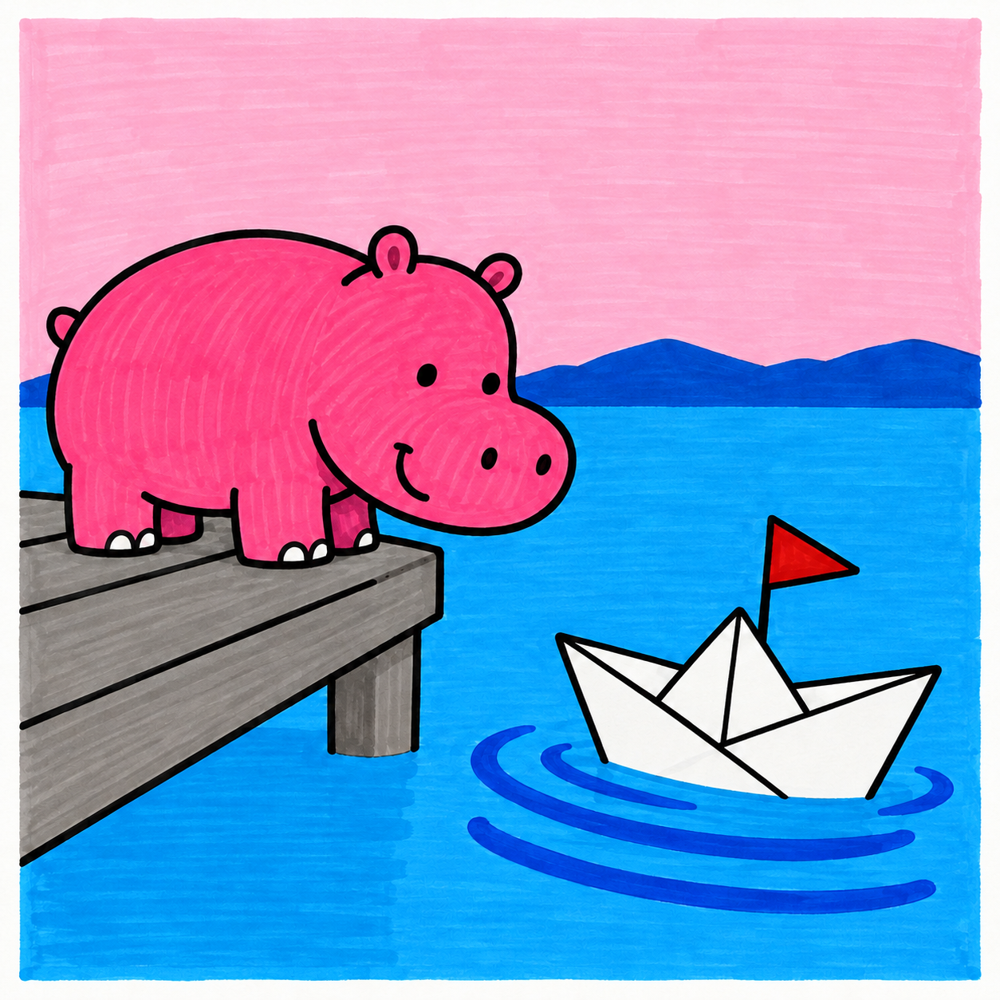

# S001-018｜纸船渡口

[全部教案](../README.md) · [本阶段](README.md) · [S001风格](../../styles/001-playful-color-block.md)

**D3 综合组织 · 提示练习 · 预计整幅约70分钟**

先修：已能控制曲线、表情、线条与简单遮挡；先完成D2复盘，或有相同能力。

主要目标：**用前后遮挡和形状大小组织小场景空间**。

计划时间包括试色、起稿、上色和检查，不含额外干燥等待，不登记为实际用时。可按每次20～30分钟分次：先完成草图与留白，再分批上色，最后干透后勾线。

## 纸笔与画面大小

使用16.5×16.5厘米马克笔专用纸，纸下垫废纸；本课主体约12～13厘米，四周留白。普通铅笔轻定位，0.5mm针管笔收轮廓，0.15mm用于少量细节，1.0mm外轮廓可选。

使用Touchmark学生36色油性马克笔。针管笔耐酒精性未知时统一先上色，完全干透后勾线。大块白形留纸白，132不当覆盖白笔或混色笔；白色高光工具仅可选，需先试效果，本课不依赖。

## 色号与区域

| 色号 | 本套色名 | 计划区域 |
| --- | --- | --- |
| 8 | Rose Pink | 河马 |
| 63 | Cerulean Blue | 水面 |
| 135 | Pale Cherry Pink | 天空 |
| 2 | Old Red | 小旗 |
| 71 | Cobalt Blue | 远山与水纹 |
| WG5 | Warm Grey 5 | 码头 |

AI图颜色仅近似实物。先在废纸试色，以此表为准；同色深浅只允许在完全干后小面积轻叠，不依赖浅色覆盖深色。更换配色时仍从本套已有色号中选择，保持主次关系，并更新本课色号记录。

## 先练3～5分钟

画两组大小不同的船与河马方块，小船放下方、远山放上方，比较空间是否更清楚。

## 留纸白

整只纸船与河马脚趾提前留纸白，水纹不穿过船体。

## 成品与递进示意

从左到右、从上到下阅读。灰线表示铅笔，黑轮廓等颜色完全干透后再画；示意若提前出现少量五官，按正文延后。

## 8个操作环节

### 01 前后定位

河马和码头放左前景，纸船放右下，远山压成一条窄带。先留出船前进的空水面。

### 02 码头与折面

码头画出顶面、前缘和支腿，纸船先定船沿，再用两三条折线表示纸面。旗杆从折面之间竖起。

### 03 留白与遮挡

船体和脚趾留白；码头遮住河马的远侧脚。船折线不能画成穿透船壳的交叉网。

### 04 天空与河马

135涂天空，8涂河马。轻涂浅色天空，不用反复刷成深粉。

### 05 水面与码头

63涂水面，WG5涂码头。码头前缘可干后同色轻叠一遍，与顶面形成简单区分。

### 06 远山与旗帜

71涂远山，2涂旗帜。山压低、旗保持小块，避免比纸船更抢眼。

### 07 水纹与边界

71画少量环绕船体的水纹，弧线在船后断开；近处宽、远处短，不画满整片水。

### 08 干透勾线

干透后勾船折线、码头、河马外形和五官。轮廓粗细有主次，纸面内折线略细。

## 常见问题

船像白色石头：先把船沿两角和中间三角折面画清楚，减少内部线；水纹贴着船外侧绕开，不能穿进白船。

## 完成检查

- 码头顶面与侧面可区分
- 纸船靠折面而非灰色渐变立起来
- 河马和船的视线联系清楚

## 换题迁移

试把小旗换到另一侧船尖，检查旗杆是否仍从船内长出。

本页小草图与局部试练不另算一幅完成作品。只有实际画完正式作品后才登记；日期、照片、用时与反馈可省略。每阶段7幅后结合实际能力复盘，需要巩固再补练，不自动晋级。

成品示例：完成自己的草图后再展开

## 来源

成品与教学提示图为AI生成示意，使用OpenAI内置imagegen；不计实际手绘完成。

[本课提示词与检查说明](../../entries/scene/018-paper-boat-ferry/reference/generation-prompts.json) · [基础学习资料](../../docs/learning-references.md) · [完整进阶规则](../../docs/learning-system.md)
