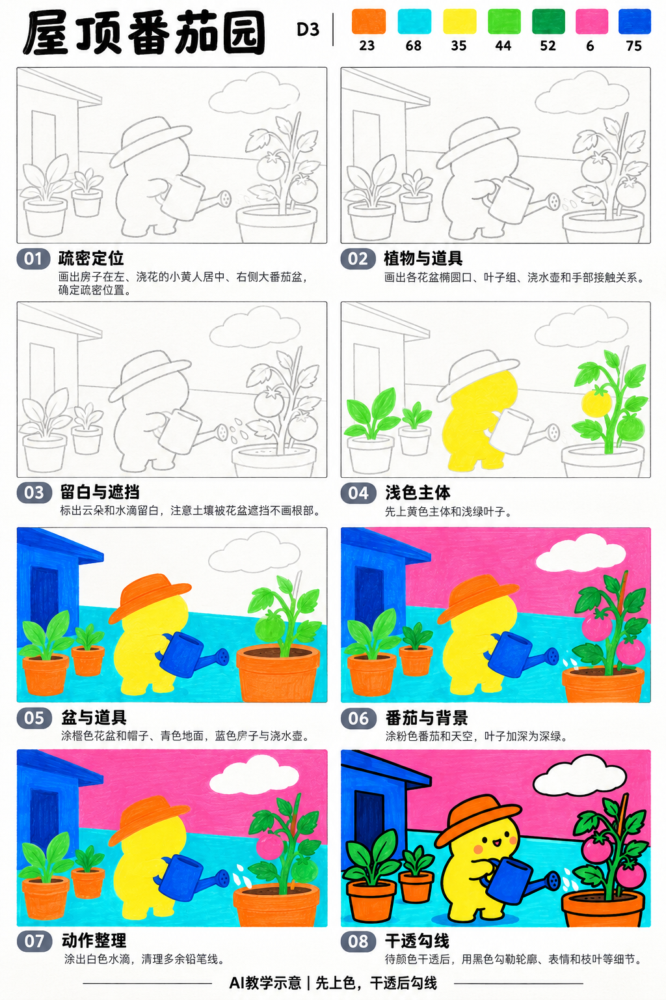
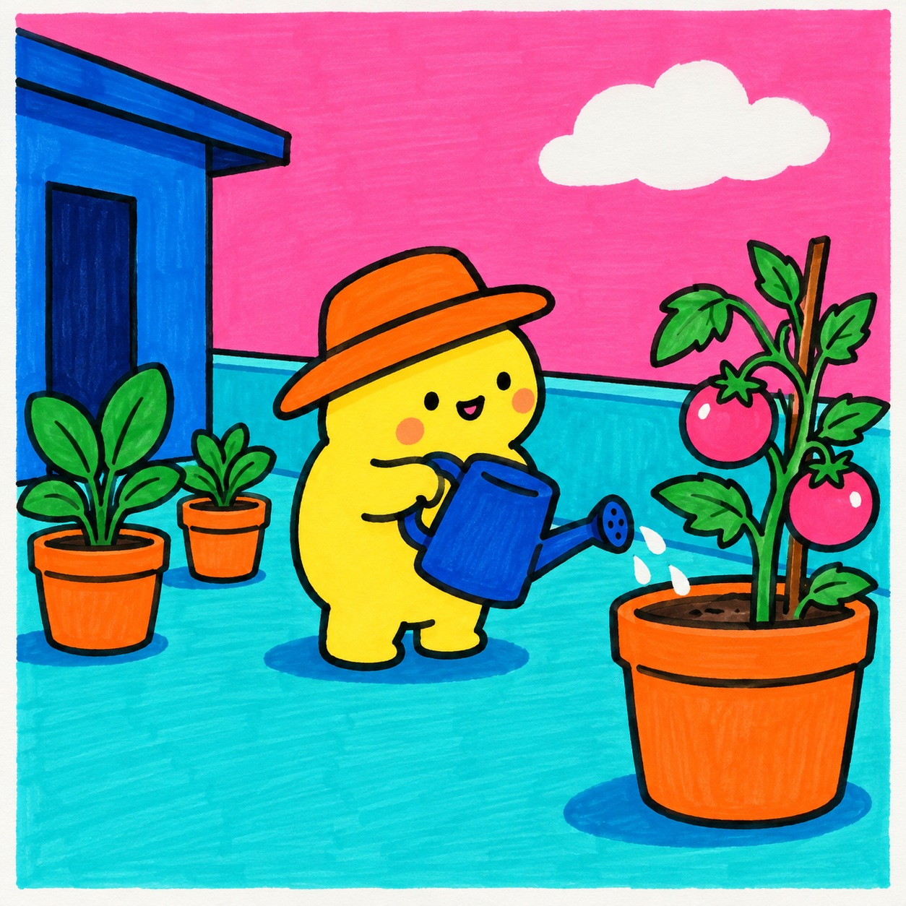

# S001-019｜屋顶番茄园

[全部教案](../README.md) · [本阶段](README.md) · [S001风格](../../styles/001-playful-color-block.md)

**D3 综合组织 · 提示练习 · 预计整幅约70分钟**

先修：已能控制曲线、表情、线条与简单遮挡；先完成D2复盘，或有相同能力。

主要目标：**控制重复物件的疏密与画面重心**。

计划时间包括试色、起稿、上色和检查，不含额外干燥等待，不登记为实际用时。可按每次20～30分钟分次：先完成草图与留白，再分批上色，最后干透后勾线。

## 纸笔与画面大小

使用16.5×16.5厘米马克笔专用纸，纸下垫废纸；本课主体约12～13厘米，四周留白。普通铅笔轻定位，0.5mm针管笔收轮廓，0.15mm用于少量细节，1.0mm外轮廓可选。

使用Touchmark学生36色油性马克笔。针管笔耐酒精性未知时统一先上色，完全干透后勾线。大块白形留纸白，132不当覆盖白笔或混色笔；白色高光工具仅可选，需先试效果，本课不依赖。

## 色号与区域

| 色号 | 本套色名 | 计划区域 |
| --- | --- | --- |
| 23 | Orange | 花盆与帽子 |
| 68 | Turquoise Blue | 水壶与地面 |
| 35 | Lemon Yellow | 角色 |
| 44 | Fresh Green | 叶片 |
| 52 | Deep Green | 较深叶片 |
| 6 | Vivid Pink | 番茄与背景 |
| 75 | Dark Blue Light | 小屋 |

AI图颜色仅近似实物。先在废纸试色，以此表为准；同色深浅只允许在完全干后小面积轻叠，不依赖浅色覆盖深色。更换配色时仍从本套已有色号中选择，保持主次关系，并更新本课色号记录。

## 先练3～5分钟

画三个大小不一的盆栽剪影，排出疏、密、留空三种节奏，给浇水动作留出一块空白。

## 留纸白

云、喷水小线和眼睛高光可留纸白，高光不是必须。

## 成品与递进示意

从左到右、从上到下阅读。灰线表示铅笔，黑轮廓等颜色完全干透后再画；示意若提前出现少量五官，按正文延后。

图文检查说明：步骤图04番茄上的黄块属于AI提前着色，正式番茄保留到第06步直接用6，不先铺黄底。图中的棕支杆用23，土面用少量75或黑点简化，不新增棕笔；步骤图07的喷水仍以第03步预留纸白实现。

## 8个操作环节

### 01 疏密定位

小屋靠左，主要浇水角色在中央，较大番茄植株在右。盆栽不要等距离排成一条队。

### 02 植物与道具

画盆口椭圆、叶团和番茄圆块，添水壶。把水壶提把与角色手相连，壶嘴朝向盆内。

### 03 留白与遮挡

云和喷水线提前留白。盆口遮住植物根部，角色手压在水壶把前，擦除交叉线。

### 04 浅色主体

35涂角色，44涂亮叶。每组叶只留几片清楚的大形，不加许多叶脉。

### 05 盆与角色道具

23涂花盆和帽子，68涂地面，75涂小屋和水壶。盆沿下留窄侧面即可。

### 06 番茄与背景

6涂背景和番茄，52涂少量暗叶；番茄与背景之间靠绿叶和轮廓分开，不堆许多果实。

### 07 动作整理

检查壶嘴指向盆里，喷水小线避开脸部。叶团在疏密上有变化，删掉挡住浇水动作的小叶。

### 08 干透勾线

干透后勾主要外形与少量枝茎，再补表情。远处屋子线条略轻，角色与水壶交接最清楚。

## 常见问题

盆栽像整齐贴纸：合并几片叶为大团，让一两个盆被前景角色挡住，留出不放花盆的空地。

## 完成检查

- 水壶由手支撑且壶嘴朝盆
- 番茄、叶与盆有前后顺序
- 存在一处明显的画面留空

## 换题迁移

减少一个盆栽，观察故事是否更清楚，而非只比较画面是否更满。

本页小草图与局部试练不另算一幅完成作品。只有实际画完正式作品后才登记；日期、照片、用时与反馈可省略。每阶段7幅后结合实际能力复盘，需要巩固再补练，不自动晋级。

成品示例：完成自己的草图后再展开

## 来源

成品与教学提示图为AI生成示意，使用OpenAI内置imagegen；不计实际手绘完成。

[本课提示词与检查说明](../../entries/scene/019-rooftop-tomato-garden/reference/generation-prompts.json) · [基础学习资料](../../docs/learning-references.md) · [完整进阶规则](../../docs/learning-system.md)
