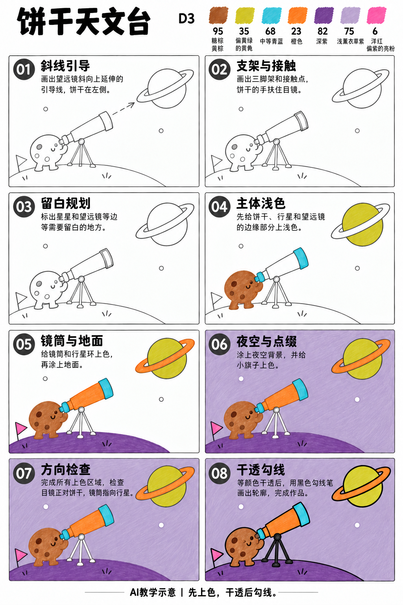
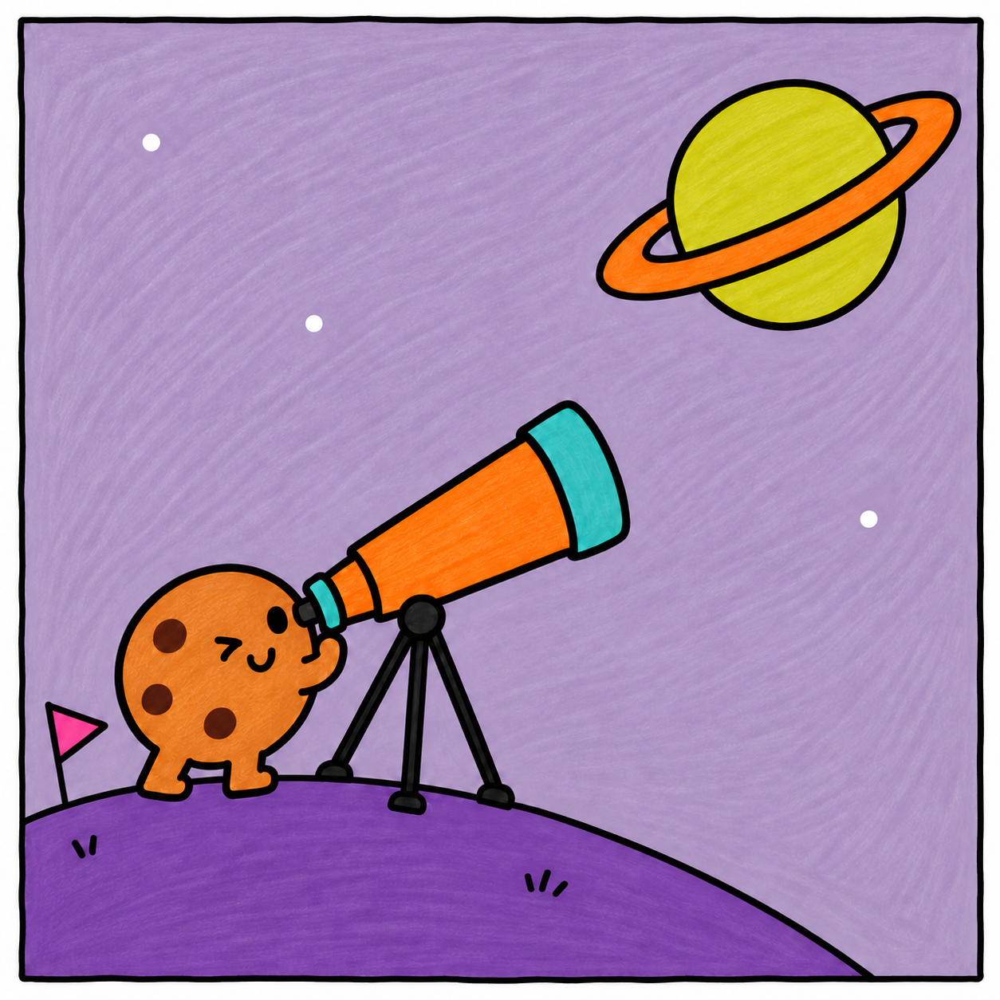

# S001-020｜饼干天文台

> **配色已修订：** 成品、教学图与正文按实涂色卡的相对色相重新配套；浅色以同纸单层试色为准，屏幕图不作精确色值。旧图只作历史留存。

[全部教案](../README.md) · [本阶段](README.md) · [S001风格](../../styles/001-playful-color-block.md)

**D3 综合组织 · 提示练习 · 预计整幅约70分钟**

先修：已能控制曲线、表情、线条与简单遮挡；先完成D2复盘，或有相同能力。

主要目标：**用大斜线和留空组织观看方向与画面焦点**。

计划时间包括试色、起稿、上色和检查，不含额外干燥等待，不登记为实际用时。可按每次20～30分钟分次：先完成草图与留白，再分批上色，最后干透后勾线。

## 纸笔与画面大小

使用16.5×16.5厘米马克笔专用纸，纸下垫废纸；本课主体约12～13厘米，四周留白。普通铅笔轻定位，0.5mm针管笔收轮廓，0.15mm用于少量细节，1.0mm外轮廓可选。

使用Touchmark学生36色油性马克笔。针管笔耐酒精性未知时统一先上色，完全干透后勾线。大块白形留纸白，132不当覆盖白笔或混色笔；白色高光工具仅可选，需先试效果，本课不依赖。

## 色号与区域

| 色号 | 本套色名 | 计划区域 |
| --- | --- | --- |
| 95 | 赭棕、黄棕 | 饼干与支架小暖色 |
| 35 | 偏黄绿的黄色 | 星球 |
| 68 | 中等青蓝 | 角色手与望远镜口 |
| 23 | 橙色 | 望远镜筒 |
| 82 | 较深紫色 | 地面 |
| 75 | 浅薰衣草紫 | 夜空 |
| 6 | 洋红、偏紫的亮粉 | 小旗与点缀 |

AI图颜色仅近似实物。先在废纸试色，以此表为准；同色深浅只允许在完全干后小面积轻叠，不依赖浅色覆盖深色。更换配色时仍从本套已有色号中选择，保持主次关系，并更新本课色号记录。

## 先练3～5分钟

用一条斜线替代望远镜，试三个角度，选能从角色视线指向星球的角度。

## 留纸白

星星、镜口亮边与角色眼睛亮点可提前留白；不依赖白笔补星空。

## 成品与递进示意

从左到右、从上到下阅读。灰线表示铅笔，黑轮廓等颜色完全干透后再画；示意若提前出现少量五官，按正文延后。

图文检查说明：步骤图04把镜筒提前示成黄色，实际镜筒先留空，第05步直接用23，不叠黄底。三脚架与接头以黑线和少量纸白表达，图中灰色不对应新增灰笔。

## 8个操作环节

### 01 斜线引导

先定望远镜斜线，从左下角色指向右上星球；角色与星球不能挤在同一块。

### 02 支架与接触

用三脚支架托住镜筒，角色手碰到镜筒或调节处。支架交会点位于镜筒下方而不是旁边。

### 03 留白规划

标出少量星点和镜口亮边，背景填色时绕开。饼干缺口与身体外轮廓相连，不画成内部黑洞。

### 04 主体浅色

35涂星球，95涂饼干，68涂镜口与手。饼干表情位置先用铅笔保留。

### 05 镜筒与地面

23涂镜筒，82涂地面；地面只留一条弧线，不增加写实陨石细节。

### 06 夜空与点缀

75涂夜空，6涂小旗。绕开星球、星点和望远镜，镜筒窄亮边可留纸白。

### 07 方向检查

确认镜筒朝向星球，角色眼睛靠近镜筒观察端。饼干点用少量95同色加深或留到黑线时轻点。

### 08 干透勾线

干透后完成支架、脸与轮廓。星球环在球体前后分开，后方一段不能穿过球心。

## 常见问题

望远镜像悬空斜棒：镜筒下增加明确支架交点，再让角色手真正碰到观察端，别靠加阴影解释支撑。

## 完成检查

- 镜筒方向能引导视线到星球
- 支架托住镜筒
- 星球环有前后遮挡

## 换题迁移

把星球放高一点，只调整镜筒倾角与视线，不重画所有物件。

本页小草图与局部试练不另算一幅完成作品。只有实际画完正式作品后才登记；日期、照片、用时与反馈可省略。每阶段7幅后结合实际能力复盘，需要巩固再补练，不自动晋级。

成品示例：完成自己的草图后再展开

## 来源

成品与教学提示图为AI生成示意，使用OpenAI内置imagegen；不计实际手绘完成。

[本课提示词与检查说明](../../entries/scene/020-cookie-observatory/reference/generation-prompts.json) · [基础学习资料](../../docs/learning-references.md) · [完整进阶规则](../../docs/learning-system.md)

[本次配色修订提示词与核对](../../entries/scene/020-cookie-observatory/reference/color-revision-v5.json)
