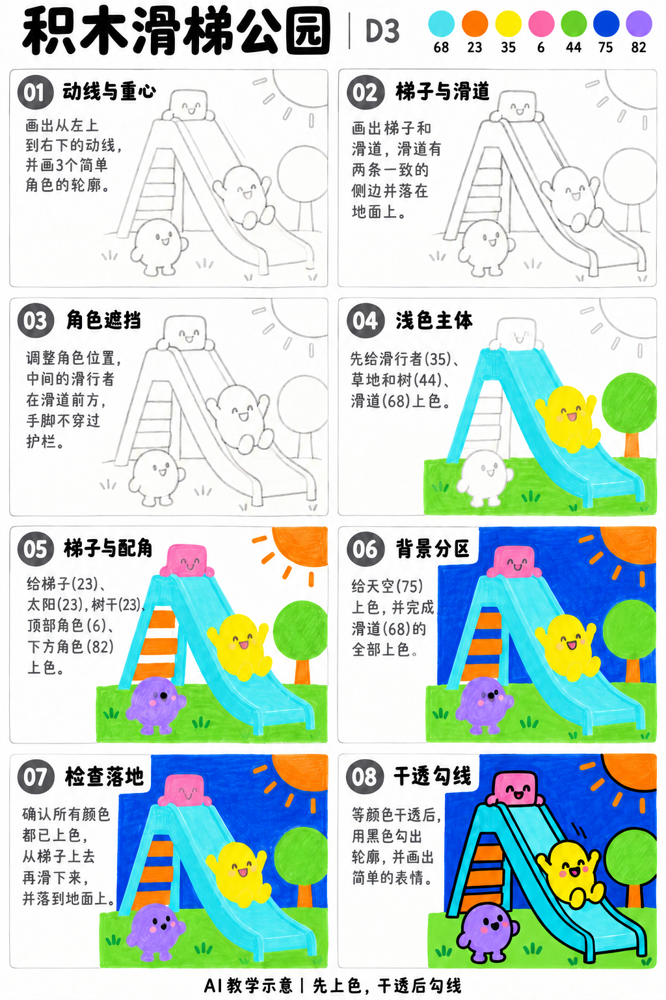
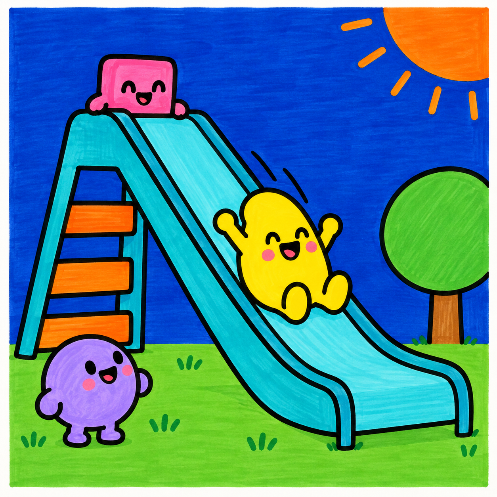

# S001-021｜积木滑梯公园

> **配色待校正：** 本课成品与教学图尚未通过实笔色卡核对，图内色号、色名和填色不能直接作为用笔依据。造型步骤保留；问题详见[36色色卡与28课审查](../../docs/color-audit-2026-11-01.md)。

[全部教案](../README.md) · [本阶段](README.md) · [S001风格](../../styles/001-playful-color-block.md)

**D3 综合组织 · 提示练习 · 预计整幅约75分钟**

先修：已能控制曲线、表情、线条与简单遮挡；先完成D2复盘，或有相同能力。

主要目标：**综合主次、斜向动势与多个角色的遮挡关系**。

计划时间包括试色、起稿、上色和检查，不含额外干燥等待，不登记为实际用时。可按每次20～30分钟分次：先完成草图与留白，再分批上色，最后干透后勾线。

## 纸笔与画面大小

使用16.5×16.5厘米马克笔专用纸，纸下垫废纸；本课主体约12～13厘米，四周留白。普通铅笔轻定位，0.5mm针管笔收轮廓，0.15mm用于少量细节，1.0mm外轮廓可选。

使用Touchmark学生36色油性马克笔。针管笔耐酒精性未知时统一先上色，完全干透后勾线。大块白形留纸白，132不当覆盖白笔或混色笔；白色高光工具仅可选，需先试效果，本课不依赖。

## 色号与区域

| 色号 | 本套色名 | 计划区域 |
| --- | --- | --- |
| 68 | Turquoise Blue | 滑梯 |
| 23 | Orange | 梯子、太阳与树干 |
| 35 | Lemon Yellow | 滑行主角 |
| 6 | Vivid Pink | 顶部角色 |
| 44 | Fresh Green | 地面与树冠 |
| 75 | Dark Blue Light | 天空 |
| 82 | Light Violet | 低处角色 |

AI图颜色仅近似实物。先在废纸试色，以此表为准；同色深浅只允许在完全干后小面积轻叠，不依赖浅色覆盖深色。更换配色时仍从本套已有色号中选择，保持主次关系，并更新本课色号记录。

## 先练3～5分钟

用三个大小块试布局，最大块当滑梯，小块当角色；沿滑梯画一条斜动线，看人物是否顺着它移动。

## 留纸白

太阳亮点和眼睛高光可省略；滑梯中的窄亮条需提前留纸白。

## 成品与递进示意

从左到右、从上到下阅读。灰线表示铅笔，黑轮廓等颜色完全干透后再画；示意若提前出现少量五官，按正文延后。

图文检查说明：顶部35与6的色卡已校正：35柠檬黄，6亮粉。树干用23，不照成品的棕色另加一支笔；图04树干与脸颊的示色可延后到第05步。

## 8个操作环节

### 01 动线与重心

滑梯从左上落向右下，画面下部留落地区。先放上、中、下三个角色的大形，保持主角最大或位置最醒目。

### 02 梯子与滑道

梯子接在滑梯顶部，滑道两侧边朝同一方向延伸。底端接地，不能悬在角色脚上。

### 03 角色遮挡

上方角色趴在顶端，滑行角色位于滑道前，低处角色站在地面。擦掉穿过手脚的滑梯线。

### 04 浅色主体

35涂滑行主角，44涂地面与树冠，68涂滑梯大面。亮条预留，不依赖白笔补。

### 05 梯子与配角

23涂梯子和太阳，6涂顶端角色，82涂低处角色；小树干用75或23，不新增棕色笔。

### 06 背景分区

75涂天空，68补齐滑道。地面与滑梯之间保留清楚边界，不用涂满所有空隙。

### 07 检查落地

从梯子走到顶端、顺滑道下滑、到地面停住，逐段检查路线。删掉挡住主角脸的线与过密装饰。

### 08 干透勾线

干透后先勾主角与滑梯外轮廓，再勾梯阶和细表情。滑梯后边线遇人物就断开。

## 常见问题

滑梯像一条彩带：补清顶部入口、双侧边与下端接地，梯子必须接到同一平台，再减少不必要的线。

## 完成检查

- 梯子、平台、滑道形成连续路线
- 三个角色的前后位置不同
- 主角与滑道重叠处没有穿透线

## 换题迁移

把低处角色移到另一侧，判断是否会挡住滑梯出口。

本页小草图与局部试练不另算一幅完成作品。只有实际画完正式作品后才登记；日期、照片、用时与反馈可省略。每阶段7幅后结合实际能力复盘，需要巩固再补练，不自动晋级。

成品示例：完成自己的草图后再展开

## 来源

成品与教学提示图为AI生成示意，使用OpenAI内置imagegen；不计实际手绘完成。

[本课提示词与检查说明](../../entries/scene/021-building-block-slide-park/reference/generation-prompts.json) · [基础学习资料](../../docs/learning-references.md) · [完整进阶规则](../../docs/learning-system.md)
