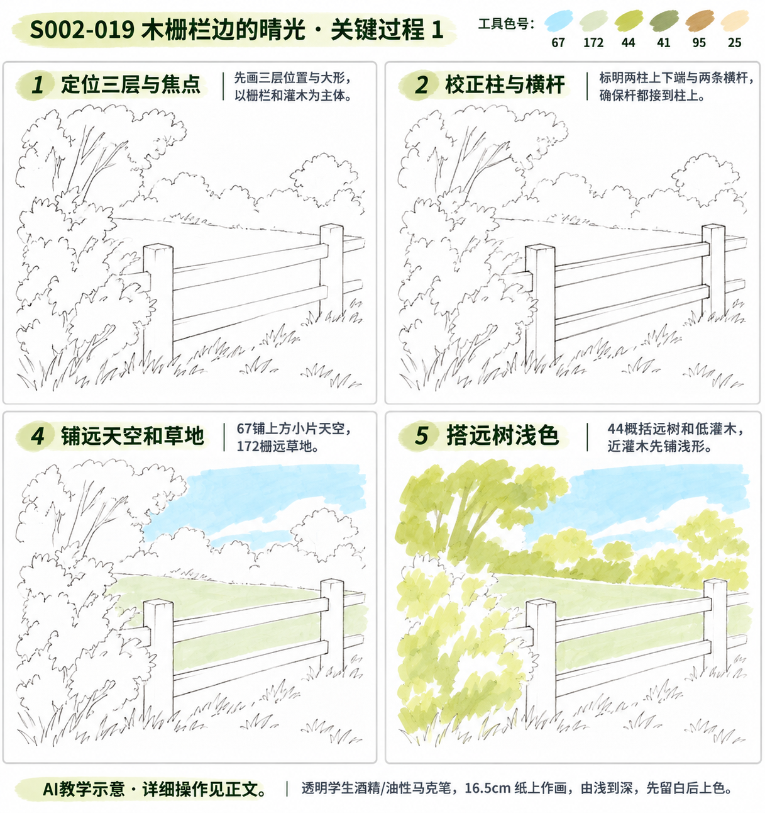
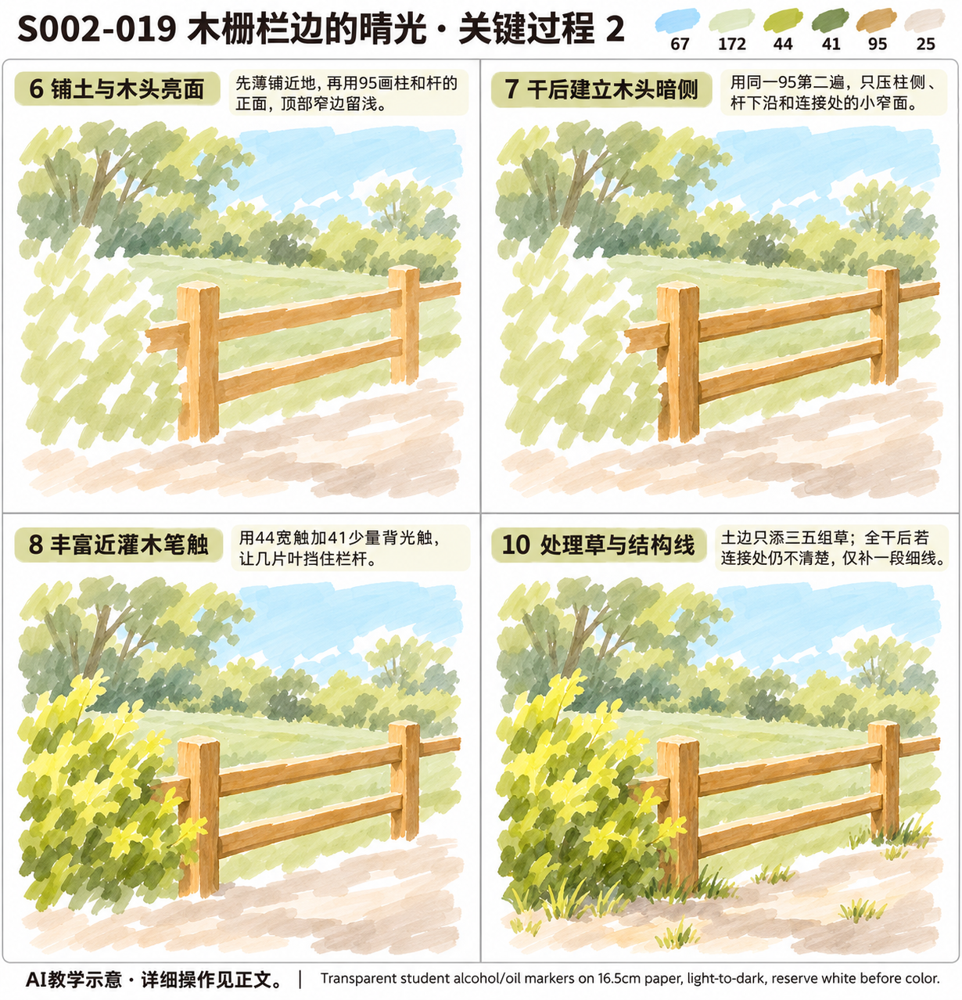
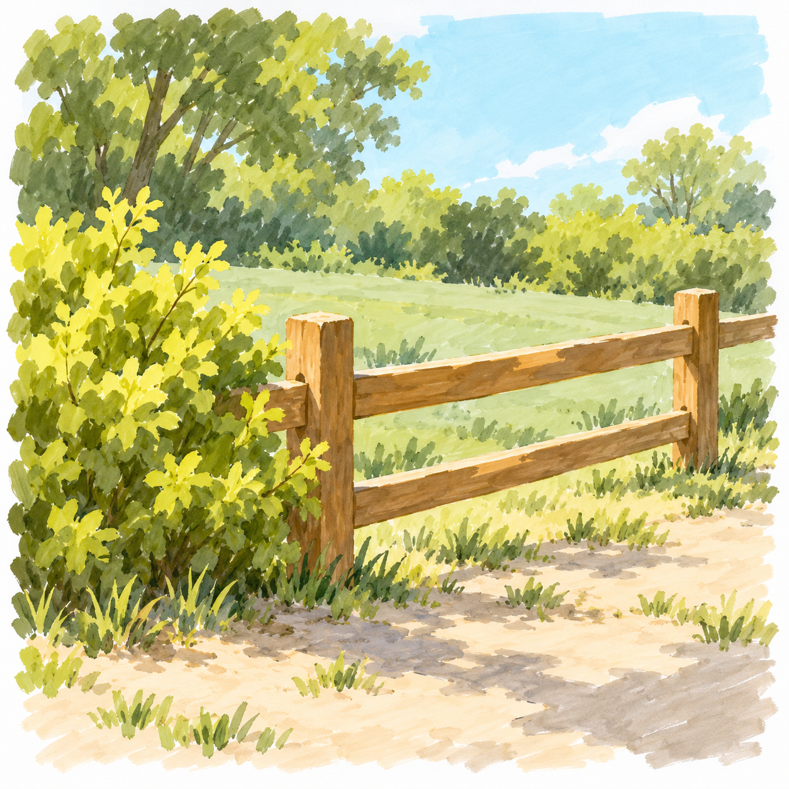

# S002-019 木栅栏边的晴光

[S002本阶段入口](S002-README.md) · [28课节奏总览](../../styles/previews/S002-28-2026-11-02/README.md) · [风格档案](../../styles/002-sunlit-brushstroke-landscape.md)

- 风格与等级：S002 晴日笔触风景 · D3 综合组织。
- 主要目标：用前后遮挡建立三层小景。
- 教学帮助：提示练习，配详细操作正文与关键过程图；需要逐笔帮助时可以进一步补专项示意。
- 先修能力：能控制少量自然笔触与简单明暗；复杂物件可先在废纸练结构，不必带着错误进入上色。
- 画幅：16.5厘米方形马克笔纸，画面约11～13厘米，四周留至少1厘米纸白；植物叶触通常约3～7毫米，不要求复制缩小后难辨认的微细纹理。
- 整幅预计：约65～100分钟；这是教学估计，不是实际用时。
- 当前状态：教案与帮助图已备，待实际练习。全部图片为AI示意，不是真实手绘。

## 分次与停笔位置

建议三次：结构与浅色约25～35分钟；主体与层次约25～35分钟；干后暗部、检查与收尾约15～25分钟。单次累了可提前停。

暂停时盖好笔帽，等颜色完全干再合本；恢复后先看最后一个检查点，再继续下一环节，不重复重刷所有旧区域。

## 工具、色号与区域分工

铅笔、橡皮、Touchmark学生36色油性马克笔，纸下垫隔墨废纸；针管笔为可选结构工具。笔头形状未确认时，先用现有笔的侧面或轻压试出宽窄，不要求另购画笔。

| 色号 | 当前实涂照片观察 | 本课用途 |
| --- | --- | --- |
| 67 | 浅青蓝（照片观察） | 铺远天空和草地 |
| 172 | 极浅灰绿（照片观察） | 铺远天空和草地、安排一组投影 |
| 44 | 偏黄的橄榄绿（照片观察） | 搭远树浅色、丰富近灌木笔触 |
| 41 | 较深橄榄绿（照片观察） | 丰富近灌木笔触、安排一组投影、处理草与结构线 |
| 95 | 赭棕、黄棕（照片观察） | 铺土与木头亮面、干后建立木头暗侧、处理草与结构线 |
| 25 | 很浅的灰米色、灰肤色（照片观察） | 铺土与木头亮面 |

先在同种废纸上画每色小块和一组浅底叠深色，干后再比较。照片与AI图只支持近似色系；25是极浅灰米、172是极浅灰绿、75是浅紫、82是较深紫，不能按旧英文名猜色。示意中同一色的笔痕明暗不必逐块另配色，不为追求屏幕色反复湿叠。

本课区域色号以本表及步骤为操作依据，黑色细线不算大面积配色。浅色不能盖回深色；132不是覆盖白，白色高光笔的覆盖能力未验证，均不列为必须工具。白云、亮花、反光与重要亮边提前留纸白。

## 结构难点：先在废纸弄清再上色

横杆必须接柱，柱脚落坡；近灌木遮挡的栏杆不透画。可省略木纹和大多数远树，不能省掉横杆厚边与支撑关系。

用铅笔在废纸缩小画一次关键结构，只要轮廓、开口、支撑或遮挡能解释清楚即可。看不懂时先停在此处；不要靠增加阴影、草叶或黑轮廓掩盖错误。

## 准备：三分钟试笔

1. 一笔轻压拖出宽触，再逐渐提起形成尖端；用较少笔触保留自然方向，避免规则圆团或外圈深点。
2. 两个浅色小块干后分别加深一小段，观察是否变脏、渗开或不易区分；不满意就缩小叠色面积。
3. 擦淡正式画面内的铅笔线，试一下橡皮是否会带走湿墨。针管笔兼容性未知时一律先上色、完全干透后才局部勾线。

## 详细操作

下方正文覆盖完整操作。帮助图只取关键状态，图中跳过的动作仍按正文执行，不因没有单独一格就省略干燥或结构检查。

### 1. 定位三层与焦点

**工具与区域：** 铅笔。

画幅约12厘米，先标近处灌木、中间栅栏、远处草地三层；栅栏最高处不过画面上三分之二。

**操作节奏：** 先轻画或单层落笔。每做完一小区域就离开观察，不为消除接笔痕持续来回摩擦。

**这一环节检查：** 主体是栅栏与灌木，不让远树抢焦点。

### 2. 校正柱与横杆

**工具与区域：** 铅笔。

标两根主柱的上、下端，再画两条横杆；每根杆必须接到柱上，远端略短、略窄，不凭空结束在草里。

**操作节奏：** 先轻画或单层落笔。每做完一小区域就离开观察，不为消除接笔痕持续来回摩擦。

**这一环节检查：** 杆与柱连接明确，柱底在同一坡面。

### 3. 画遮挡留空

**工具与区域：** 铅笔、橡皮。

近灌木先圈不规则外形，擦去被灌木挡住的栏杆线；草叶与天空小孔只留主要几处。

**操作节奏：** 先轻画或单层落笔。每做完一小区域就离开观察，不为消除接笔痕持续来回摩擦。

**这一环节检查：** 看得到的杆才保留，不透过植物画完整栏杆。

### 4. 铺远天空和草地

**工具与区域：** 67、172。

67只铺上方小片天空，云留纸白；172铺远草地，栅栏与灌木区域暂不涂。

**操作节奏：** 先轻画或单层落笔。每做完一小区域就离开观察，不为消除接笔痕持续来回摩擦。

**这一环节检查：** 远景比近景轻，天空不压满整张纸。

### 5. 搭远树浅色

**工具与区域：** 44。

用少量大短触概括远树和低灌木，边缘软而不碎；近灌木只先铺浅形，不急着每叶加深。

**操作节奏：** 若前层仍发亮或手边同纸试色摸着发凉潮湿，先停笔。等待以实际干燥为准，通常至少留几分钟；时间到但仍湿就继续等。

**这一环节检查：** 远树笔触比近叶更少、更小。

### 6. 铺土与木头亮面

**工具与区域：** 25、95。

25薄铺近地，95单层画柱和杆的正面，顶部窄边提前留浅；不另加图外的深棕色号。

**操作节奏：** 先轻画或单层落笔。每做完一小区域就离开观察，不为消除接笔痕持续来回摩擦。

**这一环节检查：** 杆有厚度但不靠黑线包边，浅亮边是预留。

### 7. 干后建立木头暗侧

**工具与区域：** 95。

用同一95第二遍只压柱侧、杆下沿和连接处的小窄面。一次画完一条暗侧，别湿叠来回刷。

**操作节奏：** 若前层仍发亮或手边同纸试色摸着发凉潮湿，先停笔。等待以实际干燥为准，通常至少留几分钟；时间到但仍湿就继续等。

**这一环节检查：** 暗侧方向一致，横杆不会变成漂浮线条。

### 8. 丰富近灌木笔触

**工具与区域：** 44、41。

近叶以44宽触和41少量背光触形成不规则边；让几片叶挡住栏杆，暗色集中在根部和重叠处。

**操作节奏：** 若前层仍发亮或手边同纸试色摸着发凉潮湿，先停笔。等待以实际干燥为准，通常至少留几分钟；时间到但仍湿就继续等。

**这一环节检查：** 近密远疏，栏杆仍是可读的大形。

### 9. 安排一组投影

**工具与区域：** 41、172。

先在废纸试172上极少41短触，满意后在柱脚和叶下铺断续阴影；不把每片叶复制到地面。

**操作节奏：** 若前层仍发亮或手边同纸试色摸着发凉潮湿，先停笔。等待以实际干燥为准，通常至少留几分钟；时间到但仍湿就继续等。

**这一环节检查：** 阴影从物体脚下出发，方向统一。

### 10. 处理草与结构线

**工具与区域：** 41、95、可选0.15针管笔。

土边只添三五组草。全干后若连接处仍不清楚，仅补一段细结构线，不勾整张风景。

**操作节奏：** 若前层仍发亮或手边同纸试色摸着发凉潮湿，先停笔。等待以实际干燥为准，通常至少留几分钟；时间到但仍湿就继续等。

**这一环节检查：** 杆接柱、柱接地，最后删除心中想加的无关小物。

## 帮助图与成品示意

关键图的编号对应上文操作编号，因此不一定连续。D3两页沿用相同构图，第二页接着第一页发展；细笔触数量允许概括变化。

## 可以省略什么，哪些不能省

可以省略示意中的细碎草尖、远树枝叶、木纹、石裂和小装饰；保留主要色块与本课主要目标即可。不能省掉主体连接、开口厚度、接地、主要遮挡、光向判断和上深色前的干燥等待。

## 出错时怎么处理

| 现象 | 先检查 | 当前能做的调整 |
| --- | --- | --- |
| 植物成了整齐色球或一圈深点 | 是否先把自然边界画成圆、暗点平均分布 | 停止描边；下一处用长短不等的独立叶触与纸白缺口。本课不要求规则对称 |
| 细节太密看不清主体 | 是否每一处都追画示意 | 当下停止加笔；先在废纸画删去一半细节的小稿，再决定下张怎么改 |
| 深色发脏或浅色盖不回去 | 是否湿底上反复刷、想用浅色覆盖深色 | 等干后只补必要深处，保留误差；大面积错误另画小稿，不用132补白 |
| 物件悬空或透视不合理 | 支撑、口沿、接触面及被挡住的线 | 先用铅笔另画结构解释，必要时重做局部练习，不用草叶遮盖 |
| 光影方向互相打架 | 主体暗侧、地面影与来光箭头 | 以最初光向为准检查，不再加第二个方向的影；大改留到下一版 |
| 马克笔洇出边界 | 是否纸太湿、边缘反复停留 | 停笔等干，之后在边界内侧提笔；不要补一圈粗黑线修边 |

## 完成检查与记录

1. 指出本课主要目标在画面中的位置，用一句话说明自己怎么做到。
2. 大形、连接、遮挡、接地和主要留白都可读；暗色与细节没有淹没主体。
3. 光向与前后层次一致；可以明确指出一处主动保留的空隙和一处主动省掉的细节。
4. 只在实际画完并确认后记录完成。照片、实际用时和文字复盘可省略；没有信息就留空，不把预计时间当实际时间。

每阶段七幅实际完成后结合能力回看，需要时补2～3幅针对性练习；不按生成数量自动晋级。D4主线后仍可持续自主创作。

## 来源与示意边界

内置imagegen生成的原创晴日笔触风景成品与关键教学图；生成提示词见本作品reference/generation.json。关键图服务构图、顺序、结构和大色块，AI细节可能概括变化，不要求逐笔复制。配色以现有工具实涂照片的相对色系和同纸试色为准，未作精确色度校准或实笔完成验证。
