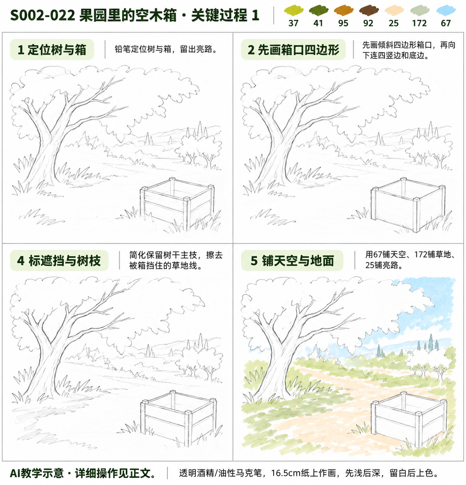
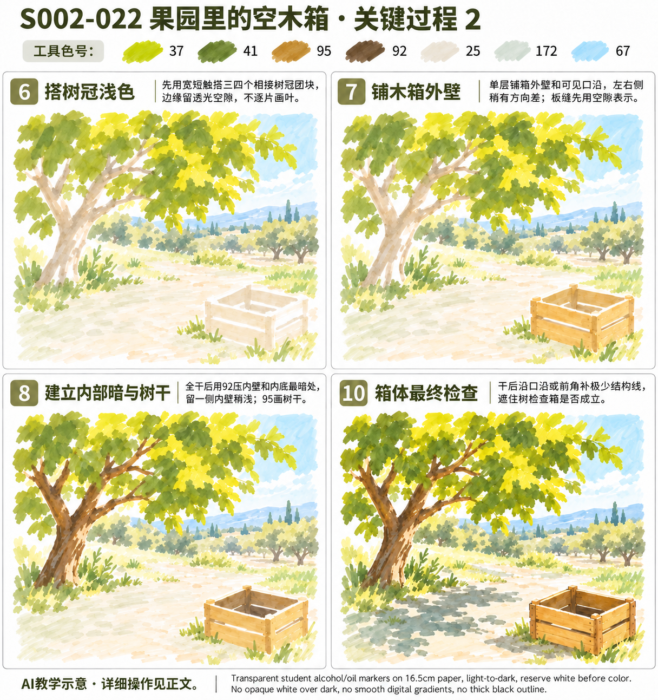
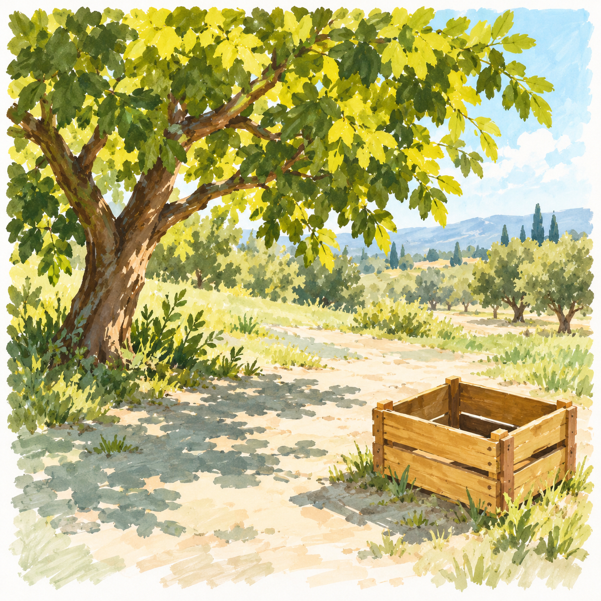

# S002-022 果园里的空木箱

[S002本阶段入口](S002-README.md) · [28课节奏总览](../../styles/previews/S002-28-2026-11-02/README.md) · [风格档案](../../styles/002-sunlit-brushstroke-landscape.md)

- 风格与等级：S002 晴日笔触风景 · D3 综合组织。
- 主要目标：协调植物大形与箱体结构。
- 教学帮助：提示练习，配详细操作正文与关键过程图；需要逐笔帮助时可以进一步补专项示意。
- 先修能力：能控制少量自然笔触与简单明暗；复杂物件可先在废纸练结构，不必带着错误进入上色。
- 画幅：16.5厘米方形马克笔纸，画面约11～13厘米，四周留至少1厘米纸白；植物叶触通常约3～7毫米，不要求复制缩小后难辨认的微细纹理。
- 整幅预计：约65～100分钟；这是教学估计，不是实际用时。
- 当前状态：教案与帮助图已备，待实际练习。全部图片为AI示意，不是真实手绘。

## 分次与停笔位置

建议三次：结构与浅色约25～35分钟；主体与层次约25～35分钟；干后暗部、检查与收尾约15～25分钟。单次累了可提前停。

暂停时盖好笔帽，等颜色完全干再合本；恢复后先看最后一个检查点，再继续下一环节，不重复重刷所有旧区域。

## 工具、色号与区域分工

铅笔、橡皮、Touchmark学生36色油性马克笔，纸下垫隔墨废纸；针管笔为可选结构工具。笔头形状未确认时，先用现有笔的侧面或轻压试出宽窄，不要求另购画笔。

| 色号 | 当前实涂照片观察 | 本课用途 |
| --- | --- | --- |
| 37 | 黄绿色，非奶油浅黄（照片观察） | 搭树冠浅色 |
| 41 | 较深橄榄绿（照片观察） | 补植物暗与投影 |
| 95 | 赭棕、黄棕（照片观察） | 铺木箱外壁、建立内部暗与树干 |
| 92 | 深棕（照片观察） | 建立内部暗与树干 |
| 25 | 很浅的灰米色、灰肤色（照片观察） | 铺天空与地面 |
| 172 | 极浅灰绿（照片观察） | 铺天空与地面、补植物暗与投影 |
| 67 | 浅青蓝（照片观察） | 铺天空与地面 |

先在同种废纸上画每色小块和一组浅底叠深色，干后再比较。照片与AI图只支持近似色系；25是极浅灰米、172是极浅灰绿、75是浅紫、82是较深紫，不能按旧英文名猜色。示意中同一色的笔痕明暗不必逐块另配色，不为追求屏幕色反复湿叠。

本课区域色号以本表及步骤为操作依据，黑色细线不算大面积配色。浅色不能盖回深色；132不是覆盖白，白色高光笔的覆盖能力未验证，均不列为必须工具。白云、亮花、反光与重要亮边提前留纸白。

## 结构难点：先在废纸弄清再上色

先画箱口四边形，再画外壁与窄口沿，内底位置低于后口沿且被前壁遮挡；空箱不是一个有盖的立方体。

用铅笔在废纸缩小画一次关键结构，只要轮廓、开口、支撑或遮挡能解释清楚即可。看不懂时先停在此处；不要靠增加阴影、草叶或黑轮廓掩盖错误。

## 准备：三分钟试笔

1. 一笔轻压拖出宽触，再逐渐提起形成尖端；用较少笔触保留自然方向，避免规则圆团或外圈深点。
2. 两个浅色小块干后分别加深一小段，观察是否变脏、渗开或不易区分；不满意就缩小叠色面积。
3. 擦淡正式画面内的铅笔线，试一下橡皮是否会带走湿墨。针管笔兼容性未知时一律先上色、完全干透后才局部勾线。

## 详细操作

下方正文覆盖完整操作。帮助图只取关键状态，图中跳过的动作仍按正文执行，不因没有单独一格就省略干燥或结构检查。

### 1. 定位树与箱

**工具与区域：** 铅笔。

左上放树冠，右下放空箱，留一条从近地通往中景的亮路；树冠与箱都不能占满画幅。

**操作节奏：** 先轻画或单层落笔。每做完一小区域就离开观察，不为消除接笔痕持续来回摩擦。

**这一环节检查：** 箱是结构训练重点，树仅提供环境。

### 2. 先画箱口四边形

**工具与区域：** 铅笔。

用一个倾斜四边形表示开口，四角确定后向下画四根竖边，再连底边；左右边分别保持近大远小。

**操作节奏：** 先轻画或单层落笔。每做完一小区域就离开观察，不为消除接笔痕持续来回摩擦。

**这一环节检查：** 箱口能看进去，不是画了带盖方块。

### 3. 补口沿和内底

**工具与区域：** 铅笔。

沿箱口向内退一窄圈形成厚度，再在内部画较低的内底；被前壁挡住的内底线擦去。

**操作节奏：** 先轻画或单层落笔。每做完一小区域就离开观察，不为消除接笔痕持续来回摩擦。

**这一环节检查：** 开口、厚边、内底、外壁四者可区分。

### 4. 标遮挡与树枝

**工具与区域：** 铅笔、橡皮。

树干与主枝只保留几条，树冠用大范围概括；箱子挡住的草和地线擦去。

**操作节奏：** 先轻画或单层落笔。每做完一小区域就离开观察，不为消除接笔痕持续来回摩擦。

**这一环节检查：** 没有树枝穿箱、地线穿箱的情况。

### 5. 铺天空与地面

**工具与区域：** 67、172、25。

67铺小片天空，172铺草地，25铺亮路；云、树冠浅部和箱口细亮边保留。

**操作节奏：** 先轻画或单层落笔。每做完一小区域就离开观察，不为消除接笔痕持续来回摩擦。

**这一环节检查：** 路面连续，箱体区域干净。

### 6. 搭树冠浅色

**工具与区域：** 37。

先用宽短触搭三四个相接树冠团块，边缘留透光空隙，不逐片画叶；树冠不跨到箱口。

**操作节奏：** 先轻画或单层落笔。每做完一小区域就离开观察，不为消除接笔痕持续来回摩擦。

**这一环节检查：** 树形明亮，主体数量未增加。

### 7. 铺木箱外壁

**工具与区域：** 95。

单层铺箱外壁和可见口沿，左右侧稍有方向差；木板缝先用空隙或细留白表示，不密画钉子。

**操作节奏：** 先轻画或单层落笔。每做完一小区域就离开观察，不为消除接笔痕持续来回摩擦。

**这一环节检查：** 板条方向顺着箱面，口沿厚度均匀。

### 8. 建立内部暗与树干

**工具与区域：** 92、95。

全干后用92压内壁和内底最暗处，留一侧内壁稍浅；95画树干，必要处用92一小段暗侧。

**操作节奏：** 若前层仍发亮或手边同纸试色摸着发凉潮湿，先停笔。等待以实际干燥为准，通常至少留几分钟；时间到但仍湿就继续等。

**这一环节检查：** 箱内比外壁暗但仍能看出内底，不成为纯黑洞。

### 9. 补植物暗与投影

**工具与区域：** 41、172。

41放树冠交叠暗部与箱脚少量草；172地面上少量叠层概括树影，不能逐片照搬全部叶子。

**操作节奏：** 若前层仍发亮或手边同纸试色摸着发凉潮湿，先停笔。等待以实际干燥为准，通常至少留几分钟；时间到但仍湿就继续等。

**这一环节检查：** 投影方向一致，箱脚与地面接触。

### 10. 箱体最终检查

**工具与区域：** 可选0.15针管笔、橡皮。

干后沿口沿或前角补极少结构线。遮住树检查箱是否成立；细枝、远树、碎草均可减去。

**操作节奏：** 若前层仍发亮或手边同纸试色摸着发凉潮湿，先停笔。等待以实际干燥为准，通常至少留几分钟；时间到但仍湿就继续等。

**这一环节检查：** 开口、厚度、支撑和前后遮挡全部可解释。

## 帮助图与成品示意

关键图的编号对应上文操作编号，因此不一定连续。D3两页沿用相同构图，第二页接着第一页发展；细笔触数量允许概括变化。

## 可以省略什么，哪些不能省

可以省略示意中的细碎草尖、远树枝叶、木纹、石裂和小装饰；保留主要色块与本课主要目标即可。不能省掉主体连接、开口厚度、接地、主要遮挡、光向判断和上深色前的干燥等待。

## 出错时怎么处理

| 现象 | 先检查 | 当前能做的调整 |
| --- | --- | --- |
| 植物成了整齐色球或一圈深点 | 是否先把自然边界画成圆、暗点平均分布 | 停止描边；下一处用长短不等的独立叶触与纸白缺口。本课不要求规则对称 |
| 细节太密看不清主体 | 是否每一处都追画示意 | 当下停止加笔；先在废纸画删去一半细节的小稿，再决定下张怎么改 |
| 深色发脏或浅色盖不回去 | 是否湿底上反复刷、想用浅色覆盖深色 | 等干后只补必要深处，保留误差；大面积错误另画小稿，不用132补白 |
| 物件悬空或透视不合理 | 支撑、口沿、接触面及被挡住的线 | 先用铅笔另画结构解释，必要时重做局部练习，不用草叶遮盖 |
| 光影方向互相打架 | 主体暗侧、地面影与来光箭头 | 以最初光向为准检查，不再加第二个方向的影；大改留到下一版 |
| 马克笔洇出边界 | 是否纸太湿、边缘反复停留 | 停笔等干，之后在边界内侧提笔；不要补一圈粗黑线修边 |

## 完成检查与记录

1. 指出本课主要目标在画面中的位置，用一句话说明自己怎么做到。
2. 大形、连接、遮挡、接地和主要留白都可读；暗色与细节没有淹没主体。
3. 光向与前后层次一致；可以明确指出一处主动保留的空隙和一处主动省掉的细节。
4. 只在实际画完并确认后记录完成。照片、实际用时和文字复盘可省略；没有信息就留空，不把预计时间当实际时间。

每阶段七幅实际完成后结合能力回看，需要时补2～3幅针对性练习；不按生成数量自动晋级。D4主线后仍可持续自主创作。

## 来源与示意边界

内置imagegen生成的原创晴日笔触风景成品与关键教学图；生成提示词见本作品reference/generation.json。关键图服务构图、顺序、结构和大色块，AI细节可能概括变化，不要求逐笔复制。配色以现有工具实涂照片的相对色系和同纸试色为准，未作精确色度校准或实笔完成验证。
