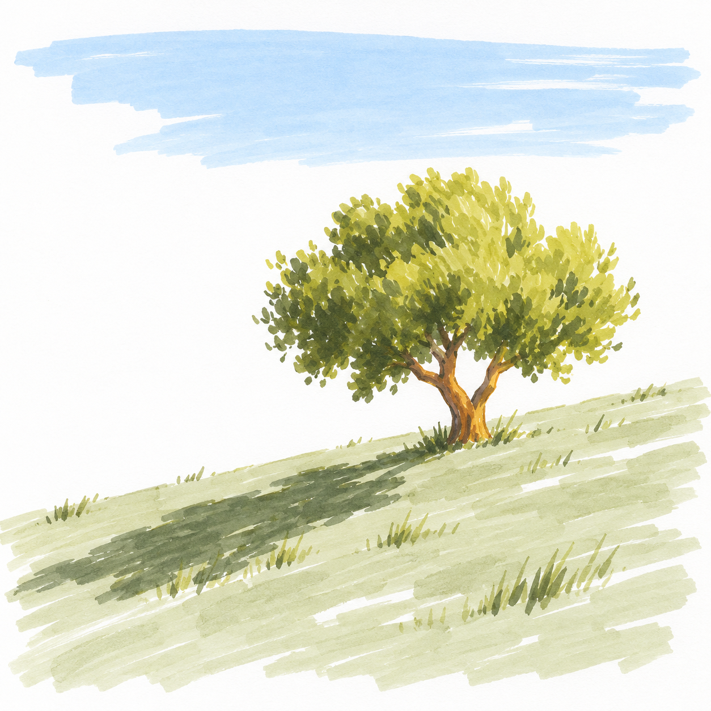

# S002-002 坡上的一株树

[风格档案](../../../../styles/002-sunlit-brushstroke-landscape.md)

AI原创成品候选，非真实手绘，非可直接跟画教程，不计实际完成。

构图简洁，但树冠碎笔触及明暗超过D1预期；目前估计D2，入门教学需再简化。

配色为生成目标，尚未完成实笔逐区域色号核对；白形需提前留纸白，不依赖浅色覆盖深底。

完整生成提示词见同目录material.json。
