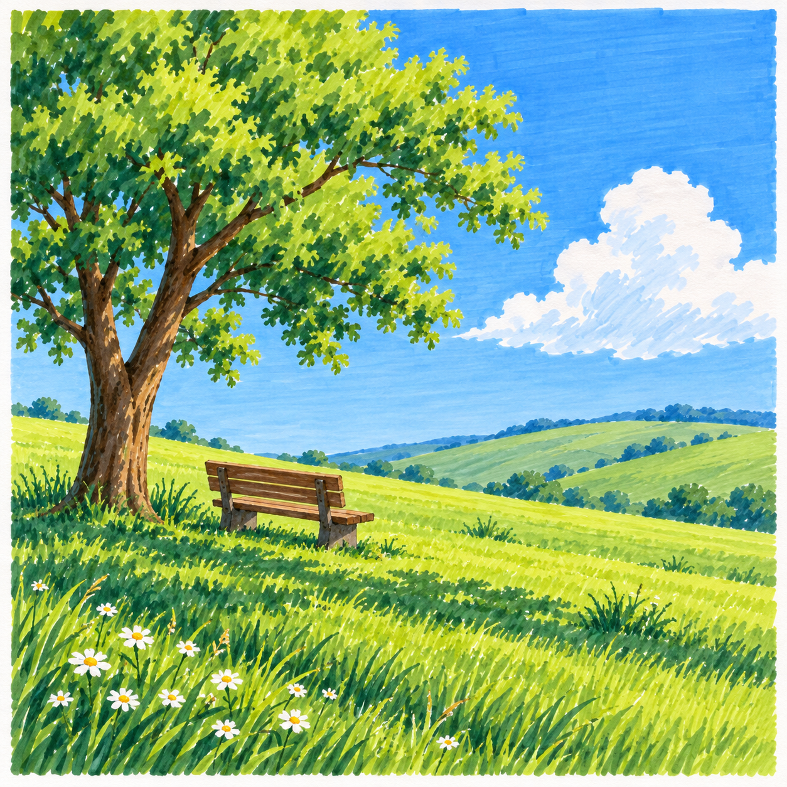

# S002-001 树荫下，坐一会儿

[风格档案](../../../../styles/002-sunlit-brushstroke-landscape.md)

- 风格：S002 晴日笔触风景。
- 用途：AI生成的成品展示素材，非真实手绘，非已备好的跟画教程。
- 预计阶段：D3综合组织；树形、明暗分组、前中远层次、长椅透视与投影需综合处理。
- 来源：AI原创场景示意，以草木笔触、明亮色彩与自然空间作为视觉方向。
- 配色与工具适配：尚未完成逐区域实笔色号核对，不据此指认精确色号。转为油性马克笔教案前需简化纹理、规划白云与白花留纸白，验证浅到深的操作顺序；不依赖浅色覆盖深底。
- 状态：仅展示；不计实际练习完成，不占用28幅主线课位。

画面描述：方形成品，左侧大树与树荫中的木长椅，前景草地与小白花，远处起伏草坡和晴空白云；通过可见草木短笔触、受光与阴影分组表现晴日氛围。
