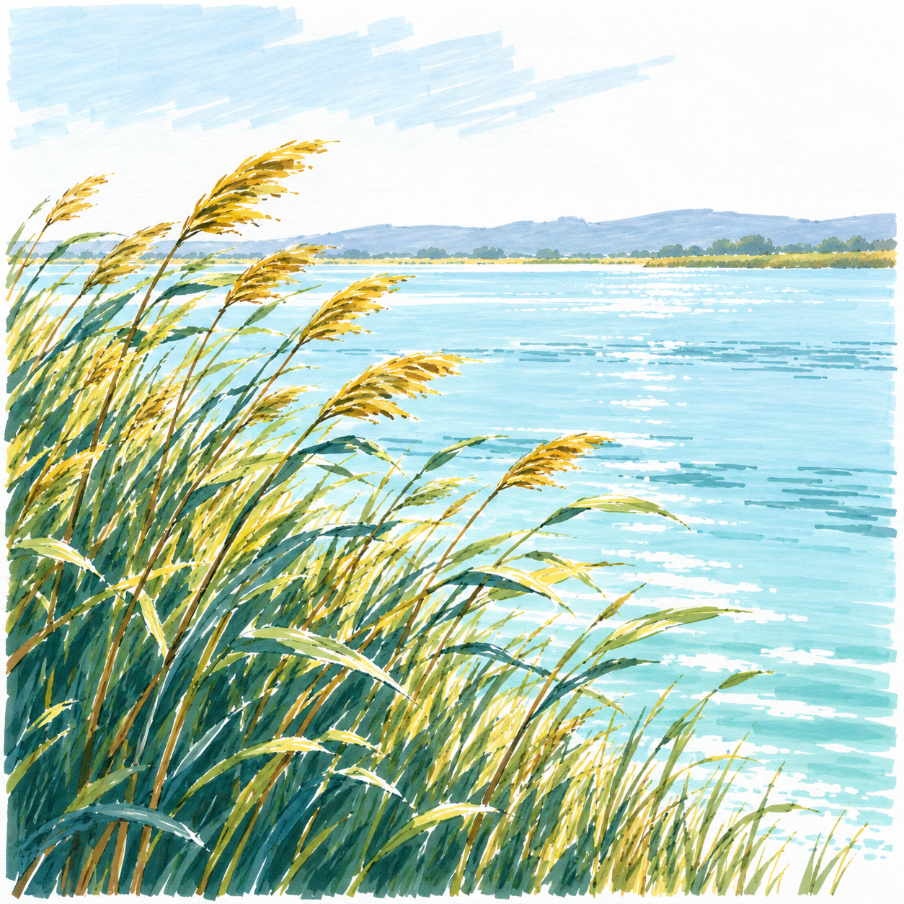

# S002-003 风吹芦苇岸

[风格档案](../../../../styles/002-sunlit-brushstroke-landscape.md)

AI原创成品候选，非真实手绘，非可直接跟画教程，不计实际完成。

芦苇密度与水面留白比原计划复杂，目前估计D3；专项练习需减少枝叶和水纹。

配色为生成目标，尚未完成实笔逐区域色号核对；白形需提前留纸白，不依赖浅色覆盖深底。

完整生成提示词见同目录material.json。
