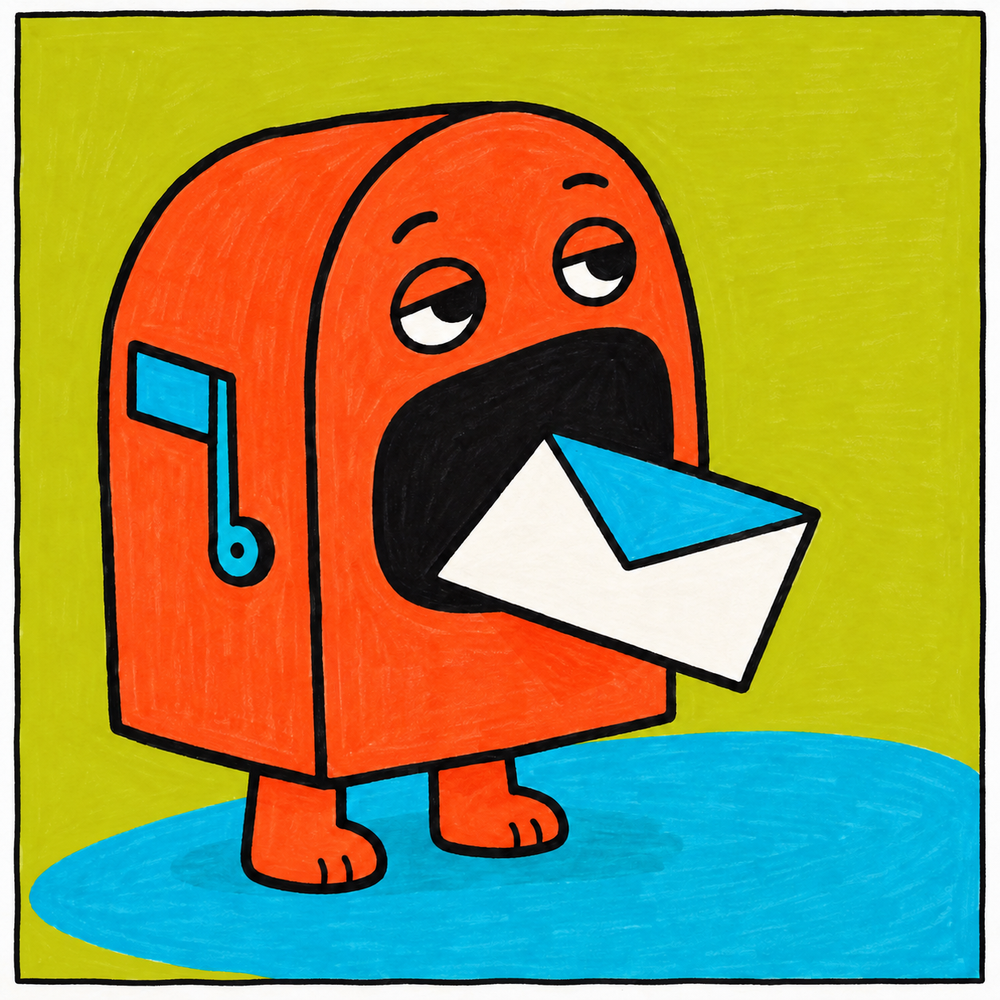
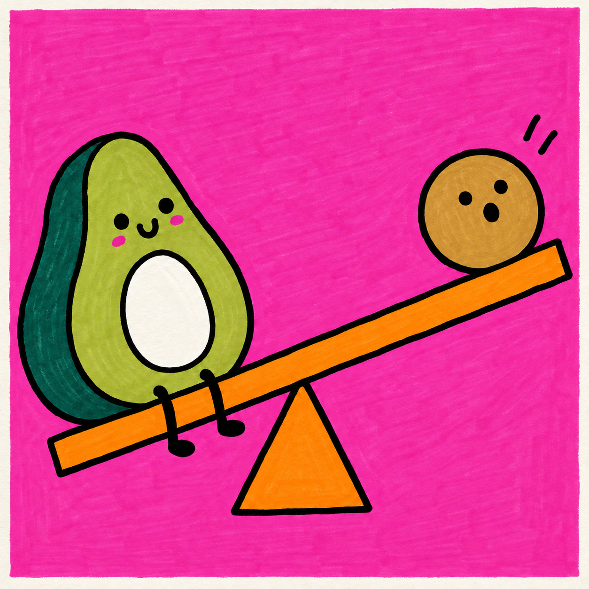
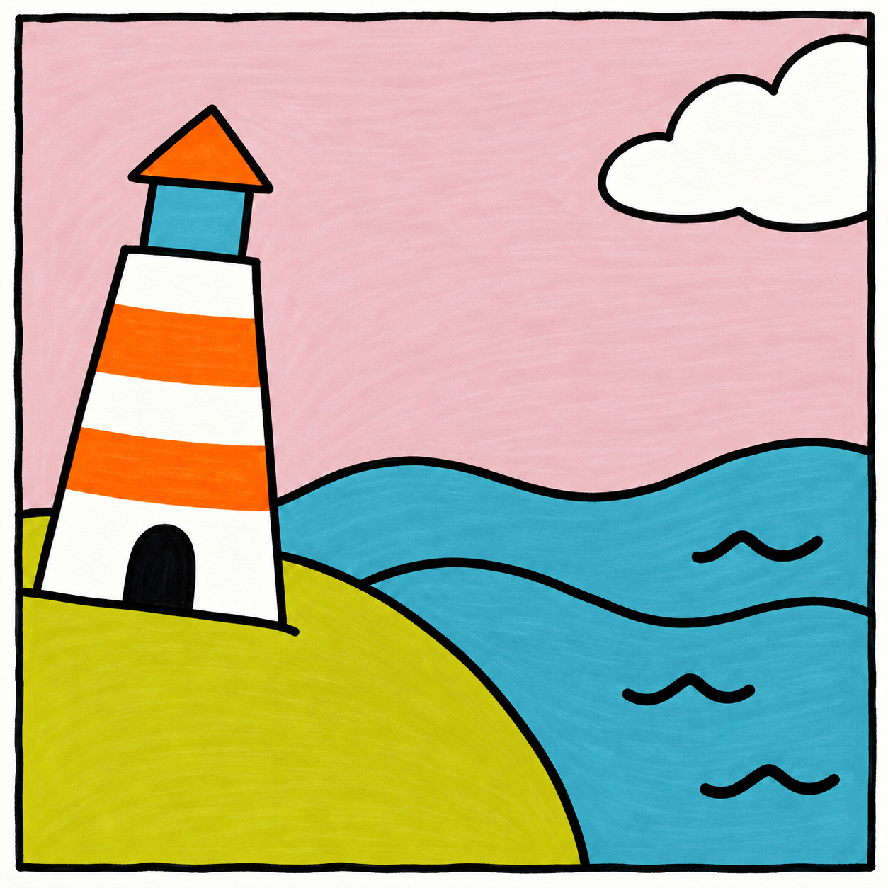
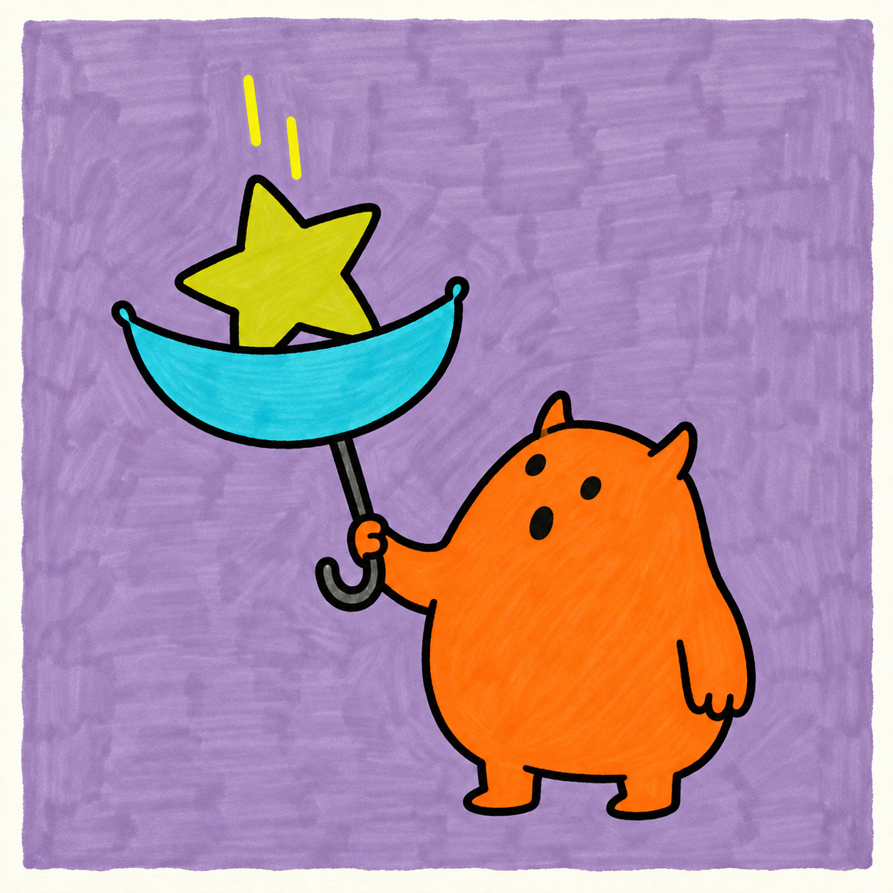
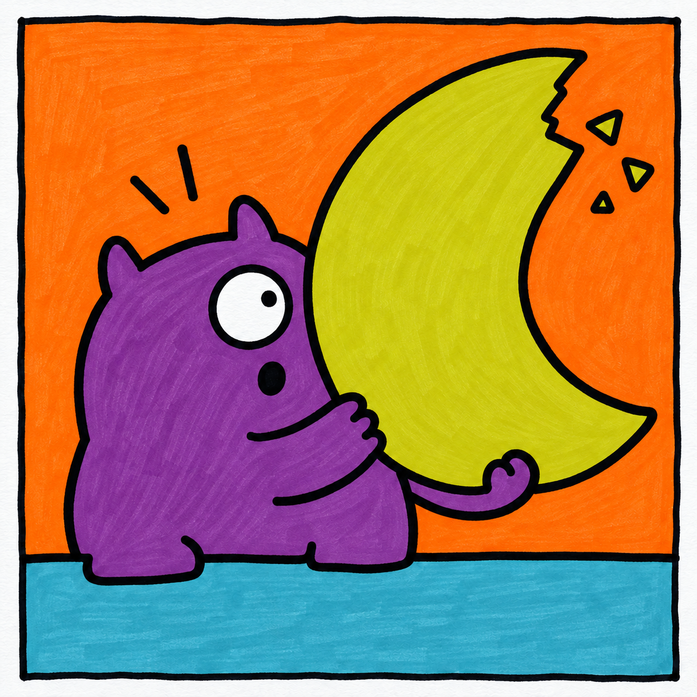
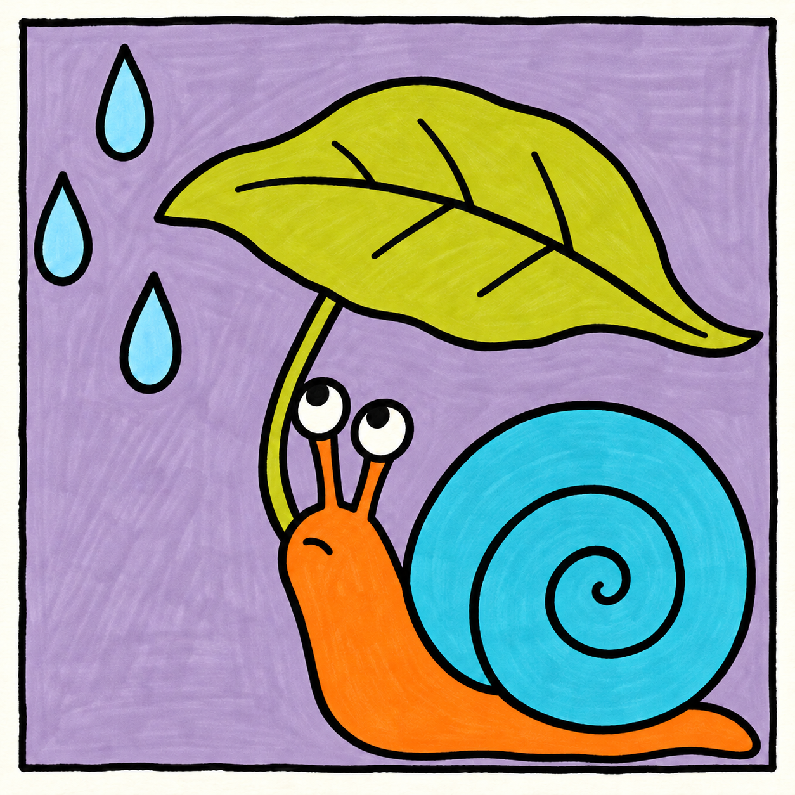
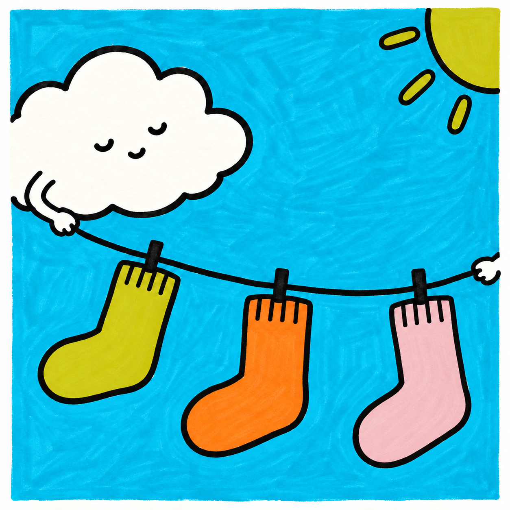
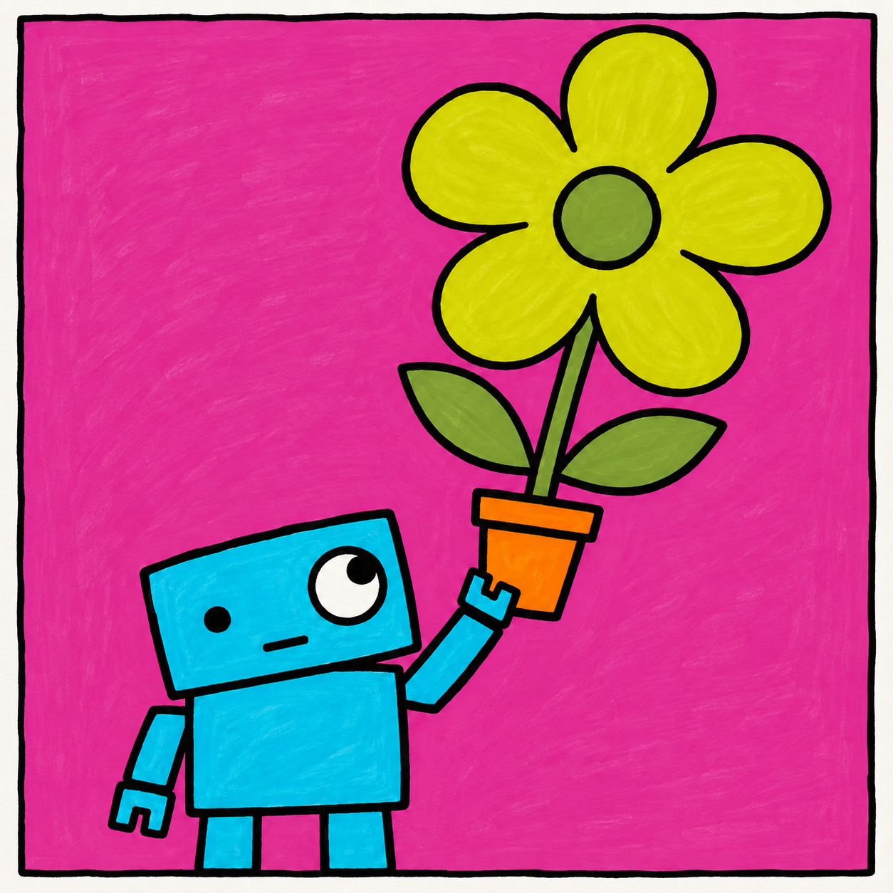
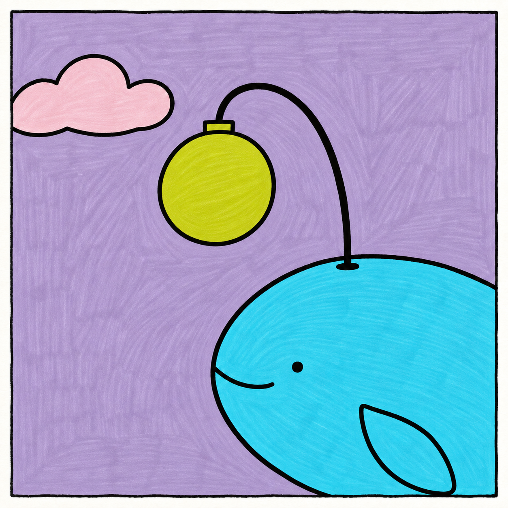

# S001｜童趣色块手绘

> **配色修订：** 28课成品、教学图和正文已按实涂色卡的相对色相重新配套；图像不作精确色值，以同纸试色为准。

[风格库](README.md) · 当前默认 · 建档：2026-10-31

一种便于复用的风格描述：浓郁平涂色块、自然手绘线条、简化形状，以及有情绪或小情节的画面。名称用于选画和组织练习，不是严格的美术流派，也不指向某位画家的专属风格。

## 风格展示

### 第一课展示

[001｜戴耳机的小蘑菇完整教程](../lessons/beginner/001-headphone-mushroom.md)

[查看28幅四阶段主线成品预览](previews/S001-2026-11-01/README.md)：当前复用11幅、新生成17幅（含第02幅替换）；每阶段7幅。28课已配齐教学图、正文和色号，见[全部教案](../lessons/README.md)。

### 其他题材

以下图片均为AI生成的风格示意，各有完整教程，不是真实练习完成记录。图片复用作品档案，不重复保存副本。

| 打哈欠的邮筒 | 鳄梨和果核玩跷跷板 |
| --- | --- |
|  |  |
| [003｜完整教程](../lessons/beginner/003-yawning-mailbox.md) | [004｜完整教程](../lessons/beginner/004-avocado-seesaw.md) |

| 粉色天空下的条纹灯塔 | 接住一颗星星 |
| --- | --- |
|  |  |
| [005｜完整教程](../lessons/beginner/005-striped-lighthouse.md) | [006｜完整教程](../lessons/beginner/006-catch-a-star.md) |

| 偷吃月亮 | 雨天的蜗牛 |
| --- | --- |
|  |  |
| [007｜完整教程](../lessons/beginner/007-moon-snack.md) | [008｜完整教程](../lessons/beginner/008-snail-leaf.md) |

| 云朵晾衣日 | 企鹅的热可可 |
| --- | --- |
|  |  |
| [009｜完整教程](../lessons/beginner/009-cloud-laundry.md) | [010｜完整教程](../lessons/beginner/010-penguin-cocoa.md) |

| 举着花盆的机器人 | 鲸鱼的晚安灯 |
| --- | --- |
|  |  |
| [011｜完整教程](../lessons/beginner/011-robot-flowerpot.md) | [012｜完整教程](../lessons/beginner/012-whale-lantern.md) |

## 视觉规则

| 要素 | 可复用的特点 |
| --- | --- |
| 色彩 | 浓郁、对比清楚的大色块；入门通常2～5色，后续按阶段与主题选配，保持主色清楚；可用黄与蓝、橙与蓝、粉与青绿等组合，具体从已有色号选择 |
| 线条 | 角色用有分量、略有起伏的自然黑线；色块风景可直接以色块交界塑形，不强加黑轮廓 |
| 造型 | 大头、短身、简化手脚和几何大形；表情靠眼皮、瞳孔及嘴的位置，不堆细节 |
| 构图 | 方形小画、有完整色块背景；允许偏心、局部出框、上下分区和大小对比 |
| 内容 | 发呆、惊讶、好奇等情绪，或递花、接星星等一眼能看懂的小情节 |
| 笔触 | 保留马克笔连续排笔的自然痕迹；不刻意模拟很脏的纹理，也不追求数码般绝对均匀 |
| 完成感 | 几块大形就构成一幅完整小插画，趣味来自角色关系、情绪和位置安排 |

角色方向可描述为“童趣涂鸦、呆萌搞怪、扁平色块”；风景方向可描述为“几何色块风景”。它们共享少色、大形、自然笔触的原则，无需每张都使用相同颜色或粗黑线。

## 选题与难度

每次选一个新主题或小情节，变换角色、动作、道具和构图，不只把已有角色或风景换色再画。可画动物、原创小怪兽、拟人小物或简单自然场景。入门单幅只练一个基础点，约20～30分钟；画面约10×10厘米，置于16.5厘米方纸上。后续沿通用四级路径增加能力要求，仍保持童趣、色块与简化造型。

入门优先避开：默认淡色和大量空白背景、只有居中单体的图标构图、过分规整的数码线条、写实细节、复杂渐变与倒影、密集装饰、多个同时展开的基础课题。外侧纸白可以保留，不等于画面内部必须留白。

## 生成与教学提示

以下为D1入门提示；D2～D4按具体训练目标调整主体关系、构图复杂度与用色，仍保持扁平色块与自然手绘线，不依靠写实纹理制造难度。

> 方形小幅马克笔手绘插画，童趣涂鸦感，浓郁的少量大色块，自然略有起伏的黑色轮廓，保留适度排笔痕迹。主题为【全新角色、动作或情节】，构图为【本次安排】，角色有明确情绪或简单互动。仅用已拥有的2～5个色号，平涂，适合约20～30分钟临摹。几何风景可不用黑色轮廓。不要复杂渐变、写实纹理、密集装饰、文字或水印。

本风格不固定使用橙、青绿、亮粉、柠檬黄和深蓝。后续从当前36色选主色、背景和辅助色，回看近期作品并轮换；原生成提示词只作为历史记录，不直接套用其中的固定配色。简化造型仍要表现可读的弧面、开口与遮挡，可用薄边和少量平涂明暗分面。

主题、构图和色号每次单独填写；可取风格展示图为视觉参考，但不复制同一角色和画面布局。AI颜色只近似示意，以实物试色为准。

已有入门课保留第一课的竖版两列三行六步图。新课步骤按真实操作需要拆解，可多页；教学方式与绘画风格分别管理，遵循[通用学习规则](../docs/learning-system.md)。先铅笔定位、上色、干透后勾线；纸白提前留，132不用作不透明覆盖笔。完整教案统一放在lessons中，本页只维护风格说明和索引。

## 后续扩充

新风格另建档案，不改写此风格以适应所有题材。已有练习保留创建时的style_id和工具快照；之后切换默认风格不追溯修改旧作。展示新真实作品前，先确认公开授权并处理照片背景和元数据。

## 本风格的四级学习路径

本风格独立递进，不作为其他风格的先修；升级标准与其他风格相同，具体表达保持S001。

| 等级 | 本风格的训练方式 | 课程状态 |
| --- | --- | --- |
| D1 基础大形 | 角色与几何风景的大形、平涂、留白与简单遮挡 | 主线7幅：6幅复用，1幅替换为松鼠抱橡果，均有入门教案 |
| D2 专项控制 | 表情与动作变化、自然线条控制、色块疏密节奏；不强制加入写实体积 | 7课已配套修订：专项试练、操作提示与换题迁移 |
| D3 综合组织 | 多个角色或物件的关系、主次与环境色块组织，保持简化造型 | 7课已配套修订：每课8环节、递进图与结构检查 |
| D4 自主创作 | 自行设计题材、角色关系、构图与系列配色，稳定童趣表达 | 7课已配套修订：每课10环节、两版小构图与结构提示 |

素材编号S001-001～028对应当前28课，旧教案内部编号保留。D2复用的5幅已按专项补入试练、检查与换题迁移，原步骤仍可作造型提示，原D1阶段快照另存保留；旧教案链接引向唯一的新正文。全部AI教案已备齐，不代表实际画完。
