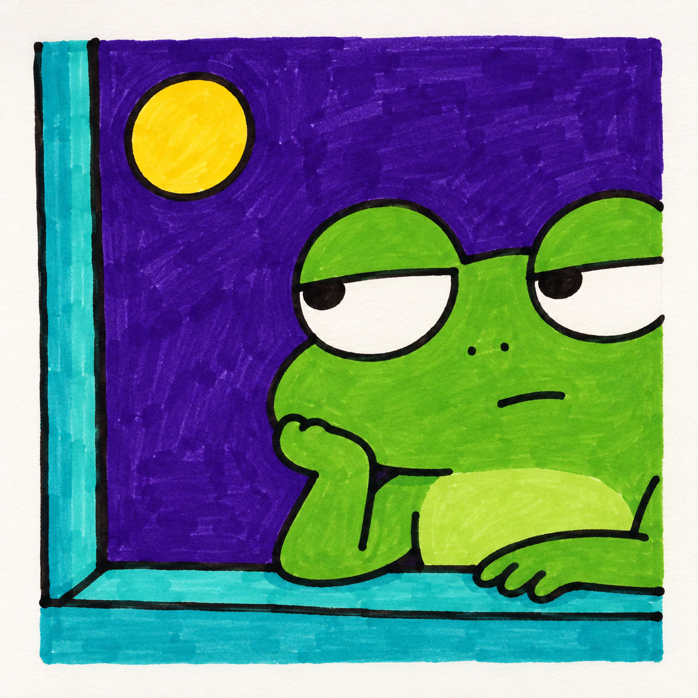
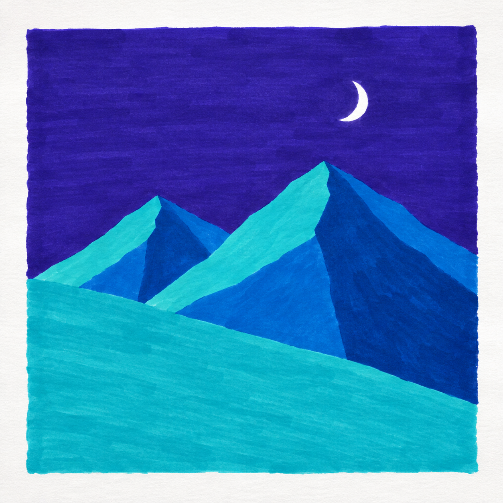

# S001｜童趣色块手绘

[风格库](README.md) · 当前默认 · 建档：2026-10-31

一种便于复用的风格描述：浓郁平涂色块、自然手绘线条、简化形状，以及有情绪或小情节的画面。名称用于选画和组织练习，不是严格的美术流派，也不指向某位画家的专属风格。

## 风格展示

以下四张为AI生成的风格示意，已各自配有完整教程；不是实际练习完成记录。图像复用作品档案，不重复保存副本。

| 有情绪的单角色 | 两个角色的小互动 |
| --- | --- |
|  |  |
| [003｜窗边发呆的青蛙](../lessons/beginner/003-sleepy-frog.md) | [004｜猫咪送一朵花](../lessons/beginner/004-cat-flower.md) |

| 几何色块风景 | 带想象力的新题材 |
| --- | --- |
|  |  |
| [005｜月夜蓝色山](../lessons/beginner/005-moon-mountains.md) | [006｜接住一颗星星](../lessons/beginner/006-catch-a-star.md) |

## 视觉规则

| 要素 | 可复用的特点 |
| --- | --- |
| 色彩 | 浓郁、对比清楚的2～5个大色块；可用黄与蓝、橙与蓝、粉与青绿等组合，具体从已有色号选择 |
| 线条 | 角色用有分量、略有起伏的自然黑线；几何山景可直接以色块交界塑形，不强加黑轮廓 |
| 造型 | 大头、短身、简化手脚和几何大形；表情靠眼皮、瞳孔及嘴的位置，不堆细节 |
| 构图 | 方形小画、有完整色块背景；允许偏心、局部出框、上下分区和大小对比 |
| 内容 | 发呆、惊讶、好奇等情绪，或递花、接星星等一眼能看懂的小情节 |
| 笔触 | 保留马克笔连续排笔的自然痕迹；不刻意模拟很脏的纹理，也不追求数码般绝对均匀 |
| 完成感 | 几块大形就构成一幅完整小插画，趣味来自角色关系、情绪和位置安排 |

角色方向可描述为“童趣涂鸦、呆萌搞怪、扁平色块”；风景方向可描述为“几何色块风景”。它们共享少色、大形、自然笔触的原则，无需每张都使用相同颜色或粗黑线。

## 选题与难度

每次选一个新主题或小情节，变换角色、动作、道具和构图，不只把青蛙、猫、猪或山景换色再画。可画动物、原创小怪兽、拟人小物或简单自然场景。单幅只练一个基础点，约20～30分钟；画面约10×10厘米，置于16.5厘米方纸上。

优先避开：默认淡色和大量空白背景、只有居中单体的图标构图、过分规整的数码线条、写实细节、复杂渐变与倒影、密集装饰、多个同时展开的基础课题。外侧纸白可以保留，不等于画面内部必须留白。

## 生成与教学提示

> 方形小幅马克笔手绘插画，童趣涂鸦感，浓郁的少量大色块，自然略有起伏的黑色轮廓，保留适度排笔痕迹。主题为【全新角色、动作或情节】，构图为【本次安排】，角色有明确情绪或简单互动。仅用已拥有的2～5个色号，平涂，适合约20～30分钟临摹。几何风景可不用黑色轮廓。不要复杂渐变、写实纹理、密集装饰、文字或水印。

主题、构图和色号每次单独填写；可取风格展示图为视觉参考，但不复制同一角色和画面布局。AI颜色只近似示意，以实物试色为准。

六步教学图继续采用小鸡教程的竖版两列三行格式：顶部标题与色号，每格编号、步骤名和操作提示。教学图版式与绘画风格分别管理。先铅笔定位、上色、干透后勾线；纸白提前留，132不用作不透明覆盖笔。完整教案统一放在lessons中，本页只维护风格说明和索引。

## 后续扩充

新风格另建档案，不改写此风格以适应所有题材。已有练习保留创建时的style_id和工具快照；之后切换默认风格不追溯修改旧作。展示新真实作品前，先确认公开授权并处理照片背景和元数据。
