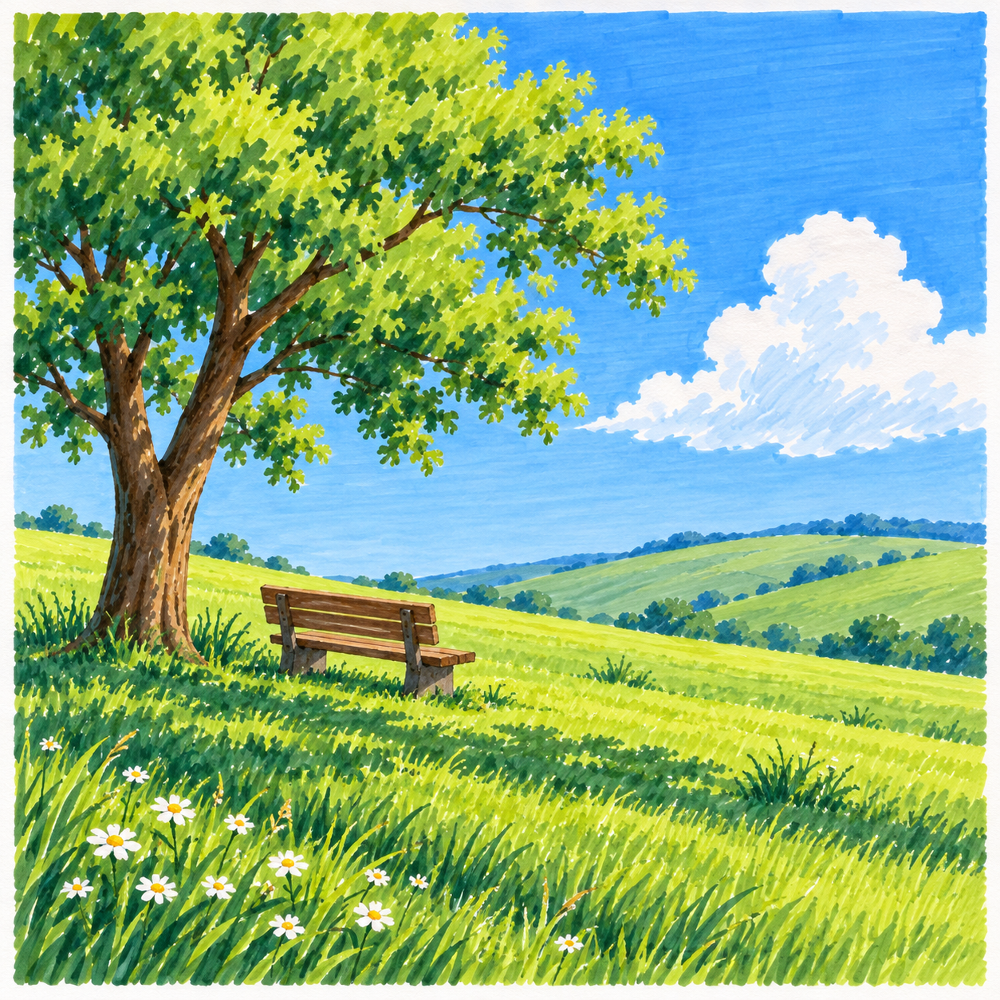

# S002 晴日笔触风景

[风格库](README.md) · [通用学习规则](../docs/learning-system.md)

## 身份与视觉规则

- 编号：S002；slug：sunlit-brushstroke-landscape；建档日期：2026-11-01。
- 核心：以可见的草木短笔触和大色块组织自然景物，通过受光与阴影分组、前后遮挡和远近层次表现明亮的晴日空气感。
- 线条：以色块边界与笔触说明形状，局部结构可用细线，不依赖全轮廓粗黑勾线。
- 造型与构图：概括树冠、草坡、云等自然大形；主次清楚，疏密有变化，保留呼吸空间。
- 配色：重视明暗、冷暖与色彩关系；蓝天绿草是可选组合，不是固定模板。可随季节与题材轮换暖黄、赭棕、灰绿、蓝紫等现有颜色，保持日照感。
- 适用：树木、花草、田野、公园、乡间道路和有少量人造物的自然小景。
- 避免：全画面同密度碎笔触、无明暗组织的堆色、固定套用呆萌拟人角色、夜间微光主导，以及照搬参考中有辨识度的主体组合与构图。

## 展示与来源

[S002-001《树荫下，坐一会儿》](../materials/S002/scene/S002-001/README.md)为AI原创场景示意，用于风格展示，预计D3综合组织，尚非可直接跟画的教程；实笔配色与操作适配待核对，不计真实完成。它是独立展示素材，不预先指定为主线课程。

## 同一风格的四级学习路径

以下概述各级能力路径，具体逐课内容见课程入口。每级7幅，共28幅；目前D1～D4共28课正文与相应教学帮助已备齐。

| 等级 | 本风格能力与技法 | 选题方向 | 复盘可观察表现 | 状态 |
| --- | --- | --- | --- | --- |
| D1 基础大形 | 用2～5色概括天空、地面与一个主要植物形；简单遮挡、留白，局部少量短笔触 | 单株树、草坡、小片花丛 | 大形位置清楚，纸白保留合理，少量笔触能表现草木 | [已备7课](../lessons/beginner/S002-README.md) |
| D2 专项控制 | 控制短笔触方向、密度与明暗分组；每幅聚焦一项，在不同植物题材中迁移 | 树冠、灌木、草丛的专项变化 | 两种题材中可稳定运用笔触或明暗分组，不逐笔依赖示意 | [已备7课](previews/S002-28-2026-11-02/README.md) |
| D3 综合组织 | 综合前中远层次、树影、植物笔触与少量人造物结构；保留当次重点 | 林边歇脚处、田间道路、花园一角 | 主次与空间清楚，阴影关系和物件支撑合理，能取舍纹理 | [已备7课](previews/S002-28-2026-11-02/README.md) |
| D4 自主创作 | 从观察或主题自主安排构图、配色、日照方向和上色顺序，形成小系列 | 不同季节、地点与时刻的晴日小景 | 能说明构图与配色选择，独立修正并保持风格 | [已备7课](previews/S002-28-2026-11-02/README.md) |

每级按建立技能、换题迁移、巩固组合、阶段回看安排，实际练习与能力复盘决定晋级。新风格独立从D1记录，不要求先学S001；教学帮助独立选择guided、supported、independent。

## 工具适配与教学

使用16.5厘米方形马克笔纸、Touchmark学生36色油性马克笔、铅笔与针管笔。按当前工具档案的实涂色卡观察及同纸试色选择色号，不按旧英文色名猜色。每幅按等级控制色数，整组合理轮换颜色；深色主体与黑色细节需检查对比。

油性笔按浅到深组织大色块与局部笔触，避免反复湿叠造成脏色。白云、白花与主要亮部先留纸白，132不当覆盖白；白色高光笔覆盖效果待实测，只作可选小高光。针管笔耐酒精性未确认时先上色，干透后局部勾线，不照搬深底浅色覆盖技法。

逐幅先确定主要目标、构图、等级和真实操作，再设计配色与示意。完整跟画需成品、连续步骤图和正文，步骤按操作需要拆分，可分页或分次。展示素材不冒称零基础教程；未核对配色、工具与步骤的内容不标ready。

## 编号与接入状态

S002使用独立连续素材编号，已分配S002-001～S002-032；后续新画面从033继续，跨阶段不重置。同一画面修订与附属步骤沿用原号加版本。28幅是主线规模，不是素材上限。

已建立独立风格与D1学习进度；默认风格保留S001。四阶段独立题库已登记，28课均有唯一正文和相应帮助图；D1完整跟画，D2～D3详细提示练习，D4自主任务与详细支架。

## 新增成品候选

- [S002-002《坡上的一株树》](../materials/S002/intermediate/S002-002/README.md)：AI成品候选，工具适配与教学简化待核对。
- [S002-003《风吹芦苇岸》](../materials/S002/scene/S002-003/README.md)：AI成品候选，工具适配与教学简化待核对。
- [S002-004《秋日田间小路》](../materials/S002/scene/S002-004/README.md)：AI成品候选，工具适配与教学简化待核对。

以上仅供视觉核对，不预先确定主线选题或新增学习示例数量。

## D1完整跟画七课

[进入七课正文](../lessons/beginner/S002-README.md) · [查看七幅成品预览](previews/S002-D1-2026-11-02/README.md)

主线素材编号为S002-005～011，先前001～004展示保留。成品与步骤为AI教学示意，实际练习单独记录。

## D1～D4整体节奏预览

[28幅总览](previews/S002-28-2026-11-02/README.md) · [并排画廊](previews/S002-28-2026-11-02/gallery.html)

D1为S002-005～011；D2为012～018；D3为019～025；D4为026～032。001～004仍为主线外展示。D4示意提供一种创作解法，实际任务先自行构思，不以复制成品为目标。生成不改变独立学习进度。

## 详细教学准备状态

D2每课8环节；D3每课10环节及两页关键过程图；D4每课10环节及构思、配色、结构帮助。各环节写工具、动作、干燥与检查；复杂结构先拆解，实际分次与停笔位置写入正文。叶簇及穗草已修订自然笔触，旧版保留。AI图不替代实际完成与能力复盘。
