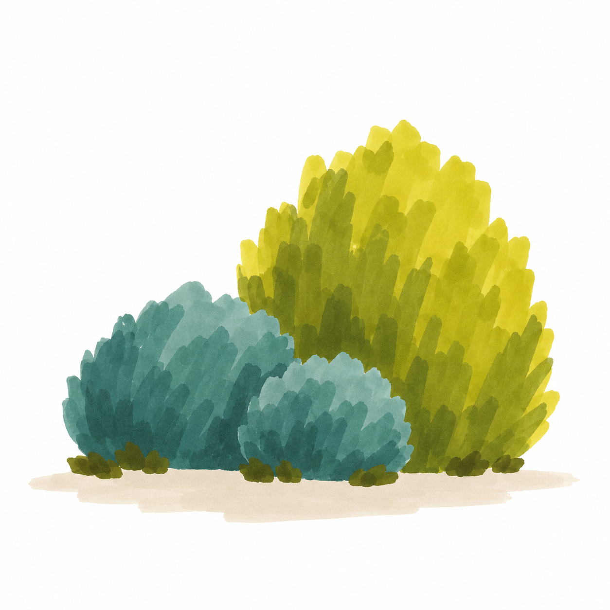
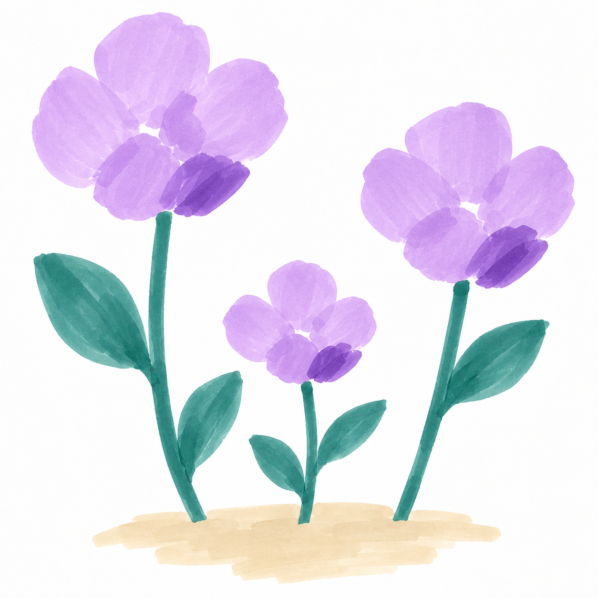
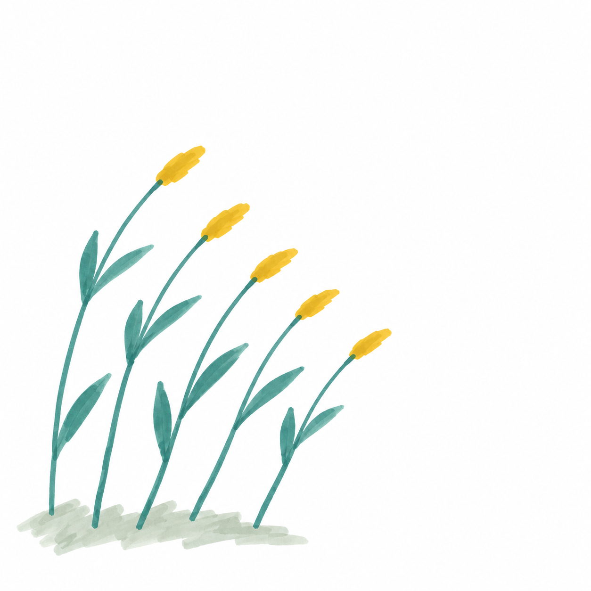
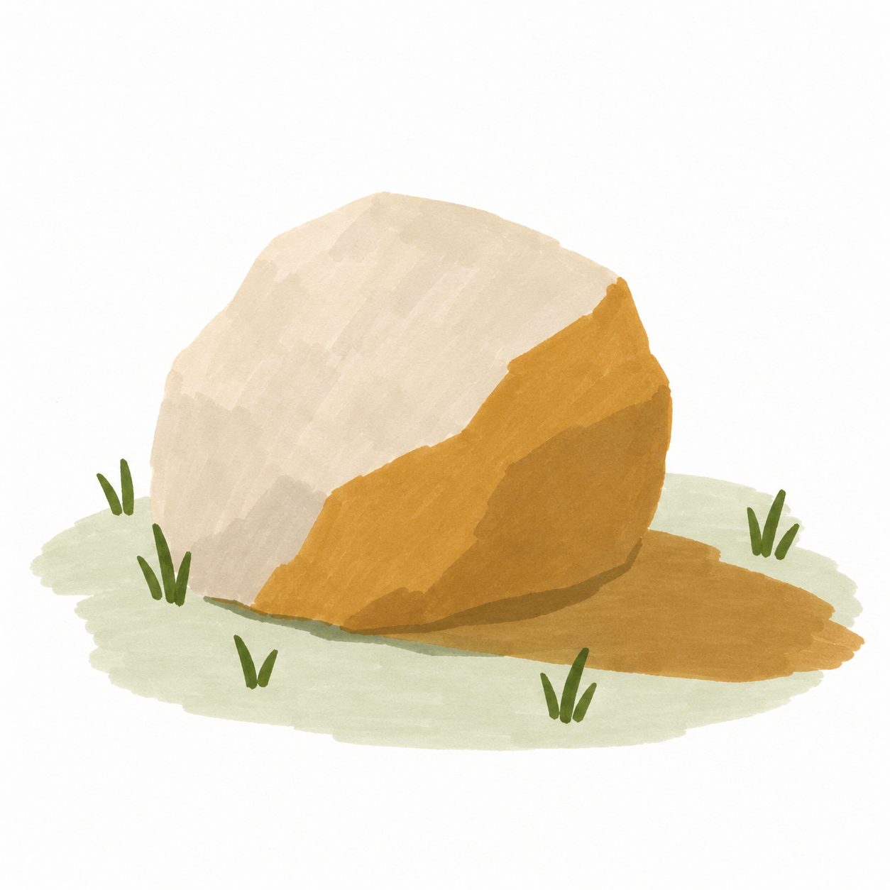

# D1 基础大形｜S002七课

[返回整体节奏](README.md) · [本阶段正文入口](../../../lessons/beginner/S002-README.md)

| 序位 | 完整教案 | 主要目标 | 本幅作用 |
| --- | --- | --- | --- |
| 1 | [S002-005 晴光里的圆树](../../../lessons/beginner/029-sunny-round-tree.md) | 用树冠与树干两个大形定位主体 | 建立技能 |
| 2 | [S002-006 白云经过草坡](../../../lessons/beginner/030-cloud-over-grass.md) | 在天空色块中提前保留完整白云 | 建立技能 |
| 3 | [S002-007 路边三团灌木](../../../lessons/beginner/031-three-sunny-shrubs.md) | 用大小与前后遮挡组织植物大形 | 换题迁移 |
| 4 | [S002-008 晴日三枝紫花](../../../lessons/beginner/032-three-purple-flowers.md) | 把花头概括为大色团并保留间隙 | 换题迁移 |
| 5 | [S002-009 风往右边吹](../../../lessons/beginner/033-five-windy-grasses.md) | 用一致方向的长短笔触表现草叶 | 巩固组合 |
| 6 | [S002-010 草地上的暖石头](../../../lessons/beginner/034-sunlit-ochre-stone.md) | 用两块平涂区分受光面与暗面 | 巩固组合 |
| 7 | [S002-011 小路通向晴光](../../../lessons/beginner/035-path-to-sunny-shrub.md) | 回看大形、留白与简单遮挡的组合 | 阶段回看 |

## 1. 晴光里的圆树

用树冠与树干两个大形定位主体。

[进入详细正文](../../../lessons/beginner/029-sunny-round-tree.md)

## 2. 白云经过草坡

在天空色块中提前保留完整白云。

[进入详细正文](../../../lessons/beginner/030-cloud-over-grass.md)

## 3. 路边三团灌木

用大小与前后遮挡组织植物大形。

[进入详细正文](../../../lessons/beginner/031-three-sunny-shrubs.md)

## 4. 晴日三枝紫花

把花头概括为大色团并保留间隙。

[进入详细正文](../../../lessons/beginner/032-three-purple-flowers.md)

## 5. 风往右边吹

用一致方向的长短笔触表现草叶。

[进入详细正文](../../../lessons/beginner/033-five-windy-grasses.md)

## 6. 草地上的暖石头

用两块平涂区分受光面与暗面。

[进入详细正文](../../../lessons/beginner/034-sunlit-ochre-stone.md)

## 7. 小路通向晴光

回看大形、留白与简单遮挡的组合。

[进入详细正文](../../../lessons/beginner/035-path-to-sunny-shrub.md)
